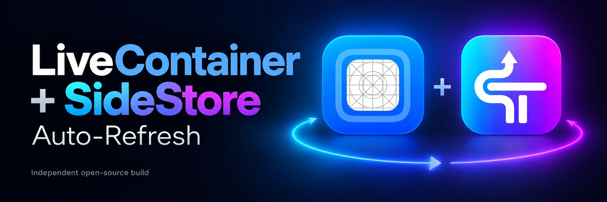
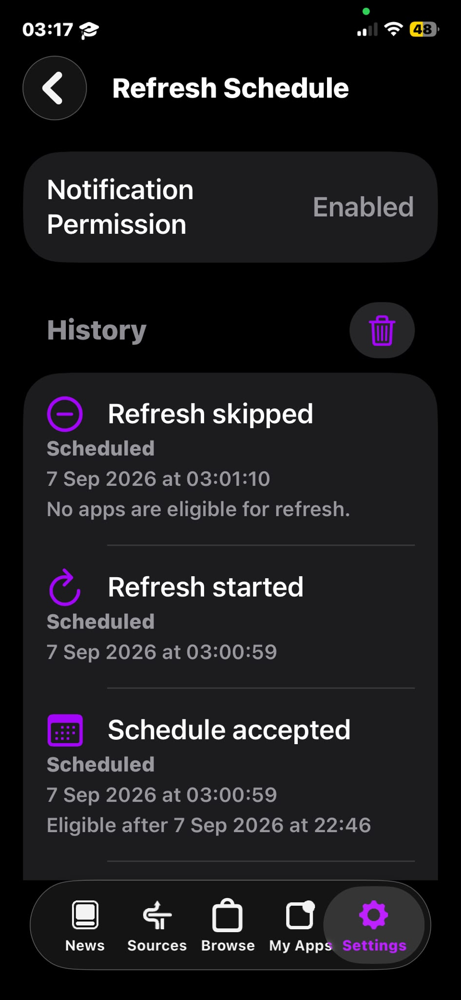

<a id="livecontainer--sidestore-auto-refresh"></a>

# LiveContainer + SideStore 自动续签

<!-- README language selector -->
[](README.md)
[](README.zh-CN.md)
[](README.zh-TW.md)
[](README.ru.md)
[](README.he.md)
<!-- /README language selector -->



[](https://github.com/NRG-Wardog/sidestore-auto-refresh/actions/workflows/livecontainer-build.yml)
[](https://github.com/NRG-Wardog/sidestore-auto-refresh/actions/workflows/build-current.yml)
[](https://github.com/NRG-Wardog/sidestore-auto-refresh/releases/latest)
[](LICENSE)

这是基于 **SideStore** 和 **LiveContainer** 的独立开源构建，专注于可靠的本机续签、清晰的计划安排、结果验证，以及适合新手的设置流程。

<a id="current-status-v310-is-not-recommended"></a>

## 当前状态：不推荐使用 v3.1.0

> [!WARNING]
> **请勿将 v3.1.0 视为推荐的稳定版本。** Apple 账户登录和预配失败的问题正在 [Issue #42](https://github.com/NRG-Wardog/sidestore-auto-refresh/issues/42) 中调查。测试和修复仍在进行。CI 运行成功并不能证明登录或续签能在实体设备上正常工作。

- **公开发布版：** [v3.1.0](https://github.com/NRG-Wardog/sidestore-auto-refresh/releases/tag/v3.1.0) 仍可下载以供参考，但存在已知问题。它与正在测试的诊断构建不是同一个产物。
- **开发构建：** 来自 `fix/v3.1.0-audit` 的候选构建用于诊断和验证。它们不是新的公开发布版本，也不是已确认有效的修复。
- **暂停发布：** 在维护者使用自己的设备完成完整的登录及关键流程测试之前，不发布新版本。问题须在验收检查得到确认后才能关闭；仅凭 CI 不能关闭问题。
- **旧版本：** v3.0.2、组合版 v2 和独立版 v1 仍作为历史选项保留。本 README 不保证任何旧版本可作为安全的替代方案，也不建议降级。
- **已有安装：** 请保留当前设置并备份重要的客体应用数据。不要以猜测性的恢复措施删除应用、重置账户数据或替换配对记录。

本独立项目将 LiveContainer 和 SideStore 整合在同一界面中。首次安装和配对需要电脑。设置完成后，预期的续签路径使用 **Wi-Fi + App Store 官方 LocalDevVPN**，无需保持电脑连接。仅使用蜂窝网络进行续签仍属于实验功能。

[发布状态](#current-status-v310-is-not-recommended) · [安装参考](#installation) · [已知问题](#troubleshooting) · [验证](#verification-status) · [从源码构建](#build-it-yourself)

> [!NOTE]
> 这不是 SideStore 或 LiveContainer 的官方发布版。如需原版行为和上游支持，请使用官方 [SideStore](https://github.com/SideStore/SideStore) 和 [LiveContainer](https://github.com/LiveContainer/LiveContainer) 项目。


<a id="why-this-project-exists"></a>

## 为什么创建这个项目

我创建此项目，是因为原版 SideStore 的续签路径在我的配置上不够可靠。关键修复不是围绕同一流程再添加一个快捷指令或触发器，而是改变用于访问 iPhone 设备服务的本机传输方式。

本项目预期使用的本机路径如下：

```text
official LocalDevVPN -> Lockdown -> CoreDeviceProxy TLS -> CDTunnel -> RSD -> AFC / InstallationProxy
```

该路径正常工作后，项目逐步发展为更完整的 LiveContainer + SideStore 体验：明确的续签计划、历史记录与验证、按阶段划分的诊断、布局选项、客体应用返回控件，以及统一的 v3 界面。

<a id="what-this-project-improves"></a>

### 本项目改进了什么

| 方面 | 本项目提供的功能 |
| --- | --- |
| **可靠的本机传输** | 用本项目采用的 **LocalDevVPN -> CoreDevice -> RSD** 路径替代在我的配置上失败的 Lockdown 服务路径 |
| **真正统一的 LiveContainer + SideStore 体验** | v3 保留 LiveContainer 作为宿主，通过边界明确的服务接口提供 SideStore 功能，使日常操作留在 **Home / Apps / Sources / Refresh / Settings** 中，而不是跳转到单独的内嵌 SideStore 流程 |
| **明确的自动续签** | 由用户控制的**每六小时、每天和每周**计划、首选时间、通知、到期提醒及持久保存的历史记录 |
| **经过验证的续签结果** | 将每次运行与其实际结果关联，因此仅任务启动、发生交接或发出请求本身不会被报告为续签成功 |
| **有用的诊断** | 区分 VPN、CoreDevice、心跳、RSD、Lockdown、签名和安装失败，不会将无关故障合并为一条笼统消息 |
| **更好的应用浏览** | 增加 **List、Grid 和 Compact List**、持久保存的布局偏好，以及可选的 Grid 标签；本次比较所检查的上游 LiveContainer 应用列表没有这些本项目特有的布局控件 |
| **更好的客体应用导航** | 为全屏/直接运行的客体应用流程增加本项目特有的 **Return** 控件、**Start Collapsed**、位置保存，以及自定义图标/背景颜色 |
| **设置完成后无需电脑的续签运行方式** | 首次安装和配对仍需使用电脑，但受支持的续签路径旨在通过 Wi-Fi + 官方 LocalDevVPN 在 iPhone 上运行，无需让电脑一直保持连接 |

<details>
<summary><strong>与上游的技术比较</strong></summary>

上述产品行为所对应的源码级差异如下：

| 方面 | 已检查的上游代码 | 本项目 |
| --- | --- | --- |
| Lockdown 服务路径 | Lockdown 服务调用使用直接 TCP 提供器 | **CoreDeviceProxy TLS -> CDTunnel -> userspace IPv6 -> RSD** |
| iOS 26.4+ 上本地 VPN 的就绪条件 | Lockdown 的本地 VPN 就绪检查要求存在 IKEv2/IPsec 接口 | CoreDevice 路径使用官方 LocalDevVPN 的 `utun` 路径，无需第二条 IKEv2/IPsec 隧道 |
| 复合配对文件 | 在 Lockdown 密钥之前检查 RemotePairing 密钥 | 优先使用有效的 **Lockdown** 数据，从而选择 CoreDevice 路径 |
| 组合版 LC + SS 导航 | 当前 LiveContainer 代码通过 `openSideStore` / `builtinSideStore` 打开/选择内置 SideStore 流程 | v3 通过统一的宿主 UI 和服务桥接执行日常 SideStore 操作，而不把用户切换到内嵌的 SideStore UI |

SideStore 自己的 README 已经介绍了定期后台续签。这里的改进并不是声称以前不存在后台续签，而是将改变后的传输路径与明确的计划、可观测性、历史记录、验证和故障处理结合起来。

_比较依据：上游 SideStore `develop` 的 `797e0d46c46491c7fba1192c789c016d24b35591`、minimuxer `20248550bbe014805460d4fa22ea69f146d338a0`，以及 2026 年 9 月 16 日检查的 LiveContainer 源码。上游可能在此快照之后发生变化。_

</details>

---

<h2 align="center"><a href="#installation">安装参考</a></h2>
<p align="center"><strong>请先阅读发布警告。以下设置指南保留用于参考和受控测试。</strong></p>
<p align="center"><a href="#what-this-project-improves">了解本项目的改进</a> · <a href="#installation">开始安装</a></p>

---

<a id="installation"></a>

## 安装

<a id="before-you-start"></a>

### 开始之前

**以下说明描述已发布 v3 版本的设置方式；在登录问题尚未解决时，这并不表示推荐安装 v3.1.0。** 决定是否测试之前，请阅读[当前状态](#current-status-v310-is-not-recommended)和[发布说明](https://github.com/NRG-Wardog/sidestore-auto-refresh/releases/tag/v3.1.0)。

对公开发布版进行受控测试时，安装文件为 `LiveContainer-SideStore-v3.1.0.ipa`。GitHub 的源码归档文件不是可安装的 IPA。私有诊断候选构建必须通过其确切的构建器修订版本及校验和识别，不能只看显示的版本号。

安装前请检查以下项目：

| 检查项 | 所需条件 |
| --- | --- |
| **设备** | 受支持的 iPhone 或 iPad，首次设置期间保持解锁 |
| **电脑** | Windows、macOS 或 Linux，仅首次安装和配对需要 |
| **安装器** | [iLoader](https://github.com/nab138/iloader/releases/latest) **2.3.1 或更高版本**，或其他兼容的 IPA 安装器 |
| **Apple 账户** | 用于签署 IPA 的 Apple 账户 / Personal Team（个人团队） |
| **开发者模式** | 安装后启用 |
| **配对** | 为正在使用的**那一台实体设备**生成的配对数据 |
| **网络** | Wi-Fi，并准备好 iPhone 当前的 **IP Address（IP 地址）和 Subnet Mask（子网掩码）** |
| **VPN** | App Store 上由 **Coxson Engineering LLC** 发布的官方 **LocalDevVPN** |
| **应用扩展** | 保留组合版构建所需的扩展，包括 **LiveProcess** |
| **已有安装** | 升级时，使用相同的签名身份覆盖安装到匹配的现有 LiveContainer 构建上；不要将先删除应用作为常规步骤 |

如想先了解差异，请查看[本项目改进了什么](#what-this-project-improves)。否则，请按顺序完成以下步骤。

<a id="step-1-download-the-correct-ipa"></a>

### 第 1 步：下载正确的 IPA

仅供参考或受控测试，已发布的 v3.1.0 产物为：

**[LiveContainer-SideStore-v3.1.0.ipa](https://github.com/NRG-Wardog/sidestore-auto-refresh/releases/download/v3.1.0/LiveContainer-SideStore-v3.1.0.ipa)**

如果你需要本项目的修改版构建，请不要使用 iLoader 内置的原版 SideStore 或原版 LiveContainer + SideStore 安装器。请使用 **Import IPA**，选择从本仓库下载的 IPA。

其他产品线：

- **独立版 SideStore：** [v1.0.4](https://github.com/NRG-Wardog/sidestore-auto-refresh/releases/tag/v1.0.4)
- **旧组合版界面：** [v2.1.1](https://github.com/NRG-Wardog/sidestore-auto-refresh/releases/tag/v2.1.1)
- **历史统一版构建：** [v3.0.2](https://github.com/NRG-Wardog/sidestore-auto-refresh/releases/tag/v3.0.2)

<a id="step-2-install-with-iloader"></a>

### 第 2 步：使用 iLoader 安装

1. 安装/打开 [iLoader](https://github.com/nab138/iloader/releases/latest)。
2. 在 Windows 上，确保已安装 Apple 设备驱动程序。
3. 通过 USB 连接 iPhone，解锁，并在出现提示时点按 **Trust（信任）**。
4. 在 iLoader 中选择已连接的设备。
5. 登录你希望用于签名的 Apple 账户。
6. 打开 **Installers -> Import IPA**。
7. 选择 `LiveContainer-SideStore-v3.1.0.ipa`。
8. 保留所需的应用扩展，包括 **LiveProcess**。不要移除所有扩展。
9. 让 iLoader 签署并安装 IPA。安装完成之前，请保持设备连接并解锁。

<a id="step-3-trust-the-app-and-enable-developer-mode"></a>

### 第 3 步：信任应用并启用开发者模式

如果 iOS 显示 **Untrusted Developer（不受信任的开发者）**：

`Settings -> General -> VPN & Device Management -> Developer App -> Trust`

然后启用：

`Settings -> Privacy & Security -> Developer Mode`

设备可能会重新启动。如果重启后出现提示，请确认 **Turn On（开启）**。

<a id="step-4-place-the-pairing-file"></a>

### 第 4 步：放置配对文件

保持设备通过 USB 连接并处于解锁状态。

在 iLoader 中：

1. 打开 **Management**。
2. 打开 **Manage Pairing File**。
3. 如果未列出应用，请使用 **Rescan Installed Apps**。
4. 找到你刚安装的、兼容 SideStore 的应用。
5. 对该应用点击 **Place**；只有在你明确希望对所有应用操作时，才使用 **Place In All Apps**。
6. 等待成功消息后再继续。

> [!CAUTION]
> 配对文件包含设备的私密凭据。切勿将其上传到 GitHub、Discord、Issue、公共文件托管服务，也不要让其出现在截图中。

传输、RSD 或服务错误**不**自动意味着配对文件有问题。只有诊断明确指出故障发生在配对阶段时，才替换配对数据。

<a id="step-5-install-the-correct-localdevvpn"></a>

### 第 5 步：安装正确的 LocalDevVPN

从 App Store 安装官方 **[LocalDevVPN](https://apps.apple.com/us/app/localdevvpn/id6755608044)**，并核实开发者为 **Coxson Engineering LLC**。

受支持的 CoreDevice 路径无需第二个 IKEv2/IPsec VPN。

<a id="step-6-find-the-iphones-wi-fi-subnet"></a>

### 第 6 步：查找 iPhone 的 Wi-Fi 子网

在 iPhone 上打开：

`Settings -> Wi-Fi -> ⓘ next to the connected network`

记下：

- **IP Address（IP 地址）**
- **Subnet Mask（子网掩码）**

示例：

```text
IP Address:  192.168.1.50
Subnet Mask: 255.255.255.0
```

该示例属于 `192.168.1.x/24` 子网。

> [!WARNING]
> 不要盲目照抄示例地址。请使用属于**你当前 Wi-Fi 子网**的地址。

<a id="step-7-choose-two-unused-localdevvpn-addresses"></a>

### 第 7 步：选择两个未使用的 LocalDevVPN 地址

选择**两个不同且未被使用的 IPv4 地址，它们必须与 iPhone 当前的 Wi-Fi 连接处于同一子网**。

以下仅为 `192.168.1.x/24` 的示例：

```text
Tunnel IP: 192.168.1.240/32
Device IP: 192.168.1.241/32
```

**不要**使用：

- iPhone 实际的 Wi-Fi IP
- 路由器/默认网关的 IP
- 电脑的 IP
- 已分配给其他设备的 IP
- 当前 Wi-Fi 子网之外的 IP
最稳妥的检查方法是查看路由器的 DHCP 租约或已连接客户端列表。仅凭 ping 失败不能证明地址未被使用。

<a id="step-8-configure-localdevvpn"></a>

### 第 8 步：配置 LocalDevVPN

打开：

`LocalDevVPN -> Settings -> Network Configuration`

然后：

1. 输入选定的 **Tunnel IP**，带上 `/32`。
2. 输入选定的 **Device IP**，带上 `/32`。
3. 启用 **Allow Intermediate Addresses**。
4. 点按 **Done**。
5. 点按 **Save & Apply**。
6. 连接 LocalDevVPN。
7. 打开 **Session Details**，确认自定义值已保留。

> [!IMPORTANT]
> 如果切换到子网不同的 Wi-Fi 网络，请在再次续签之前，将 Tunnel IP 和 Device IP 更新为适用于该网络的地址。

<a id="step-9-open-v3-and-complete-account--signing"></a>

### 第 9 步：打开 v3 并完成账户与签名设置

**已知阻碍：** v3.1.0 可能出现登录或预配失败。请查看 [Issue #42](https://github.com/NRG-Wardog/sidestore-auto-refresh/issues/42)。不要假设以下流程一定能完成，也不要为强行完成它而清除数据。

打开已安装的应用。v3 的日常操作位于 **Home / Apps / Sources / Refresh / Settings** 中。

前往：

`Settings -> Account and Signing -> Sign In / Authenticate`

在 Wi-Fi 和 LocalDevVPN 已连接时完成账户流程。

<a id="step-10-run-one-manual-refresh-before-enabling-automation"></a>

### 第 10 步：启用自动化前先手动续签一次

打开 **Refresh**，先执行一次手动续签。

继续之前，请验证：

- LocalDevVPN 已连接
- 传输状态显示为可达/就绪
- 续签已进入签名/安装流水线
- 续签历史/验证中记录的最终结果为成功

仅有任务启动或发生交接还不够。请确认最终续签结果。

如果失败，请先阅读所报告的故障阶段，再进行任何更改。诊断旨在区分 VPN、CoreDevice、心跳、RSD、Lockdown、签名、安装和配对故障。

<a id="step-11-enable-automatic-refresh"></a>

### 第 11 步：启用自动续签

仅在手动续签成功后：

1. 打开 **Refresh** 标签页/设置。
2. 启用自动续签。
3. 在可用时选择 **Every Six Hours（每六小时）**、**Daily（每天）** 或 **Weekly（每周）**。
4. 设置首选时间/日期。
5. 优先选择 iPhone 通常连接到已为 LocalDevVPN 配置好的 Wi-Fi 网络的时间。
6. 如需开始、失败和到期提醒，请允许通知。

> [!NOTE]
> iOS 后台执行只能尽力而为。所选时间不是精确闹钟，iOS 可能稍后才运行任务。请在签名有效期临近结束之前检查最近一次经过验证的续签。

<a id="step-12-confirm-pc-free-runtime"></a>

### 第 12 步：确认无需电脑即可运行

首次安装和配对设置完成后，受支持的续签运行方式旨在使用：

```text
iPhone/iPad + Wi-Fi + official LocalDevVPN
```

正常续签过程中，应当无需让电脑和 USB 线保持连接。

<a id="updating-without-losing-your-setup"></a>

### 在不丢失设置的情况下更新

对于 v3/v2 组合版构建，使用相同的 Apple 账户 / Personal Team 和匹配的标识符，将匹配的新 IPA **覆盖安装到现有 LiveContainer 安装上**。

**不要**将先删除应用作为常规更新步骤。更新前请备份重要的客体应用数据。

对于独立版 SideStore，请将新的独立版构建覆盖安装到匹配的现有 SideStore 安装上。不要将独立版 SideStore IPA 覆盖安装到 LiveContainer 上。

<a id="if-something-does-not-work"></a>

### 如果出现问题

请先按顺序检查：

1. 确切的发布版本/构建和 IPA 文件名。
2. 开发者模式和信任状态。
3. 配对数据是否属于当前这台设备。
4. LocalDevVPN 是否为 App Store 官方构建，并且已连接。
5. Tunnel IP 和 Device IP 是否为**同一 Wi-Fi 子网中未被使用的地址**，而非 iPhone、路由器或电脑的 IP。
6. 是否启用 **Allow Intermediate Addresses**，并使用过 **Save & Apply**。
7. 账户/签名认证是否完成。
8. 重置配对/账户数据之前，先阅读确切的诊断故障阶段。
9. 如果 Wi-Fi 已更改，请为新子网重新配置 LocalDevVPN。
10. 如果自动续签没有运行，请先测试手动续签；iOS 不保证精确的后台执行时间。

如需进一步排查，请查看[故障排查](#troubleshooting)和[验证](docs/VERIFICATION.md)。

<a id="what-is-this"></a>

## 这是什么？

**v3 将 Home、Apps、Sources、Refresh 和 Settings 整合为一体化的应用体验。** 日常操作不再需要在 LiveContainer 和旧的内嵌 SideStore 界面之间切换。LocalDevVPN 仍是续签传输所使用的独立应用。


本项目是经过修改的 SideStore / LiveContainer 构建，使本机续签更易操作，也更易验证。

它增加了：

- 直接在 iPhone 上手动续签
- 每六小时、每天和每周的续签计划
- 首选续签时间控件
- 持久保存的续签历史
- 有界的重试与恢复逻辑
- 明确的续签验证
- 本机 **LocalDevVPN + CoreDevice** 传输路径
- 已内嵌修改版 SideStore 的 LiveContainer 组合构建
- 组合版中的客体应用 Return 控件
- 组合版 v2.1.0 中的 **Start Collapsed** 和**自定义 Return 按钮颜色**

目标很简单：首次安装和配对设置完成后，正常续签应在 iPhone 上进行，无需让电脑一直连接。

<a id="preview"></a>

## 预览

以下截图是历史 v2 和独立版预览，并非新的统一版 v3 界面截图。保留版本标注是为了避免混淆。

<a id="combined-v210"></a>

### 组合版 v2.1.0

这些是 **LiveContainer + 内嵌 SideStore v2.1.0** 的实际截图。

<table>
<tr>
<td align="center"><br><strong>续签状态</strong></td>
<td align="center"><br><strong>续签计划</strong></td>
<td align="center"><br><strong>续签历史</strong></td>
<td align="center"><br><strong>客体应用控件</strong></td>
</tr>
</table>

v2.1.0 的 Guest Controls 页面包括 **Show Return Button**、**Start Collapsed**、**Use Custom Colors**、**Icon Color** 和 **Button Background**。

<a id="standalone-preview-v102-screenshots"></a>

### 独立版预览（v1.0.2 截图）

这些截图展示的是较早的独立版 SideStore v1.0.2 界面。当前可下载的独立版为 v1.0.4，基于 SideStore 0.7.0 nightly。

<table>
<tr>
<td align="center"><br><strong>应用续签</strong></td>
<td align="center"><br><strong>续签计划</strong></td>
<td align="center"><br><strong>续签历史</strong></td>
</tr>
</table>

<a id="quick-navigation"></a>

## 快速导航

- [为什么创建这个项目](#why-this-project-exists)
- [选择构建](#which-version-should-i-download)
- [与原始项目有何不同？](#how-this-project-differs-from-the-original-projects)
- [安装](#installation)
- [旧产品线](#previous-product-lines)
- [故障排查](#troubleshooting)
- [技术架构](#technical-architecture)

<a id="which-version-should-i-download"></a>

## 我应该下载哪个版本？

| 你的需求 | 使用版本 | 下载 |
| --- | --- | --- |
| 统一的 LiveContainer + SideStore 界面 | **v3.1.0：不推荐；登录问题仍在调查中** | [发布说明和已知问题](https://github.com/NRG-Wardog/sidestore-auto-refresh/releases/tag/v3.1.0) |
| 旧组合版界面 | **组合版 v2.1.1（旧版本）** | [旧 v2 发布版](https://github.com/NRG-Wardog/sidestore-auto-refresh/releases/tag/v2.1.1) |
| 只使用 SideStore，侧载应用按常规方式单独安装 | **独立版 v1.0.4** | **[下载独立版 IPA](https://github.com/NRG-Wardog/sidestore-auto-refresh/releases/download/v1.0.4/SideStore.ipa)** |

统一版构建已包含 SideStore，因此不需要另行安装 SideStore。这些链接用于标识已发布的产品线，不代表稳定性排名。旧产品线的界面和验证历史各不相同；这里没有将其中任何版本推荐为已验证能绕过当前登录问题的方案。

**已发布的统一版构建（不推荐）：** [v3.1.0 发布版](https://github.com/NRG-Wardog/sidestore-auto-refresh/releases/tag/v3.1.0)

**之前的统一版构建：** [v3.0.2 发布版](https://github.com/NRG-Wardog/sidestore-auto-refresh/releases/tag/v3.0.2)（仍可下载）

**旧组合版产品线：** [v2.1.1 发布版](https://github.com/NRG-Wardog/sidestore-auto-refresh/releases/tag/v2.1.1)

**独立版：** [v1.0.4 发布版](https://github.com/NRG-Wardog/sidestore-auto-refresh/releases/tag/v1.0.4)

<a id="whats-new-in-v310"></a>

## v3.1.0 有哪些新内容？

**以下是历史发布内容，不代表对稳定性的认可。** 后续出现的登录/预配失败在 [Issue #42](https://github.com/NRG-Wardog/sidestore-auto-refresh/issues/42) 中跟踪。

已发布的 IPA 使用构建器 **651587433eb7142089509e558dcfba9eb69d0470**，来自成功的 macOS CI [37158730837](https://github.com/NRG-Wardog/sidestore-auto-refresh/actions/runs/37158730837)。应用内诊断保留了原有的 `Combined LC+SS v3.0.3-rc` 标签。公开发布版为 v3.1.0；它不包含后续开发更改。

- **更小的无界面后端：** 移除了旧 SideStore UI/资源，同时保留上游后端操作。原始 IPA 大小为 **25,122,692 字节 / 23.958866 MiB**，相比 v3.0.2 减少 **35.14%**。这是产物大小的测量结果，并非运行速度方面的声明。
- **稳定化：** 包括从直接根视图展示/复用本地 IPA、以权威状态为准的源添加持久化、类型化的认证/提示归属、已签名 App Group/运行时存储处理、操作阶段/进度、LC 原生 JIT-Less 观察，以及针对性的上游客体应用后台行为回移植。
- **明确的验收限制：** 某些 iOS 27.0.1 设备仍无法启动内嵌 LiveProcess；已发布的 IPA 在缺少请求 UUID 时仍会带有合成的 Cocoa 3587 标记。其实体设备上的成因尚未解决。替代的 App ID 数量限制错误码 9120 映射和改进的启动诊断属于后续开发更改，不包含在已发布的 v3.1.0 IPA 中。这些发布时的限制保留用于追溯；后续诊断工作不会改变已发布的 IPA。
- **仍需设备测试：** 真实 Apple 认证/2FA、持续/计划续签、受影响设备上的客体应用生命周期/偏好、源目录/重启，以及最新的 JIT-Less 就绪/签名行为。请查看[完整发布说明、校验和及大小表](https://github.com/NRG-Wardog/sidestore-auto-refresh/releases/tag/v3.1.0)。不要以猜测性的启动恢复措施删除数据或重置配对。

SHA-256：`2337e08a71b2af4fee930b59ccd28522563acd81e908069e56f6d27d1636daf4`。

<a id="whats-new-in-v302"></a>

## v3.0.2 有哪些新内容？

v3.0.2 是统一 LiveContainer + SideStore v3 产品线的上一版维护发布。

- **Setup Assistant（设置助理）：** 由宿主负责的初始设置清单，涵盖设备、配对、Apple 账户、网络、后台 App 刷新、计划，以及经过验证的测试续签。Setup Complete 要求已登录团队、网络和隧道满足条件、后台 App 刷新可用、计划已启用，并且在当前会话中完成过经过验证的续签。
- **Start Dock Collapsed：** 新增可持久保存的多任务偏好。Dock 可以初始折叠；此后始终以手动展开/折叠操作为准，布局改变或旋转不会重置它。它与 Hide Collapsed Dock 和 Guest Controls 相互独立。
- **续签目标崩溃修复：** 在未继承 store 的情况下渲染目标应用续签区域时，不再触发陷阱崩溃。
- **首次启动通知提示：** 使用通俗语言请求权限，以便发送续签开始/完成/失败横幅。
- **可见的请求合并：** 当手动续签点击落在已运行中的续签任务上时，现在会给出反馈，不再保持静默。

<a id="whats-new-in-v301"></a>

## v3.0.1 有哪些新内容？

v3.0.1 曾是统一 LiveContainer + SideStore v3 产品线的上一版维护发布。它保留可用的 v3 架构，着重让 SideStore 成为后端实现细节，而由 LiveContainer 负责可见的用户体验。

- **无界面 SideStore 后端：** 常规 v3 流程不再依赖远端 SideStore UI 的展示。面向用户的导航、表单、弹出面板、提醒、确认、进度和错误展示均由 LiveContainer 负责。
- **引导式登录和 2FA：** 账户认证由统一 UI 驱动，提供更清晰的两步 2FA 流程：先选择受信任设备或手机接收方式，再输入验证码。
- **宿主管理页面：** 证书、开发者数据、配对、源、设置、诊断及相关流程使用 v3 服务/DTO 命令模型，而不是直接呈现 SideStore 页面。
- **Home 可直接操作：** 关键状态行现在可以直接跳转到相关的 Apps、Sign In、Developer Services、Certificates、Pairing 或 Refresh 位置。
- **设置整理：** 按相关性排序各区域，将 Guest Runtime 放在最后，并将 Build Candidate 信息移至底部。
- **减少无路可走的页面：** 当没有可用账户时，依赖账户的目标页面会跳转到 Sign In。
- **2FA 手机选择修复：** 选择手机号码后会请求将验证码发送到该号码，而不是取消流程。
- **发布/运行时稳定性：** 此发布保留现有的续签、传输、签名、持久化、客体运行时和 LiveProcess 行为，不引入无关重构。

已发布的 v3.0.1 IPA 基于同一套经过测试的 v3 行为构建，随后应用发布/版本信息和证据更新。已有 v3 用户应使用相同签名身份，将其覆盖安装到匹配的 LiveContainer 安装上，而不是先删除应用。

SideStore 继续负责自己的数据库、Keychain、认证逻辑、签名、预配、源和安装。LiveContainer 继续负责客体应用及其执行。v3 服务桥接连接这些职责主体，而不重复存储持久状态。

受支持的续签路径仍需要 Wi-Fi 和官方 LocalDevVPN 应用。后台执行时间由 iOS 控制；计划并不是精确闹钟。Issue #18 仍单独跟踪，因为无法仅凭 CI 或一台设备，就普遍证明某位受影响用户的 Apple 认证结果。

<a id="whats-new-in-v104-and-v211"></a>

## v1.0.4 和 v2.1.1 有哪些新内容？

Issue 17 在 **Interface** 下增加了可保存的应用布局选项：

- **List** 保留详细的卡片布局。
- **Grid** 显示以图标为主的应用网格。可以隐藏可见标签，同时让 VoiceOver 仍能读取每个应用名称。
- **Compact List** 使用更矮的行，以便更密集地浏览。

所选布局和标签偏好会在重新启动后保留。更改任一设置都会立即刷新 Apps 页面。网格操作继续使用现有的启动、多任务、上下文菜单、确认和错误处理路径。
<a id="whats-new-in-standalone-v103"></a>

## 独立版 v1.0.3 有哪些新内容？

独立版 v1.0.3 将应用更新为 **SideStore 0.7.0 nightly**，包括较新的 **SideSign 认证路径**。

- 保留 LocalDevVPN -> Lockdown/CoreDevice -> RSD 传输、手动续签、计划续签、历史记录、重试和验证。
- 复合配对记录优先使用 Lockdown/CoreDevice；此路径与 LocalDevVPN 配合使用，无需额外的 IKEv2/IPsec 接口。
- 将签名监测和后台数据库启动适配到 SideStore 0.7 API。
- 只有在数据库更新成功后，才记录自续签状态协调成功。

IPA 构建、自动化检查和已发布下载文件的验证均已通过。该确切 v1.0.3 构建的设备测试仍待完成；较早的独立版设备证据在下方单独列出。确切的源码修订版本和验证详情请参阅[发布说明](docs/RELEASE_NOTES_v1.0.3.md)。

<a id="whats-new-in-v210"></a>

## v2.1.0 有哪些新内容？

组合版 v2.1.0 保留现有 v2 续签技术栈，并增加新的客体应用 Return 外观控件：

- **Start Collapsed：** 客体应用打开时，Return 控件可以已经折叠为边缘标签。
- **Use Custom Colors：** 为 Return 控件启用已保存的自定义颜色。
- **Icon Color：** 更改 Return 图标和折叠标签图标的颜色。
- **Button Background：** 更改展开后的 Return 按钮背景。
- 客体应用控件的外观偏好会在重新启动后保留。
- 仍可手动长按折叠、点按展开。
- 折叠标签在使用所选图标颜色的同时，背景保持透明。

此发布仍包含手动续签、计划续签、续签历史、验证、LocalDevVPN/CoreDevice 传输，以及内嵌 SideStore 集成。

<a id="how-this-project-differs-from-the-original-projects"></a>

## 本项目与原始项目有何不同

SideStore 和 LiveContainer 是上游基础；本仓库针对这一使用场景，将它们变为不同的端到端体验。主要优势是 **CoreDevice/RSD 续签路径**、**统一的 v3 LiveContainer + SideStore 工作流程**、明确的计划与历史记录、运行级验证、结构化诊断，以及上文介绍的额外应用/客体 UI 控件。

如需了解确切的源码级差异，请展开本 README 顶部附近的**与上游的技术比较**。

<a id="what-this-project-does-not-change"></a>

### 本项目没有改变什么

- 它**不会**消除常规 Personal Team 签名到期限制，而是在到期前续签。
- 它**不保证**精确的后台执行时间。任务计划由 iOS 控制。
- 它**尚未**使仅蜂窝网络续签成为稳定功能。
- 受支持的 Wi-Fi 路径**不需要**越狱。
- 它**不会**让 LiveContainer 客体应用等同于单独安装的 iOS 应用。
- 它**不保证** iOS 会让每个客体进程持续存活。

由于组合版构建修改了 LiveContainer，且包含内嵌 SideStore 代码，请采用与其他修改版 LiveContainer 构建相同的信任模型。本仓库开源；如果你倾向于亲自验证构建路径，可以[自行构建](#build-it-yourself)。

<a id="previous-product-lines"></a>

## 旧产品线

主要的[安装](#installation)指南描述已发布 v3.1.0 的设置方式，并附有当前登录警告。以下旧产品线保留用于参考，不作为推荐替代品。

<a id="combined-v211"></a>

### 组合版 v2.1.1

只有当你明确需要旧组合版界面时，才使用 [v2.1.1 发布版](https://github.com/NRG-Wardog/sidestore-auto-refresh/releases/tag/v2.1.1)。打开 LiveContainer，进入内嵌 SideStore 流程，先手动续签一次，并且仅在该次手动续签成功后启用自动化。

<a id="standalone-sidestore-v104"></a>

### 独立版 SideStore v1.0.4

如果你需要不包含 LiveContainer 的 SideStore，请使用 [v1.0.4 发布版](https://github.com/NRG-Wardog/sidestore-auto-refresh/releases/tag/v1.0.4)。将它覆盖安装到匹配的现有独立版 SideStore 安装上，确保 LocalDevVPN 按当前 Wi-Fi 子网配置，先手动续签一次，再启用其续签计划。

<a id="normal-daily-use"></a>

## 日常使用

设置正常工作后：

- 保持 Wi-Fi 可用
- 尽可能保持 LocalDevVPN 正确配置并连接
- 保持后台 App 刷新开启
- 偶尔检查续签历史，确认运行成功
- 切换到不同的 Wi-Fi 子网时，更新 LocalDevVPN 地址

首次设置后，正常续签运行期间应当无需电脑。

仅蜂窝网络续签仍属于实验功能。

<a id="updating-without-losing-setup-data"></a>

## 在不丢失设置数据的情况下更新

<a id="unified-v3-and-combined-v2"></a>

### 统一版 v3 和组合版 v2

使用相同的 Apple 账户 / Personal Team 和匹配的标识符，将新的组合版 IPA **覆盖安装到现有 LiveContainer 安装上**。

**不要先删除 LiveContainer。** 更新前请备份重要的客体应用数据。

<a id="standalone-v1"></a>

### 独立版 v1

将新的独立版 SideStore 构建覆盖安装到匹配的现有 SideStore 安装上。

**不要先删除 SideStore。** 覆盖安装有助于保留配对数据、Apple 账户状态和 SideStore 数据库。

不要将独立版 IPA 覆盖安装到 LiveContainer 上。不提供从独立版到组合版的数据迁移。

<a id="troubleshooting"></a>

## 故障排查

| 问题 | 首先检查 |
| --- | --- |
| Windows 上 iLoader 无法识别 iPhone | 确认已安装 Apple 设备驱动程序，重新连接 USB，解锁手机，并点按 **Trust** |
| iLoader 提示未选择设备 | 在执行 **Import IPA** 或配对操作前，先在 iLoader 中选择 iPhone |
| 应用显示不受信任的开发者 | `Settings -> General -> VPN & Device Management -> Developer App -> Trust` |
| 应用无法打开 | 确认已在 `Settings -> Privacy & Security` 中启用开发者模式 |
| 已确认配对数据缺失/无效 | 重新连接 USB，打开 **Manage Pairing File**，使用 **Rescan Installed Apps**，然后再次对当前这台设备执行 **Place** |
| v3.1.0 登录或预配失败 | 关注 [Issue #42](https://github.com/NRG-Wardog/sidestore-auto-refresh/issues/42)。记录确切构建和脱敏后的错误；不要以猜测性的修复措施删除应用或重置账户/配对数据 |
| v3 服务启动或传输错误 | 阅读诊断中的阶段和错误码。不要仅因服务或网络连接失败就重置账户或配对数据 |
| LocalDevVPN 无法连接 | 重新检查 Network Configuration、两个 `/32` 端点和 **Allow Intermediate Addresses** |
| LocalDevVPN 已连接但续签失败 | 确认地址位于 iPhone 当前 Wi-Fi 子网内，且未被占用 |
| 更换 Wi-Fi 后续签停止 | 为新子网重新配置 Tunnel IP 和 Device IP |
| 手动续签失败 | 确认 Wi-Fi、LocalDevVPN、配对、SideStore 登录，以及记录的续签结果/历史 |
| 错过计划续签 | 确认手动续签正常且后台 App 刷新已启用。所选时间并不是精确的唤醒时间 |
| App ID 数量不足 | 免费 Apple 账户有注册数量限制。不要反复删除/重新安装构建。等待注册到期，或在支持的情况下复用匹配的标识符 |
| 客体应用签名警告 | 此警告与已验证的续签状态相互独立。打开警告中指明的客体应用，并报告它是否能实际启动 |
| 仅蜂窝网络续签失败 | 仅蜂窝网络传输属于实验功能，不在受支持的 Wi-Fi 路径范围内 |

如需深入调查，请查看[验证](docs/VERIFICATION.md)、[兼容性](docs/COMPATIBILITY.md)和 [Issue #1](https://github.com/NRG-Wardog/sidestore-auto-refresh/issues/1)。

<a id="features"></a>

## 功能

<a id="shared-refresh-features"></a>

### 共有续签功能

- 本机 LocalDevVPN + CoreDevice 续签路径
- 支持免费 Apple 账户 / Personal Team
- 手动续签
- 每六小时、每天和每周计划
- 首选续签时间控件
- 持久保存的续签历史
- 有界的重试与恢复逻辑
- 到期时间和通知支持
- 用于故障排查的有界诊断
- 首次设置后，正常续签运行期间无需电脑

<a id="combined-features-retained-from-v2"></a>

### 从 v2 保留的组合版功能

- 内嵌本仓库修改版 SideStore 的 LiveContainer
- 宿主级续签协调与交接处理
- 与运行关联的验证结果桥接
- 内嵌 SideStore 的启动和认证修复
- 共享 Keychain 迁移与宿主身份处理
- 客体应用 Return 控件
- 建议性的客体应用签名检查不会覆盖经过验证的成功续签结果
- **v2.1.0：** Start Collapsed
- **v2.1.0：** 自定义 Return 图标和背景颜色

<a id="guest-return-behavior"></a>

## 客体应用 Return 行为

| 执行模式 | Return 行为 |
| --- | --- |
| 窗口化 LiveProcess 多任务 | 隐藏悬浮 Return 按钮。请使用普通窗口控件。 |
| 全屏或最大化 LiveProcess | Return 会激活宿主或将客体最小化以返回宿主，而不会有意终止客体应用。 |
| 重新打开保留的客体应用 | 如果现有实例仍存活，则复用它。冷启动前会清理过期实例。 |
| 直接在宿主进程中运行的客体应用 | 使用现有的重启返回路径。不保留客体内存。 |

长按 Return 按钮可将其折叠为边缘标签。点按标签可恢复。其位置会被保存，并在尺寸改变后限制在有效范围内。

v2.1.0 在 **LiveContainer Settings > Guest Controls** 中增加以下选项：

- **Start Collapsed：** 新客体应用以边缘标签形式打开。点按一次展开，再点按 Return 返回。使用 Return 会再次折叠控件，包括重新打开保留的客体应用时。此选项默认关闭。
- **Use Custom Colors：** 选择 **Icon Color** 和 **Button Background**。图标颜色也应用于折叠标签；标签背景保持透明。关闭此选项可恢复系统颜色。所选颜色会保存以供以后使用。

这些偏好同时适用于全屏 LiveProcess 和直接在宿主进程中运行的客体应用。**Show Return Button** 仍控制可见性，窗口化多任务仍使用普通窗口控件。

<a id="more-screenshots"></a>

## 更多截图

以下补充截图展示独立版 SideStore 的续签 UI。

<table>
<tr>
<td align="center"><br><strong>计划选项</strong></td>
<td align="center"><br><strong>首选时间</strong></td>
<td align="center"><br><strong>已跳过续签</strong></td>
</tr>
</table>

<a id="technical-architecture"></a>

## 技术架构

确切的 v3 实现和职责边界，请阅读 [v3.0.2 标签中的架构说明](https://github.com/NRG-Wardog/sidestore-auto-refresh/blob/v3.0.2/docs/V3_UNIFIED_ARCHITECTURE.md)。以下共享续签传输仍与统一 UI 和服务生命周期分离。

```text
LiveContainer triggers / embedded SideStore
    -> refresh coordination and eligibility
    -> Wi-Fi / LocalDevVPN preflight
    -> signing and refresh pipeline
    -> Lockdown -> CoreDeviceProxy TLS -> CDTunnel
    -> userspace adapter -> RSD
    -> AFC staging / InstallationProxy and profile operations
    -> correlated verification results and history
```

CoreDevice 路径保留服务 TLS、连续 CDTunnel 写入、传输操作期间的心跳、数据包大小和流控制修复，以及修正后的 FFI 所有权。实验性的蜂窝网络工作不属于受支持的 Wi-Fi 路径。

<a id="app-layout-architecture-issue-17"></a>

### 应用布局架构（Issue #17）

Issue #17 有意设计为**展示层功能**。它不得修改续签传输、签名、认证、后台计划、数据库状态协调或 CoreDevice 流水线。

```text
Interface settings
    -> persisted AppLayoutPreferences
        -> App Layout: list | grid | compactList
        -> Show app labels: true | false
    -> Apps screen presentation switch
        -> List renderer
        -> Grid renderer
        -> Compact List renderer
    -> shared app model + shared actions
        -> open / refresh / activate / deactivate / context menu
```

实现约定如下：

- 添加一个小型、可持久保存的布局模型，例如具有 `list`、`grid` 和 `compactList` 分支的 `AppLayoutStyle: String`。
- 保持 **List** 为默认值，使现有安装保留当前行为。
- 在现有共享偏好中保留组合版键 `LCAppLayoutStyle` 和 `LCShowAppLabels`。独立版使用其现有的偏好名称。不要为 UI 偏好新增数据库。
- 扩展现有的 **Interface -> App Layout** 设置，而不是创建第二个布局控件。仅在选择 Grid 时显示 **Show app labels**。
- 将当前列表/卡片渲染器保留为 List 路径。不要仅为共享代码而重写已经正常工作的列表行为。
- 将 Grid 实现为以图标为主的自适应网格，可选择在每个图标下方显示应用名称。
- Compact List 使用与 List 相同的应用数据和操作，但减小图标尺寸、行高和垂直内边距。
- 三种渲染器均通过现有的同一应用模型和操作处理器执行操作。布局专用视图不得复制签名、续签、激活、安装或上下文菜单的业务逻辑。
- 隐藏 Grid 标签只影响视觉显示。应用名称必须仍可作为无障碍标签使用。
- 仅将 [SideloadLabs/AppNest](https://github.com/SideloadLabs/AppNest) 作为视觉参考。除非另行审查其代码和许可证，否则不要将其实现作为第三方源码纳入或复制。

<a id="patch-strategy"></a>

#### 补丁策略

本仓库应通过确定性的构建时补丁实现此功能，与项目其他部分保持一致。预期实现为专用的语义补丁，例如 `scripts/patch_app_layout.py`，面向固定版本的 SideStore 源码，而不是整体纳入上游文件。

独立版和组合版当前使用不同的 SideStore 源码分支。UI 约定应保持一致，但当视图结构不同时，可以使用源码特定的锚点/适配器。不要仅为交付此 UI 功能，就将 LiveContainer 内嵌的 SideStore 升级到官方 SideStore 0.7。

补丁必须具有幂等性，并在上游锚点变化时安全停止。它只应修改此功能所需的最小设置/偏好和 Apps 页面展示范围。

<a id="verification-gates"></a>

#### 验证门槛

在将 Issue #17 视为完成之前：

1. 仓库测试证明补丁具有幂等性，并会拒绝已更改或存在歧义的上游锚点。
2. 生成的 Swift 成功通过语法解析，所有获得此功能的受支持目标均完成构建。
3. 可以从设置访问 List、Grid、不显示可见标签的 Grid，以及 Compact List。
4. 布局和标签偏好在重新启动后仍保留。
5. 在每种布局中，打开、续签、激活/停用、状态显示和上下文菜单操作仍使用相同的底层处理器。
6. 隐藏 Grid 标签时，无障碍功能仍能读取应用名称。
7. 此功能不修改传输、签名、认证、计划器或 CoreDevice 源码。
8. 发布前，设备截图/验收检查覆盖全部三种布局。

这种分离使 Issue #17 保持低风险：改变的是渲染器，而应用生命周期和续签技术栈保持不变。

<a id="verification-status"></a>

## 验证状态

**当前验收尚未完成。** v3.1.0 登录/预配问题仍未关闭。以下自动化和历史结果只对各自的确切构建提供证据，不代表公开发布版或后续诊断候选构建已通过完整设备测试。

| 范围 | 当前证据 |
| --- | --- |
| 统一版 v3.1.0 构建与打包 | 确切构建器 65158743 / CI 37158730837 通过了 920 项 macOS 仓库测试，零跳过；并通过原生证书检查、生成源码/幂等性检查、模拟器布局、宿主/后端构建及已上传产物验证。重新下载的发布文件与原始 IPA 校验和匹配。这并非该确切构建的实体设备验收 |
| 统一版 v3.0.2 构建与打包 | CI 35518324344 通过了 190 项仓库测试、512 项布局测量（0 失败）、宿主 + 内嵌源码构建、传输检查和 IPA 打包验证。匹配的证据附于发布版；这不是全面的实体设备验证 |
| 统一版 v3.0.1 构建与打包 | CI 35419528113 通过了 155 项仓库测试、512 项布局测量（0 失败）、宿主 + 内嵌源码构建、传输检查和 IPA 打包验证。匹配的证据附于发布版；这不是全面的实体设备验证 |
| 独立版 v1.0.4 构建与打包 | CI 通过；已验证发布 IPA 的校验和、arm64 可执行文件、后台任务配置和布局补丁语法解析 |
| 独立版 v1.0.3 设备续签 | 此确切构建的设备测试仍待完成 |
| 更早独立版的手动 CoreDevice 续签 | 已在 iPhone 12 / iOS 26.6.1 上验证；早于 v1.0.3 |
| 更早独立版在电脑断开时的计划续签 | 记录的证明早于 v1.0.3，可在验证报告中查看 |
| 组合版 v2.1.1 构建与打包 | 组合版 CI 运行成功完成，包括 LiveContainer 网格实现 |
| v2.1.0 Guest Controls | 已发布组合版构建包含 Start Collapsed 和自定义颜色 |
| 后台计划 | 尽力执行。任务启动时间由 iOS 控制 |
| 仅蜂窝网络续签 | 实验功能，不在受支持的 Wi-Fi 路径范围内 |
| 客体进程保留 | 尽力保留。iOS 可能挂起或终止客体应用 |

构建完成、后台任务启动或宿主发生交接，不会自动被视为签名有效期已续期的证明。确切的证明模型请参阅 [docs/VERIFICATION.md](docs/VERIFICATION.md)。

<a id="v302-provenance"></a>

### v3.0.2 来源记录

- 构建器/标签提交：`35c6c28c98e7261afe6049a133a9ae542d666d57`
- 组合版 CI 运行：[35518324344](https://github.com/NRG-Wardog/sidestore-auto-refresh/actions/runs/35518324344)
- IPA：`LiveContainer-SideStore-AutoRefresh.ipa`（38,736,104 字节）
- SHA-256：`5AAB622EB91CA9007BD4A29E5AD8FEB90791AC8EBB1AB7393022A1C7474CA02E`
- LiveContainer：`12377cf3b91d51739a33f14a302e5f522b238593`
- 内嵌 SideStore：`ff25922e5c13ccfafd83bda5092910d848ebd409`
- SideSign：`a731c0d5a9a6617c7b385ae493e07ffb7f81cd5d`（GSA 修复 `35993d7` 已在 CI 中验证为祖先提交）
- minimuxer：`98c3c79982f813878e922ab42f9545314a700f0c`
- 发布版：[统一 LiveContainer + SideStore v3.0.2](https://github.com/NRG-Wardog/sidestore-auto-refresh/releases/tag/v3.0.2)

v3.0.2 是历史统一版发布，不是针对当前登录问题的已验证回退方案。其来源记录和下方的 v3.0.1 记录保留用于复现。

<a id="v301-provenance"></a>

### v3.0.1 来源记录

- 构建器/标签提交：`6f0a144936c789bd7557d93ec1752888fddbb256`
- 组合版 CI 运行：[35419528113](https://github.com/NRG-Wardog/sidestore-auto-refresh/actions/runs/35419528113)
- IPA：`LiveContainer-SideStore-AutoRefresh.ipa`（38,644,788 字节）
- SHA-256：`A8A783D4FB6D229FAA449024872F1C56755351F9593349C6BC10B9CD76FE16311`
- LiveContainer：`12377cf3b91d51739a33f14a302e5f522b238593`
- 内嵌 SideStore：`ff25922e5c13ccfafd83bda5092910d848ebd409`
- SideSign：`a731c0d5a9a661c7b385ae493e07ffb7f81cd5d`（GSA 修复 `35993d7` 已在 CI 中验证为祖先提交）
- minimuxer：`98c3c79982f813878e922ab42f9545314a700f0c`
- 发布版：[统一 LiveContainer + SideStore v3.0.1](https://github.com/NRG-Wardog/sidestore-auto-refresh/releases/tag/v3.0.1)

v3.0.1 记录在此保留，用于复现和历史验证。之后是此前发布的 v3.0.0 来源记录。

<a id="v300-provenance"></a>

### v3.0.0 来源记录

- 构建器/标签提交：`6bbddd55531ac2497707fce184e5370f76d7991f`
- 组合版 CI 运行：[34763923268](https://github.com/NRG-Wardog/sidestore-auto-refresh/actions/runs/34763923268)
- IPA：`LiveContainer-SideStore-AutoRefresh.ipa`
- SHA-256：`699f20bd839136b652e30c6c4de1d9237aa79b91437202daf4f8e59684358268`
- SideStoreSupport 和匹配的 dSYM UUID：`C59B7B1F-1CC8-3667-AE90-2514C2F11869`
- 发布版：[统一 LiveContainer + SideStore v3.0.0](https://github.com/NRG-Wardog/sidestore-auto-refresh/releases/tag/v3.0.0)

此发布将已验证的 preview.2 IPA 提升为正式发布，而不重新构建或重新签名。其内部上游版本仍可能显示 `3.8.9`；请通过发布标签和 **Settings > Build Candidate** 修订版本识别软件包。v2 和独立版附件保留各自独立的来源记录。

<a id="v211-provenance"></a>

### v2.1.1 来源记录

- 构建器/标签提交：`3d4a7c49f9c202159397c25106149a3bad2b2902`
- 组合版 CI 运行：[34689847917](https://github.com/NRG-Wardog/sidestore-auto-refresh/actions/runs/34689847917)
- IPA：`LiveContainer-SideStore-AutoRefresh.ipa`
- SHA-256：`94a95f1b51066db0552c65ac5e4f3cf67efc3baa293adc2eca077228adabb583`
- 发布版：[LiveContainer + SideStore 自动续签 v2.1.1](https://github.com/NRG-Wardog/sidestore-auto-refresh/releases/tag/v2.1.1)

<a id="v104-provenance"></a>

### v1.0.4 来源记录

- 构建器/标签提交：`3d4a7c49f9c202159397c25106149a3bad2b2902`
- 独立版 CI 运行：[34689425130](https://github.com/NRG-Wardog/sidestore-auto-refresh/actions/runs/34689425130)
- IPA：`SideStore.ipa`
- SHA-256：`f9641f559e922ea4de5099d9857438a7970e216f40536cf7fece8f21a1ee3692`
- 发布版：[SideStore CoreDevice 自动续签 v1.0.4](https://github.com/NRG-Wardog/sidestore-auto-refresh/releases/tag/v1.0.4)

<a id="v103-provenance"></a>

### v1.0.3 来源记录

- 构建器/标签提交：`07d52be7a49f6795b82f081ded2ec94eb44d50df`
- 独立版 CI 运行：[34613911507](https://github.com/NRG-Wardog/sidestore-auto-refresh/actions/runs/34613911507)
- 上游应用版本：SideStore `0.7.0`，构建 `0700`
- IPA：`SideStore-CoreDevice-AutoRefresh-v1.0.3.ipa`
- SHA-256：`ab35772fe3209618c7bec302e315faea0a35b7ae280edfb9b5390d2aa62c8940`
- 发布版：[SideStore CoreDevice 自动续签 v1.0.3](https://github.com/NRG-Wardog/sidestore-auto-refresh/releases/tag/v1.0.3)
- 固定源码和验证：[v1.0.3 发布说明](docs/RELEASE_NOTES_v1.0.3.md)

<a id="build-it-yourself"></a>

## 自行构建

本仓库包含构建时补丁，而不是永久纳入的 LiveContainer 和 SideStore 源码副本。工作流会获取固定的上游修订版本。

1. Fork 本仓库并启用 GitHub Actions。
2. 组合版 IPA 运行 **LiveContainer embedded SideStore build**；独立版运行 **Build Current SideStore**。
3. 要复现已发布的软件包，请检出其确切的发布标签，并查看所记录的构建器修订版本。对于 v3.1.0，请使用 [`v3.1.0` 标签](https://github.com/NRG-Wardog/sidestore-auto-refresh/tree/v3.1.0)和其[发布说明](https://github.com/NRG-Wardog/sidestore-auto-refresh/releases/tag/v3.1.0)中的来源记录。`main` 上的文档并不意味着相应 v3 源码已经合并到该分支。`fix/v3.1.0-audit` 分支包含正在进行的诊断工作，并非公开稳定版。
4. 下载成功运行的产物。
5. 安装之前，使用你自己的 Apple 账户 / Personal Team 签署生成的 IPA。

[组合版工作流](.github/workflows/livecontainer-build.yml) | [独立版工作流](.github/workflows/build-current.yml)

<a id="development-checks"></a>

## 开发检查

```bash
python -m unittest discover -s tests -v
git diff --check
```

依赖编译器的测试需要相应工具链。源码和静态检查不能替代真实设备验证。

<a id="security-privacy-licensing-and-support"></a>

## 安全、隐私、许可和支持

切勿公开配对文件、Apple 凭据、私钥、个人签名 IPA、不必要的设备标识符或完整的私密设备日志。

组合版构建可以按照 LiveContainer 架构访问 LiveContainer 及其客体应用所使用的数据。如果你重视信任模型，请审查源码并自行构建 IPA。

除非另有说明，本仓库原创工作采用 MIT 许可证。上游代码及衍生二进制文件保留其适用的上游许可证。

横幅是借助 AI 创作的项目图片，参考了上游 [LiveContainer](https://github.com/LiveContainer/LiveContainer) 和 [SideStore](https://github.com/SideStore/SideStore) 的应用图标。它不是应用截图，也不表示上游认可。

[贡献](CONTRIBUTING.md) | [安全](SECURITY.md) | [许可证](LICENSE) | [第三方声明](THIRD_PARTY_NOTICES.md)

报告兼容性结果时，请提供确切的发布标签和构建器修订版本、设备型号、iOS 版本、产品线（v1、v2 或 v3）、下载来源、Wi-Fi 网络类别、LocalDevVPN 状态，以及不含敏感信息的续签结果。不要附加秘密信息或完整的私密日志。兼容性报告请提交至 [Issue #1](https://github.com/NRG-Wardog/sidestore-auto-refresh/issues/1)。
