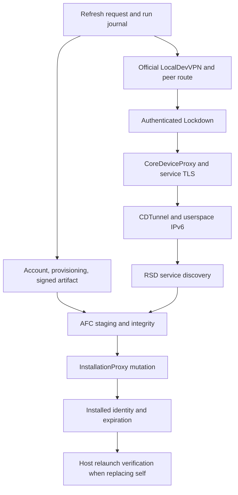
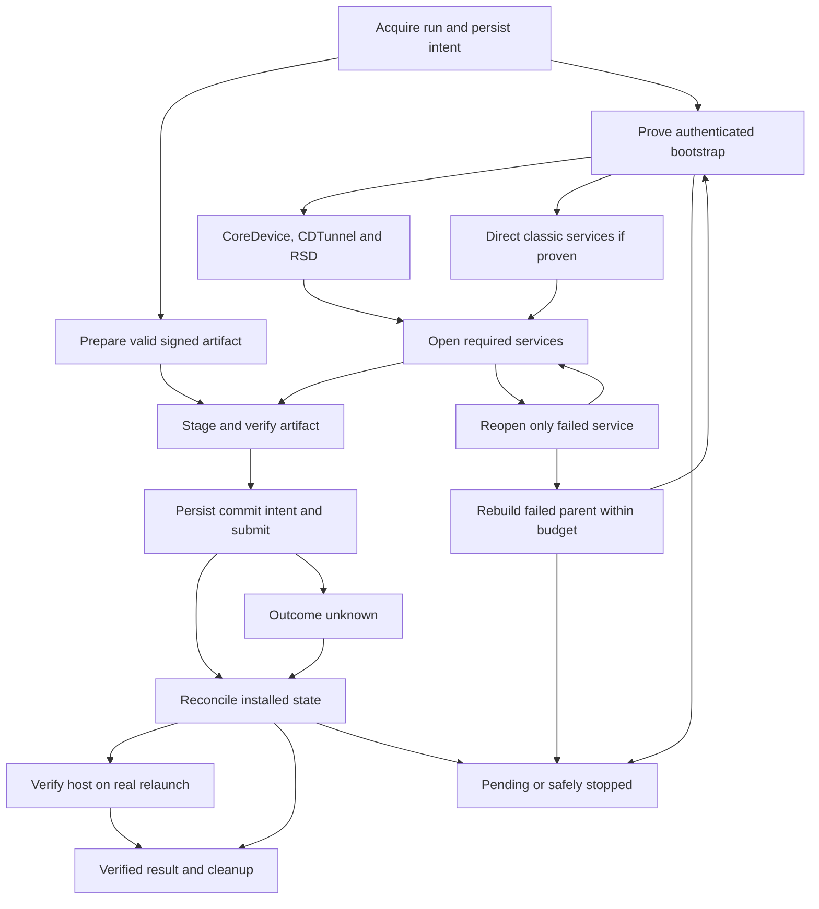

# Cellular-only refresh: feasibility and recovery plan

**Research date:** 2026-10-22

**Owner / scope:** engineering investigation for [Issue #3][issue3], including the [specific feature request][request3].

**Decision:** preserve the existing CoreDevice installation backend; gate any cellular implementation on a successful cold bootstrap experiment.

**Current acceptance status:** **BLOCKED — no verified end-to-end demonstration meeting all constraints was found.**

**Work performed:** source inspection, public primary-source research, historical evidence reconciliation, architecture and validation design. **No physical iPhone experiments were performed in this investigation.** This document changes no production code, dependency pins, or releases.

## A. Executive conclusion

The missing capability is an authenticated, installation-capable connection to the **same iPhone** when Wi-Fi was disabled before startup. Ordinary cellular Internet access, an active VPN, a successful TCP connection, and a completed pairing exchange are separate facts. None proves this capability.

The strongest defensible direction is a **small, falsifiable bootstrap investigation around the existing official LocalDevVPN → Lockdown → CoreDeviceProxy backend**, followed by stage-local recovery work only if that investigation passes. There is substantial evidence for this backend under the project's documented Wi-Fi conditions. There is also direct contrary evidence for cellular operation of official LocalDevVPN. Removing Wi-Fi checks is necessary to run a controlled experiment, but is not a demonstrated transport fix. [verification] [ldv31] [pr935]

The first experiment should compare the normal route with a narrowly scoped client connection on an **actually observed and unambiguously matched** tunnel interface, using the current classic pairing record and a harmless authenticated Lockdown operation. Apple documents client interface selection; it does not document a way for that selection to override a protected service's acceptance policy. This is a capability test, not a causal diagnosis: scoping may change both route and source address. Even success would not uniquely identify the cause of earlier failures. If both variants fail before authenticated Lockdown, downstream recovery cannot repair the missing first hop. [apple-scope] [apple-routing]

The recommendation has three parts:

1. **Establish or reject the missing bootstrap before substantial implementation.** Record route selection, TCP result, first protocol response, pairing/session result, and exact failure boundary separately. Keep Wi-Fi off throughout each acceptance run; never use radio toggles as recovery.
2. **Retain and harden the existing install backend if bootstrap succeeds.** Preserve signed artifacts across transport failure; reopen an individual failed service before replacing its parent tunnel; reconcile uncertain mutations before replaying them; verify installation and expiration independently of optimistic UI state.
3. **Keep alternatives honest.** Direct classic Lockdown AFC/InstallationProxy is a real downstream alternative when Lockdown works but CoreDevice does not. A direct trusted RSD endpoint would be a genuinely different bootstrap, but no qualifying endpoint has been demonstrated. SideInstaller's newer cellular claim deserves controlled replication; its source does not yet supply the substantial new evidence required to reopen RemotePairing dynamic TCP. [install-helpers] [si-engine] [si-device] [si-tunnel]

### Confidence and release implications

| Conclusion | Confidence / evidence level | Practical implication |
|---|---|---|
| Current readiness checks and the legacy cellular-toggle mode do not implement the requested capability | High; source inspection | Introduce a separate experimental policy; do not enable the old toggle mode as the fix. |
| Existing CoreDevice services can install on the documented Wi-Fi setup | EVIDENCE-SUPPORTED by project device reports; not reproduced here | Preserve this backend and its controls. Do not extrapolate to other variants or radio states. |
| Official LocalDevVPN has failed cold and transition-to-cellular cases on reported devices | EVIDENCE-SUPPORTED, device/version scoped | Treat cellular bootstrap as blocked until contrary controlled evidence exists. |
| Client interface scoping will repair cellular bootstrap | Low; EXPERIMENTAL | Run one bounded comparison; do not commit to a product architecture on this assumption. |
| Every possible no-toggle, on-device cellular architecture is impossible | Not established | Do not make this claim. The exact daemon/routing enforcement point and a few alternative endpoints remain unresolved. |
| A working full IPA install automatically proves self-refresh or unattended scheduling | False inference | Require distinct installation, host replacement, expiration, and background acceptance records. |

**No cellular feature should be advertised or enabled by default from this report.** A successful experiment must include a real signed IPA install and SideStore self-refresh with Wi-Fi off, USB absent, no participating PC/relay, and post-install signing evidence. Until then, the deliverable is an actionable research and recovery plan.

### Evidence vocabulary

**PROVEN** means demonstrated within explicitly stated conditions by a reproducible observation or a directly inspectable source property. A report from another developer is labeled as a reported result, not this investigation's reproduction. **EVIDENCE-SUPPORTED** means primary sources support the mechanism or reported behavior, with stated gaps. **EXPERIMENTAL** means an unverified hypothesis or proposed recovery. **BLOCKED** means a required dependency lacks a compatible working implementation or evidence under this mission. “Unsupported by public APIs,” “experimentally unsuccessful,” and “impossible under a specified constraint” are different classifications.

In this document, a successful **authenticated Lockdown bootstrap** means the imported pairing session was accepted and protocol-reported device identity matched. It does not assert independent cryptographic server authentication by the current client: the pinned Rust TLS verifier accepts server certificates and handshake signatures without validation. TLS completion alone is therefore especially weak evidence. Record this verification limit, retain required protocol TLS, and review peer-identity verification separately before production promotion; do not represent the current verifier as a security guarantee. [idev-sni]

## B. Existing implementation

### B.1 Audited revisions and ownership

The default branch is not the whole current development picture. This investigation read `main`, the later maintained-source integration/diagnostic branch, relevant history, and the runtime forks named by its manifest. Conclusions refer to these snapshots, not an unspecified latest build. [main] [manifest] [cutover]

| Component | Audited immutable revision | Relevant responsibility |
|---|---|---|
| Builder default branch | `c0a286b55fadf5954f258e3cf6aec2a0b961fd10` | Published documentation, compatibility reports, legacy build-time patch history |
| Builder maintained-source diagnostic baseline | `3edd9fa523a223bcd2898d5c960c5da7ff335be8` | `migration/maintained-sources.json`, source-owner cutover, host scheduler/preflight templates |
| NRG-Wardog/LiveContainer | `545438e1f0a89fdef375f73273c5c9fc2735cbce` | Maintained host integration named by the manifest; not every host file independently audited here |
| NRG-Wardog/SideStore | `d507f9e417f12c262b4d7e717c84d4a244c8e625` | Operation pipeline, signing, upload/install, profile refresh, self-reinstall intent |
| NRG-Wardog/minimuxer | `efbcab05d7d636aa37c6bf6c7f364d122c5610f6` | Transport policy, endpoint discovery, batch lifetime, device gateway |
| NRG-Wardog/idevice | `803f9368e6b27a43d8a9f22dc0ec281c87883113` | Lockdown/service TLS, CoreDeviceProxy, CDTunnel, RSD, FFI tunnel creation |
| NRG-Wardog/jktcp | `32c0210f286b4fd16efe05be4f57167a9d94459b` | Userspace TCP dependency; pin recorded, not a separate complete implementation audit |
| Official LocalDevVPN public source | `af3fd697803ada4ac2b8d518358f5ab0a534844c` | External packet-tunnel provider; latest public main observed in this investigation |

The same manifest pins SideSign `c733332b0d64022cd603ab9ac5de054413729aab` and AnisetteKit `e6e9d4aac698de2a5219aaef02c9a417da45f4e9`. Signing/login has its own unresolved diagnostics; this report does not certify those libraries. Future changes belong in the **maintained source owner**, then the integration manifest and its required validation. Editing only a legacy builder patch would miss the cutover. [manifest] [cutover] [issue42]

### B.2 Current data and control paths

There are two dependency lanes. Cellular HTTPS can serve account, provisioning and download work without making the local device service reachable. Signing produces the package that installation consumes. The local connection has its own bootstrap and trust chain.

The first VPN is an **outer local IPv4 reflection mechanism**. The IPv6/TCP stack created inside CDTunnel is downstream. It cannot fix an unreachable outer Lockdown endpoint. The public LocalDevVPN provider configures a peer included route and default excluded route, swaps IPv4 source and destination addresses, and reinjects packets. It does not itself contain `jktcp` or configure the inner developer tunnel. [ldv-provider]

| Layer / concrete source | Existing behavior | Cellular gap / limit |
|---|---|---|
| Host preflight: `scripts/templates/livecontainer_network_preflight.swift` | Monitors Wi-Fi specifically; examines tunnel interfaces; can request foreground activation of official LocalDevVPN | First explicit Wi-Fi gate. An observed `utun` is not proof of provider identity or service reachability. [host-preflight] |
| `Sources/MinimuxerImpl.swift`, `Sources/RefreshTransportPolicy.swift` | Second Wi-Fi readiness gate; selects a transport from pairing shape, OS and VPN context; opens CoreDevice only within an active transport batch | Selection is not connection. A cellular experimental mode must bypass only eligibility, then require real protocol evidence. [min-impl] [min-policy] |
| `NetworkIfaceScanner.swift`, `DeviceConnectionManager.swift`, `NetworkObserverService.swift` | Derives peer candidates from interfaces/routes, supports an override, performs reachability checks and reacts to path changes | Discovery is range-agnostic, but current local-VPN selection filters IPv4 `utun` interfaces without IPv6 addresses. Names/presence/subnet tests are heuristics, not proof. [min-scanner] [min-manager] [min-observer] |
| `IdeviceGateway.swift`, `ensureCoreDeviceConnection` | Uses classic pairing and a TCP provider; reuses a complete live connection; otherwise creates a tunnel and RSD state | A missing UDID can result from earlier connection failure. Do not interpret every nil UDID as corrupt pairing. [min-gateway] [issue24] |
| `idevice/src/lib.rs`, `services/core_device_proxy.rs` | Starts a Lockdown session, requests the service, connects its returned port, applies service TLS when requested, then opens CoreDeviceProxy | Every advertised service port must actually work through the provider. Disabling required TLS is not a fallback. [idev-lib] [idev-cdp] |
| `idevice/src/tunnel.rs`, `ffi/src/tunnel_provider.rs` | Coalesces CDTunnel framing and payload into a write plus flush; negotiates inner addresses/MTU/RSD port; creates userspace adapter; connects RSD | `tunnel_create_usb` accepts a generic provider: its name does not mean this call uses physical USB. A successful TLS exchange alone does not prove CDTunnel. [idev-tunnel] [idev-ffi] |
| RSD and service gateway | Discovers services; opens AFC, InstallationProxy or profile management through authenticated transport | A discovered name or metadata entitlement is not service authorization. Different service protocols/TLS requirements remain distinct. [idev-rsd] [min-gateway] |
| SideStore operation pipeline | Acquires/releases a transport batch, prepares apps, uploads and installs; normally processes ordinary apps before host replacement | A batch owns ephemeral connections. Process replacement or batch teardown cannot preserve sockets. [ss-pipeline] [ss-install] |

The FFI bootstrap currently starts the protocol heartbeat, then CoreDeviceProxy, adapter and RSD; source timeouts include 20 seconds for the CoreDeviceProxy connection operation, 12 for RSD connection and 15 for RSD handshake. These are implementation values, not measured cellular reliability. **The 20-second operation already includes CDTunnel:** `CoreDeviceProxy::from_stream` calls its constructor, which performs that handshake. Existing `TUNNEL_COREDEVICE_CONNECT_PASS` therefore spans multiple proposed stages; finer S6/S7 attribution needs instrumentation inside those calls. The heartbeat answers the device protocol while a useful session is active. That differs from inventing traffic to retain an idle app/tunnel. [idev-ffi] [idev-cdp]

### B.3 Refresh is not necessarily an IPA installation

`OperationStepDefinition.swift` and `RefreshAppOperation.swift` distinguish a profile refresh from a full resign/send/install sequence. A normal refresh can install renewed provisioning profiles through `misagent` and update the database without replacing an IPA. Therefore a green refresh result, a changed database expiration or success on a small profile write cannot establish large package transfer or full self-replacement. [ss-steps] [ss-refresh]

Acceptance must record **which operation actually executed**:

- **Profile-only refresh:** prove the renewed profile is installed in the device profile store, matches the app's signing identity and remains valid. The embedded profile in unchanged app bytes need not have changed.
- **Full third-party install/upgrade:** prove the signed package was transferred and InstallationProxy completed, then reconcile exact installed app identity and fresh signing evidence.
- **Full SideStore/combined-host reinstall:** persist intent before replacement, then verify the newly launched host and its installed embedded profile after relaunch. A process exit is not success.

For a concrete diagnostic entry point, use `AppManager.install(...)` for the test IPA and `AppManager.resign(...)` / the `.resign` pipeline for a full installed-app or host replacement. `.refresh` is insufficient. Set the existing `preferResignedIPA=true` when the acceptance run must transfer the archive itself; otherwise the full-install pipeline can stage an unpacked signed `.app` bundle. For combined LiveContainer, assert the **outer installed host's identity**, so replacing embedded SideStore cannot accidentally satisfy the host-replacement gate. [ss-manager] [ss-steps] [ss-send]

Profile readback is available through `misagent_copy_all`. Use filtered in-memory comparisons rather than the existing bulk `dumpProfiles` export, which writes complete provisioning files. Profile presence does not by itself prove which profile iOS selected. The host's existing embedded-profile reader extracts metadata; it does not independently validate CMS signatures. Successful installation/launch, metadata consistency, and independent cryptographic validation are separate claims. A reinstall with the same expiration may be real, but it does not prove extended validity. [idev-misagent] [host-scheduler]

The existing gateway checks uploaded file sizes and install completion, and has stricter signed bundle identity handling for raw bundle installs. Its raw-IPA post-install lookup still includes prefix-based matching, which is weaker than the exact identity/artifact proof needed here. It also has a whole-connection retry after service-open failure; the finer recovery in section H is a **proposed improvement**, not an existing guarantee. [min-gateway]

The host scheduler template already records correlated run/request state, snapshots the pre-refresh embedded provisioning profile, and defers host-replacement success until relaunch verification. Reuse these ideas and reconcile their actual maintained owner before implementing. The current SideStore install operation removes temporary resources before installation; resumable recovery would require a separately retained immutable signed artifact and durable staging manifest. [host-scheduler] [ss-install]

### B.4 The existing cellular setting is outside this mission

`CellularRefreshManager` opens `TurnOffData` and `TurnOnData` shortcuts; the operation pipeline can skip normal readiness when that mode is enabled. Calls also occur around signing, sending and refresh. Enabling this setting is not an acceptable way to reach the new path. Introduce a distinct policy that **cannot invoke radio-toggle shortcuts**, including indirect call sites. Keep the existing mode off in all experiments here. [ss-cellular] [ss-pipeline] [ss-send] [ss-resign]

### B.5 What is actually established in this repository

The documented standalone proof is an iPhone 12 on iOS 26.6.1 with official LocalDevVPN and the recorded same-subnet `/32` configuration. The project reports manual app/SideStore refresh and a PC-disconnected scheduled result there. This is a useful positive control. It does not establish cellular, all subnet families, combined-host replacement, or universal background completion. [compatibility] [verification] [issue1] [issue2]

Related issues were read as failure reports rather than acceptance certificates. Issue #13 distinguishes a guest-signature false failure from host refresh; #24 shows misleading UDID/pairing symptoms; #35 records intermittent refresh failure; #37 contains real installation/signing errors despite another installer succeeding; #42 leaves login/provisioning unresolved; #46's fork report does not prove mainline cellular or automatic refresh. The current default-branch warning about v3.1.0 login remains relevant. [issue13] [issue24] [issue35] [issue37] [issue42] [issue46] [main]

## C. Historical research and failed approaches

### C.1 Negative evidence database

The table separates executed/reported failures from proposals. “Unspecified” means the source did not establish the device, OS or radio state. Several reports exercise the same restriction; they are not counted as independent architectural proofs. No failure below proves that every possible cellular design is impossible.

| ID | Attempt and assumption | Actual observation / tested scope | Established mechanism and classification | Newer evidence and recovered knowledge |
|---|---|---|---|---|
| N01 | Connect directly to the phone's own Lockdown address; assume localhost access suffices | Original transport author reports rejection; historical versions/devices not fully specified | Author's reverse engineering attributes rejection to local-address checks. Evidence for that path, not every developer service. [coxson] | Reflection addressed source identity in older designs. Loopback RemotePairing access is not equivalent to authenticated Lockdown. |
| N02 | Secret-Tunnel userspace IP/TCP plus adapted libimobiledevice | Early SideStore work, 2022: small connections worked, larger requests stalled; implementation abandoned | Implementation/flow failure, not impossibility of userspace TCP. [coxson] | EMP reflection replaced it. Small probes must never substitute for real IPA transfer. |
| N03 | Remove minimuxer's Wi-Fi readiness gate after StosVPN replaced EMP | PR #935, SideStore 0.6.1-era build: author still could not install/refresh because of misagent/Lockdown; contrary reviewer impression lacked controlled radio conditions | Failure below eligibility; exact daemon cause unestablished. [pr935] [pr935-fail] | A later toggle proposal is outside scope. Bypass preflight only to measure the next stage. |
| N04 | StosVPN with stable/nightly SideStore on cellular | Issue #1022, 0.6.2 and contemporary nightly, July 2025: Wi-Fi requirement and continued refresh failure; device/OS absent | Product-level failure; no packet/service trace. [ss1022] | “Not implemented” guidance from February 2026 is not a timeless statement; later shortcut support exists. |
| N05 | Re-pair/reinstall the old local-VPN path after iOS 26.4 | #1174/#1194: heartbeat, connection and MuxError failures even on Wi-Fi; 26.4 betas/stable, including iPhone 14 report | Version-specific transport regression; error does not prove bad keys. [ss1174] [ss1194] | Updated pairing/nightlies restored Wi-Fi for some reporters. Record client and pairing format before replacing credentials. |
| N06 | Put reflected VPN addresses in the Wi-Fi subnet or enlarge that subnet | StikDebug #318/#320 on 26.4: some repaired connections, some continued failures, one transition to PermissionDenied | Partial address workaround with unresolved downstream authorization differences. [stik318] [stik320] | Useful Wi-Fi compatibility evidence; it requires a Wi-Fi context and supplies no cellular solution. |
| N07 | Add IKEv2/IPsec before LocalDevVPN | #1222/#1225 and related reports: mixed success, AFC failure and connectivity loss; 26.4 beta/stable, including iPhone 17 | Conditional route workaround; underlying differences unproved. [ss1222] [ss1225] | Remote VPN/server dependence violates this mission. A local computer-hosted substitute also fails the runtime constraint. |
| N08 | Replace classic protocol with RemotePairing and expect cellular to follow | ByeTunes #62: v2.2 on iPhone 17 Pro Max, iOS 26.5.1, tunnel failure; maintainer attributes case to cellular | Same-device transport limitation reported; new pairing protocol alone did not remove it. [byetunes62] | Paid signing in this report did not fix networking. Pairing success and tunnel success remain separate. |
| N09 | Start official LocalDevVPN on cellular, preserve it across Wi-Fi loss, or restart it afterward | #31: all failed in reported conditions; 1.3.0, iPhone 17 Pro/26.6.1/Verizon; another report on 17 Pro Max/27.0 build 24A5424a | Connected-but-unreachable path; exact route/filter cause unresolved. Maintainer calls it Apple-enforced. [ldv31] | Loopback/control-port reachability is partial. Proposed `enforceRoutes` was not tested. |
| N10 | Start LocalDevVPN with no physical connectivity and assume an existing-session result generalizes | #31's fully disconnected cold state did not reach connected | VPN lifecycle failure, distinct from N09's connected-but-unreachable state. [ldv31] | A previously live offline session cannot prove cold-start or post-reboot behavior. |
| N11 | Cure self-install stalls by removing EMP or changing radio state | #891, iPhone 16 Pro, iOS 18.3–18.4 DB1 / later nightly: failure recurred after initially claimed fixes | Cause remained unresolved; UDP/stale-socket hypotheses were not established. [ss891] [ss891-retract] | Treat self-install as pending verification. A retracted anecdote is not a recovery guarantee. |
| N12 | Import a newer RP record into an incompatible client | ClashMi #9, iOS 26.3/26.4: import/minimuxer failure, later nightly refresh success | Format/client integration failure, not proof of invalid cryptographic material. [clash9] | Update matching setup/client components once, separately from testing transport. Successful network conditions were not this mission's full acceptance. |
| N13 | Select cellular shortcut flow without correct capability/context | #1413/#1380: missing shortcut, redirection and AFC failure; Wi-Fi-only iPadOS 18.1 and iOS 26.3.1 reports | Client orchestration regression. [ss1413] [ss1380] | Disabling experimental shortcut flow/new nightlies repaired some cases. Transport selection must not silently mutate radio state. |
| N14 | Repeatedly reinstall and replace pairing for UDID/profile errors | #1401: iPhone 14/iOS 18.7.8 and other versions still failed; newer installer/nightly helped some | Setup/version incompatibility; no general proof keys were bad. [ss1401] | One-time setup repair can require a computer, but cannot be counted as phone-only runtime recovery. |
| N15 | Substitute personal hotspot for AltServer's expected connection | AltStore #33, iPhone XR/iOS 13.1.2/Windows 10: partial progress then device discovery failure; later version reportedly fixed | Historical host discovery issue, not a modern CoreDevice theorem. [alt33] | Internet connectivity and device discovery differ. PC involvement excludes this architecture regardless of later repair. |
| N16 | Keep using an old host QUIC command with a newer toolchain | AltStore #1591, pymobiledevice3 4.20.23/macOS/Python 3.13/iOS 18.2+: command missing, manual TCP substituted | At least a tool/API mismatch. The report alone does not prove universal QUIC removal. [alt1591] | A working host TCP tunnel does not establish on-phone dynamic TCP. |
| N17 | RemotePairing control → dynamic TCP → TLS-PSK → CDTunnel | Target V19: PairVerify/listener and verified TLS Finished succeeded, then authenticated `close_notify` after CDTunnel. The fallback QueryType frame received a TCP ACK, then reset/close without a valid Lockdown response. Phone/OS/radio state absent. [v19] | Experimentally unsuccessful after cryptographic progress. Exact daemon rejection policy remains an inference. | Substantial new device evidence is required before repeating this architecture. TLS success is below acceptance. |
| N18 | NAT dynamic-listener traffic toward the phone's IKEv2 interface as though it were a transit hop | Target V21 describes V20: forward rewrite, no SYN-ACK/reverse packet; physical-interface TLS attempt still closed. Model/OS absent. [v21] | The observed destination was another local address, not demonstrated transit; no working end-to-end path. | Later proposed Lockdown markers in the file are plans, not successful results. |
| N19 | Compare reflected, loopback and physical endpoints; use USB as positive control | Target V25 describes V24 on iOS 26.6.1 build 23G83: peer timeout, loopback refusal, physical-address TLS then alert; computer USBMux obtained RSD/services. [v25] | Endpoint-specific unsuccessful local attempts; USB demonstrated service availability through a different transport. | Wi-Fi-off was not established by these historical files. The USB control cannot validate phone-only reachability. |

Historical target files are pinned at `5ce20c1498b3cba1abc868398a6c238a188c4166`. Their labels are not a guaranteed monotonic sequence of identical experiments: V19 decodes an authenticated alert, while V25 describes V24's earlier undecoded alert. Preserve the reported build and observation rather than merging incompatible traces. Device identifiers from those documents are deliberately omitted.

The repository history also contains QUIC, listener-lifetime, native networking, NAT and framing attempts. Commit/build existence establishes implementation activity, not a device result. No new qualifying evidence found here invalidates the prior dynamic-TCP objections or authorizes a QUIC revival. [history]

The tracked V14 protocol-matrix patch already contains `IP_BOUND_IF`/`IPV6_BOUND_IF`, but applies them to RemotePairing control/dynamic-listener candidates; its reflected-peer and local-utun candidates explicitly do not bind. Earlier scoped IPv6 work also targets a dynamic listener. No equivalent reflected-peer **Lockdown 62078 connection scoped to the observed utun** was found in the reviewed tracked source. This is a bounded remaining question, not a claim of invention: a historical standalone diagnostic workflow exists without its app source in the examined trees, and unpublished attempts/results remain a gap. [v14-matrix] [source-bound]

### C.2 Positive counterevidence and claims that must not be discarded

| Evidence | What it establishes | What it does not establish |
|---|---|---|
| SideStore #1505, September 2026 nightly, initially iPhone 17 Pro/iOS 27 RC | User-confirmed cellular refresh after prescribed `TurnOffData`/`TurnOnData`; later bulk support reported | A compliant no-toggle architecture. It does supersede timeless claims that cellular refresh was never implemented. [ss1505] [ss1505-success] |
| SideStore #1389, July 2026 | Maintainer had disabled that cellular feature on 26.4+ at that time | Permanent impossibility on all later nightlies; reconcile it with the later #1505 report. [ss1389] |
| SideInstaller saved-pairing cellular-install claim | A concrete contemporary implementation worth reproducing | Source inspection finds an eligibility change and the same classic/RP tunnel families, not a new demonstrated cellular mechanism. Its notes mix earlier failures with later unspecified-network success. [si-change] [si-engine] [si-notes] |
| StikDebug PR #457, “Cellular fix” | Preserves an existing tunnel across path changes and avoids cellular reconnect | Cold bootstrap or IPA installation. The author says the latest change was not device-verified; repeated location traffic is excluded here. [stik457] |
| rrpairing-test | A different pairing proof of concept on 26.4 DB1 | Its own README still requires loopback VPN and excludes cellular. Pairing alone is not an installer. [rrpairing] |

Discussion-level statements about cellular restrictions (#380/#610), requests to disable Lockdown on newer iOS (#1656), and suggestions to set `enforceRoutes` are leads, not executed proof. They cannot override protocol-specific source and device reports. [discussion380] [discussion610] [ss1656]

### C.3 Search saturation

Research covered SideStore/AltStore issues and discussions, StosVPN/EMP history, official LocalDevVPN code/issues, the 26.4 transition, RemotePairing/QUIC attempts, CoreDevice/RSD/install source, StikDebug, SideInstaller, ByeTunes, ClashMi, original-author reverse engineering, and Apple routing/provisioning/background documentation. Follow-up searches examined exact claimed fixes and their source rather than stopping at repository descriptions.

The historical sub-investigation alone used 33 queries in nine batched searches and acquired 21 upstream issue/PR snapshots with 247 available textual comments. The target issue and related issues were read through available textual comments; linked binary logs, every screenshot, deleted comments and private Discord were not all accessible or inspected. Later query families largely repeated existing failure mechanisms or toggle-dependent workarounds. The SideInstaller claim was a material new lead and received a code audit.

This is **qualified saturation of the identified mechanism families**, not exhaustive knowledge of every fork or private iOS behavior. The unresolved evidence is concentrated: cold cellular packet/service behavior, a controlled SideInstaller reproduction, exact published VPN binary behavior, and physical-device acceptance. Searching more paraphrases of the same restrictions is less valuable than those experiments.

## D. Technical impossibility and constraint analysis

### D.1 Boundaries supported by evidence

| Boundary | Classification and exact scope | Design consequence |
|---|---|---|
| An ordinary SideStore app cannot edit another app's packet-tunnel configuration using `NETunnelProviderManager` | Documented ownership/entitlement boundary. Free provisioning does not supply a custom NetworkExtension capability. [apple-manager] [apple-capabilities] [apple-deployment] | `enforceRoutes` would require an official LocalDevVPN app/configuration change under that app's ownership. It is not a client-only fallback available under the preserved-official-app constraint. |
| Route installation and interface scoping do not grant protected-service authorization | Apple documents route precedence and client binding, not a Lockdown bypass. [apple-routing] [apple-scope] | Test route and protocol stages separately; never promote `NWPath.satisfied` or `getsockname` to service reachability. |
| Direct same-device Lockdown and changed netmask policy have primary reverse-engineering evidence | Historical author analysis; partial 26.4b1 code, not an Apple-supported contract or complete IPv6 analysis. [coxson] | Do not repeat arbitrary localhost/NAT/subnet experiments without a new falsifiable reason. Exact cellular enforcement remains unresolved. |
| Initial untrusted RSD is not necessarily installation-capable | Published RemoteXPC captures distinguish initial tunnel-bootstrap services from trusted post-tunnel services. [remotexpc] | An untrusted tunnelservice discovery that returns to dynamic TCP is not a new architecture. |
| Pairing and protected key availability depend on trust/unlock state | Apple documents physical pairing and protected-data classes. [apple-pairing] [apple-keychain] | Classify locked/unavailable credentials separately from rejected credentials; no automatic deletion. |
| Development/Personal Team installation and launch on iOS 16+ require Developer Mode | Documented setup requirement; enrollment persists across restarts/updates. [apple-devmode] | Complete this during setup. Missing enrollment is not a VPN failure; no in-run reboot/enable workaround. |
| Arbitrary exact-time or continuous background execution is unavailable | Apple DTS documents scheduling, suspension and force-quit limits. [apple-background] [apple-earliest] | A reliable foreground transport does not imply guaranteed unattended refresh before expiration. |
| Public packet-tunnel guidance does not endorse every local reinjection use | Apple TN3120 describes expected uses. [apple-expected] | Working behavior may change; “unsupported use” alone is not proof of present impossibility. |

The LocalDevVPN option **Allow Intermediate Addresses** changes CIDR input validation/canonicalization in the examined source. It is not an entitlement, routing-enforcement switch, or daemon-policy override; on `/32` addresses its relevant canonicalization distinction disappears. The official provider source has no `enforceRoutes` change establishing cellular support. [ldv-ui] [ldv-cidr] [ldv-provider]

Apple's local-network privacy rules, URLSession cellular policy and developer-service acceptance are separate systems. WWAN/VPN treatment in local-network privacy does not authorize Lockdown. `allowsCellularAccess` can permit signing/download HTTPS; it cannot reconfigure a separate Rust/BSD connection. [apple-privacy] [apple-cellular] [apple-constrained]

On iOS 26+, `BGContinuedProcessingTask` can support a user-started operation continuing from foreground into background, subject to system scheduling and expiration. It does not provide unattended periodic refresh or a transport bypass. A user force-quit also normally prevents background launch until the user opens the app again; do not promise exceptions as a recovery mechanism. [apple-continuation] [apple-background]

### D.2 Hard-constraint disposition

| Requirement | Disposition |
|---|---|
| Wi-Fi fully off before and throughout refresh | Mandatory; verify in Settings. Control Center disconnect is insufficient. [apple-wifi] |
| No PC, USB or external installation relay at runtime | Mandatory; a setup computer may create/import pairing and initially install signed tools, then must be absent from the acceptance transport. |
| No paid membership, jailbreak or custom NE | Primary design adds none. Any discovered service requiring unavailable privilege makes that branch BLOCKED. Official VPN's existing entitlement is not conferred on SideStore. |
| Preserve official unmodified LocalDevVPN when retaining this architecture | No patched provider, private configuration edit, or custom re-signing in the primary experiment. Record binary version and user-visible configuration. |
| No connectivity toggles | No shortcuts, airplane-mode recovery or warm-start-on-Wi-Fi product dependency. A separate Wi-Fi laboratory control is not part of an accepted refresh run. |
| No external transport dependency | Apple account/provisioning HTTPS is a necessary remote service, not a transport relay. Do not introduce remote anisette or another hosted service as the cellular fix; retain the project's intended authentication implementation. |
| No artificial keepalive / excessive probing | No audio, repeated location actions, idle pings or endpoint sweeps. Use bounded useful protocol requests and only the heartbeat required for an active operation. |
| Actual IPA install, signing verification and SideStore self-refresh | Separate mandatory gates; a profile-only refresh cannot substitute for the full installation gate. |

**Conditional impossibility statement:** if the official VPN cannot deliver an accepted authenticated Lockdown bootstrap on a target OS, and no legitimate alternate local installation-capable endpoint exists, the selected CoreDevice architecture cannot satisfy the mission on that target. Its descendants cannot create the missing authenticated first connection. A provider/policy change, different trust boundary or relaxed constraint would then be required. Available evidence supports this conditional boundary; it does not establish the premise for every iOS version and future endpoint.

## E. Candidate architectures

Ranking follows demonstrated behavior, constraint compliance, evidence quality, version robustness, unresolved dependencies, integration cost, energy/data cost and maintainability. There is no defensible list of several **proven** compliant architectures. Alternatives below have different statuses and explicit stop conditions.

| Rank / candidate | Mechanism and historical limitation addressed | Requirements / constraints | Evidence, cost and unresolved assumption | Smallest falsifier and real success |
|---|---|---|---|---|
| 1. Existing CoreDevice backend with a capability-gated cellular bootstrap | Keep known installation path; test whether explicit client interface selection changes the first-hop outcome | Official VPN; classic pairing; existing app privileges; actual peer route; no toggles | Best backend evidence, smallest integration. Cellular first hop remains BLOCKED; scope experiment is low-confidence. No extra idle traffic. [verification] [apple-scope] | Authenticated harmless Lockdown request fails on both variants → reject these tested variants for this exact configuration, pending new evidence. Other routing hypotheses are not thereby disproved. Full success requires K's install/self-refresh record. |
| 2. Direct classic Lockdown installation after bootstrap | Open AFC/InstallationProxy directly; bypass CoreDeviceProxy/CDTunnel/RSD failure | Same valid classic trust; reachable returned service ports; required service TLS | Real library primitives, moderate adapter work, potentially fewer layers. Does **not** repair first hop. OS/service compatibility must be measured. [install-helpers] [idev-lib] | `StartService`, service handshake or real install denied → no compatible fallback. Success is a real signed install and independent verification through direct services. |
| 3. Legitimately discovered trusted local RSD endpoint | Replace outer CoreDevice bootstrap with an existing installation-capable authenticated endpoint | Endpoint must exist without USB/Wi-Fi/relay, expose required services and validate target identity | No qualifying public demonstration found; high unresolved risk. No arbitrary port scan. [remotexpc] [idev-rsd] | Only untrusted tunnel-bootstrap services, inaccessible AFC/instproxy or missing trust → stop. Success requires the complete same-device install path without dynamic-listener detour. |
| 4. New evidence for an owned local Lockdown address | Replace reflected first hop with a directly reachable, legitimate endpoint | New version/endpoint evidence contradicting prior rejection; classic trust | Historically negative; no broad retry program justified. Lower value than rank 1. [coxson] [v19] | One targeted protocol test on the newly evidenced endpoint; rejection closes this branch. Full downstream install still required. |
| 5. Different official reflector plus on-device EMP | Replace packet-reflection implementation, not daemon authorization | Existing distributable VPN; compatible EMP; no external endpoint or custom entitlement | Historical code exists; no evidence it repairs cellular restriction. Adds lifecycle/background complexity and upstream-removed component. [emp] [pr945] | Compare useful authenticated bootstrap once only if a concrete provider difference is identified. Same failure means stop, not endless VPN cycling. |
| Evidence gate only: SideInstaller replication | Test a contemporary contrary claim using its unchanged implementation | Exact published app, pairing format, official VPN, no radio toggles or hidden setup transport during run | Uses the same CoreDevice or RP dynamic-TCP families. Low cost to reproduce; no basis yet to revive the latter. [si-engine] [si-device] [si-tunnel] | Cold-state real install with documented selected path. Failure at old boundary leaves dynamic TCP blocked; full success justifies renewed analysis, not immediate porting. |
| Recovery optimization: preserve an active useful tunnel | Avoid unnecessary teardown when path notifications change | Session already works; no artificial keepalive | Valuable for handoff, cannot solve reboot/cold start or process replacement. [stik457] | A useful operation stops after transition → bounded rebuild, not assumed session survival. |
| Optimization only: profile renewal | Reduce transfer when app signature/certificate can legitimately use a renewed profile | Trusted profile service; compatible app signing identity | Existing refresh path, smaller payload. Does not satisfy full IPA or full self-reinstall acceptance. [ss-refresh] | Profile missing/mismatched or app not launchable → fail verification; never relabel as full installation. |

QUIC and RemotePairing dynamic TCP are **not proposed fallbacks**. Fixed port 49152 speaks RemotePairing framing in the audited code, not installation-ready RSD. `tunnel_create_remotexpc` can discover an untrusted tunnel service and then return to the same dynamic listener. That changes the entry label without removing the failed dependency. [rp-socket] [si-tunnel] [remotexpc]

## F. Primary recommended architecture

### F.1 Selection and execution policy

Create an experimental `cellularNoToggle` policy separate from legacy cellular shortcuts. Its eligibility means only “allowed to attempt under these constraints.” Its readiness means “the required authenticated capability has been demonstrated for this run.” It must not invent a supported OS range from version comparisons alone.

The initial proof of concept should use a prepared, still-valid signed test IPA, foreground execution and an unlocked phone. This isolates local transport from account/provisioning failures. After that gate passes, exercise the complete on-device signing flow over cellular and repeat the install. Do not spend time hardening account login to diagnose a connection that cannot reach Lockdown.

The selected flow is:

1. Persist a run identity, operation type and pre-install baseline; acquire exclusive ownership for the target bundle/device mutation.
2. Validate pairing format and protected-key availability. Preserve credentials; do not generate or replace pairing during a failed network attempt.
3. Prepare/download/provision/sign over allowed cellular HTTPS. Validate immutable artifact identity and remaining validity before staging. Open the device tunnel late enough to avoid holding it idle through long account work.
4. Request/observe official VPN activation when foreground and permitted; derive peer/interface candidates from actual state. No provider code change.
5. Make one standard useful Lockdown attempt. If justified by observed route evidence, make at most one scoped comparison on the observed interface. Record whether the first authenticated operation succeeds. A timeout alone cannot identify an Apple policy rejection.
6. Once classic authentication is demonstrated, establish the existing heartbeat/CoreDeviceProxy/service-TLS/CDTunnel/adapter/RSD chain. Service acquisition may establish another fresh Lockdown session; E1 does not reserve one permanently usable session. Preserve useful adapter/service state unless evidence says it failed.
7. Select install services from this connection's actual capabilities. Use the direct classic backend only at the compatible boundary described in G.1.
8. Stage and verify the selected signed artifact. Write durable mutation intent before submitting InstallationProxy.
9. Reconcile terminal outcome and installed identity. For host replacement, return a pending-relaunch result, then verify from the newly launched host before declaring success.
10. Clean only owned staging/artifacts after reconciliation; release protocol resources; preserve a redacted result. Schedule opportunistic future work without claiming an exact execution time.

These are proposed implementation requirements. Existing source supplies many primitives but not a verified cellular execution of this sequence.

### F.2 State model and ownership

Persist semantic state, never FFI pointers, sockets or opaque TLS objects. A proposed journal should contain:

| State group | Minimum fields | Validity / privacy rule |
|---|---|---|
| Run | Schema version, run/request ID, selected operation, variant/build, stage, deadline, retry budget, cancellation reason | Atomic updates before irreversible mutations; one owner per target operation |
| Identity | Local reference to pairing, pairing format/generation, locally protected target identity, signing team/application ID, exact signed bundle ID | Never log pairing bytes, HostID/private keys, account tokens or raw UDID. Use a run-scoped diagnostic pseudonym. |
| Artifact | SHA-256, byte count, build/version, nested bundle manifest, signing certificate identifier, profile UUID/expiration, artifact path | Immutable after signing; retain in protected persistent storage until reconciliation; revalidate expiry/certificate before reuse |
| Transport | Backend kind, observed network generation, connection generation, pairing generation, capability results | Metadata only survives restart. All streams and advertised ports are ephemeral. |
| Staging | Owned remote path, backend/namespace, signed artifact hash, verified file sizes, staged identity, connection generation, completion flag | A remote path's existence does not prove content, ownership or cross-backend compatibility. |
| Mutation | Install/profile intent, expected result, pre-mutation baseline, whether submission started, terminal response if received | Submission with lost response means UNKNOWN; never infer failure from process death. |
| Verification | Exact observed bundle/build, profile evidence source, expiration, launch receipt when available, host relaunch result, unresolved differences | Distinguish device observation from local database values; record unavailable evidence explicitly. |

Separate three generations: **network topology**, **authenticated connection**, and **signed artifact**. A topology event does not automatically invalidate an active useful connection. A broken connection invalidates its service streams and RSD map, but normally leaves a still-valid artifact reusable. Re-signing changes artifact identity and invalidates staged-package assumptions even if its filename is unchanged.

Staging metadata in current gateway memory is not a durable resume contract. On process restart, reconstruct only from a validated journal and verify the remote namespace/contents again; otherwise upload to a fresh owned path. A future implementation must resolve the host's actual app-group identity and ensure journal/artifact accessibility across self-replacement before claiming recovery. [min-gateway] [ss-install]

Current staging paths are bundle-scoped, such as `PublicStaging/<bundleId>/app.ipa`, rather than run-scoped. A new journal alone does not make that location exclusive. Thread a proposed per-run namespace through **both upload and InstallationProxy's package path**. For raw bundles, use a fresh namespace or remove a verified-owned incomplete tree before rebuilding it; otherwise removed/renamed files from an older artifact can survive. This is a required path-contract change, not a current guarantee. [min-gateway]

### F.3 Concrete implementation boundaries

| Owner | Proposed work after the bootstrap gate passes | Deliberate boundary |
|---|---|---|
| LiveContainer host integration | Separate network eligibility from transport proof; correlate foreground VPN activation; journal deadlines/outcomes; reuse pending-relaunch verification | Reconcile maintained source paths through the manifest; templates are inspected references, not the final source owner. [cutover] [host-preflight] [host-scheduler] |
| SideStore operations | Separate profile-only/full-install modes; preserve signed artifacts before temporary cleanup; centralize mutation intent and reconciliation; audit every legacy shortcut call | Do not route the new mode through `CellularRefreshManager` toggles. [ss-cellular] [ss-steps] [ss-install] |
| minimuxer policy/discovery | Add measured capabilities and typed stage results; retain range-agnostic discovery; avoid invalidation from mere path notifications | A local interface is not proof of official VPN identity; capability probes must be bounded and useful. [min-policy] [min-manager] [min-observer] |
| Gateway/service adapter | Service-local reopen; exact app identity checks; durable staging contract; direct classic service adapter when proven | Never replay a mutating action automatically because a generic service wrapper reconnected. [min-gateway] |
| idevice / FFI | If needed, a narrowly typed optional socket-interface selection propagated to actual client sockets; preserve service TLS and error stage | The outer bootstrap uses ordinary provider sockets; inner `jktcp` is a different layer. A Swift-only path flag cannot alter a Rust socket. Current `TcpProvider.scope_id` is only an IPv6 zone ID and does nothing for IPv4 binding. [idev-provider] [idev-lib] [idev-ffi] |
| Integration repository | Pin validated owner commits and publish capability/evidence matrix | No pin or release changes are authorized by this research document itself. |

Both E1 arms must use the same diagnostic socket factory, pairing, framing and TLS. Any successful scope selection must propagate to **all outer provider connections**, including returned CoreDeviceProxy ports and applicable heartbeat sockets; it must not be applied to the inner userspace IPv6 stack. `IP_BOUND_IF`/`IPV6_BOUND_IF` or a correctly integrated Network.framework connection are implementation options, not already available configuration switches in this provider. Record socket-option acceptance separately from actual protocol success. [idev-provider] [idev-lib]

The initial comparison is specifically the official reflected peer's **TCP port 62078**, ordinarily routed versus explicitly scoped to its matched current tunnel interface. It is not a source-address-only bind, an IPv6 `scope_id`, or a RemotePairing dynamic-port sweep. If this passes, every subsequently acquired outer service connection must independently retain the demonstrated routing/identity properties.

Identify the current interface by matching observed routes/addresses to the official VPN's configured endpoint pair. A name beginning with `utun` or a Network.framework `.other` type is insufficient. If attribution is ambiguous, return `EXPERIMENT_UNAVAILABLE` instead of trying every tunnel. SideStore cannot use a provider-only `NEPacketTunnelProvider` instance belonging to LocalDevVPN. Compare fresh sequential connections; discard results confounded by topology changes. Never rebind a live authenticated stream. [apple-manager] [apple-scope]

### F.4 Resource and retry contract

Initial experimental limits are **design values to measure**, not proven optimal settings:

- One normal endpoint attempt plus, where justified, one observed-interface comparison. No arbitrary port/address sweep and no loop that manufactures new candidates after every timeout.
- One shared bootstrap deadline, initially at most 90 seconds in a foreground diagnostic run, capped by the OS execution budget. Existing stage timeouts consume this same deadline; retries do not each receive a fresh full budget.
- At most two recovery transitions for a run before mutation, with at most one reopen of a given service and one parent-connection rebuild. Child retries consume the shared budget to prevent multiplicative retry loops.
- Transfer uses progress/size-aware deadlines and a measured stall limit, not an arbitrary short total timeout for every IPA. The proof of concept starts small; production limits require measured sizes and throughput. Never keep a tunnel idle merely to preserve it.
- Once mutation submission may have occurred, stop the ordinary retry budget and enter reconciliation. A verification deadline expiring yields `outcomeUnknown` or `verificationPending`, never a fabricated install failure or success.
- An expired background task cancels further work, persists state and tears down resources. A later user-started or genuinely delivered background run may resume at the earliest invalid stage.

Record duration, useful bytes transferred, retry count and active protocol-heartbeat duration. Do not poll public Internet endpoints to prove local installation connectivity or keep the cellular radio awake.

## G. Alternative architectures and switching conditions

### G.1 Direct classic AFC / InstallationProxy / misagent

**Replace:** CoreDeviceProxy/CDTunnel/RSD service acquisition, after authenticated classic Lockdown already works.

**Keep:** pairing identity, signed artifact, operation journal and pre-install baseline.

**Discard:** CoreDevice service descriptors/ports, adapter handles, streams and any unverified staging-namespace assumption.

The library has separate direct and RSD installation helpers. Each direct service connection creates a fresh Lockdown connection/session, requests the service port, then opens a fresh service socket with the returned TLS policy. The minimum capability test must reach AFC and InstallationProxy themselves; profile-only refresh additionally requires `misagent`. Success on one service does not imply the others are allowed. This branch is potentially useful when CoreDeviceProxy is missing, rejected or fails while authenticated classic connectivity remains available. It is not a fallback for an unreachable Lockdown endpoint or an RP-only credential. The current gateway contains direct service paths but does not automatically switch from CoreDevice to classic; that orchestration is proposed. [install-helpers] [idev-lib] [min-gateway]

Switch only before an unresolved mutation, or after reconciliation proves a previous mutation did not happen. Treat remote staging as incompatible until the same target, namespace and artifact are verified; otherwise reupload the retained artifact. No security downgrade, disabled TLS, credential conversion or inferred session resumption is allowed. Status: protocol implementation EVIDENCE-SUPPORTED; cellular target behavior EXPERIMENTAL.

At the FFI boundary the TCP provider constructor consumes its pairing handle. Reparse or clone protected pairing bytes for a new provider; do not carry a consumed pointer across backend changes or free it twice. This ownership requirement belongs in implementation review alongside the semantic invalidation rules. [idev-provider-ffi]

### G.2 Direct trusted local RSD

This branch is conditional on **new evidence of an actual local endpoint**, not a guessed port. Observe its protocol, trust establishment, device identity, service table and per-service requirements with USB absent and Wi-Fi already off. A 49152 RemotePairing socket is not such evidence. An initial RSD endpoint exposing only an untrusted tunnel service loops back to the excluded dynamic TCP path and terminates this branch. [rp-socket] [remotexpc] [si-tunnel]

If a qualifying endpoint is discovered, it may supply the provider/adapter contract at S8/S9 and reuse S11–S15. It cannot reuse unrelated Lockdown TLS/session objects, old RSD ports, or staged content without verification. There is no qualifying public success in the reviewed material. Status: BLOCKED on endpoint/trust discovery; no automatic runtime fallback.

### G.3 Direct owned-address bootstrap or another official reflector

These are separately gated research alternatives, not retries in the normal run. Reopen direct local Lockdown only after a newer version-specific primary observation contradicts N01/N17. Reopen an EMP-based reflector only if a concrete, relevant routing difference is identified and its current complete implementation is available. The old WireGuard configuration depended on EMP, which upstream later removed; changing a VPN app alone does not reconstruct that path. [pr945] [emp]

Either variant must produce the same authenticated target/service contract before rejoining the install pipeline. A different source address or a successful TCP socket is insufficient. If it merely reproduces the known rejection, terminate that investigation without broadening into an unbounded endpoint search.

### G.4 Approaches requiring relaxed constraints

External AltServer/PC tunnels, relay VPNs, a custom packet-tunnel provider, jailbreak privileges, radio-toggle shortcuts, a mandatory warm start on Wi-Fi, or a paid capability obtained specifically for a new extension do not satisfy this assignment. They can explain why another tool works but cannot be silently chosen as fallbacks. An official upstream provider release changing routing would require a new evidence review and tests against that **unmodified released binary**; it is not an available recovery in the current plan.

## H. Stage-by-stage failure and recovery matrix

This section covers credible identifiable failure classes, not every theoretical OS failure. All new recovery transitions are **proposed** unless expressly described as existing behavior. Protocol primitives in source establish available operations; they do not establish that every reconnect/resume succeeds on a device.

### H.1 Contracts and diagnostic boundaries

| Stage | Preconditions / inputs | Successful output and independently identifiable failures |
|---|---|---|
| S0 — Run ownership and execution | Explicit operation, target, journal storage, enough execution budget; protected data accessible; required Developer Mode already enrolled | Exclusive run lease and baseline. Detect concurrent run, journal write failure, first-unlock/keychain-unavailable, missing setup, cancellation, expired OS budget or variant mismatch before mutation. [host-scheduler] [apple-keychain] [apple-devmode] |
| S1 — Internet/account/provisioning | Cellular permitted for app; required account state and signing resources | Valid required profiles/certificate/download inputs. Separate no Internet/DNS/TLS, cellular policy/Low Data Mode, account challenge, rate limit, certificate/capacity errors and server rejection. None alone diagnoses LocalDevVPN. [apple-cellular] [apple-constrained] [issue37] [issue42] |
| S2 — Signed artifact and identity | S1 complete or previously prepared valid artifact; sufficient storage; exact app/team/device requirements | Immutable package plus hash, signed IDs, profiles/expiration and nested manifest. Detect signing error, expired/revoked/mismatched material, wrong device/team, corrupt archive, disk exhaustion or stale artifact generation. [ss-resign] [ss-install] |
| S3 — Official VPN lifecycle | User-installed official VPN and configuration; appropriate foreground activation context | Observed activation correlated to request plus interface/route evidence. Distinguish app-open failure, missing consent/configuration, activation timeout, disconnect and another VPN replacing the expected topology. “Connected” alone is insufficient. [host-preflight] [ldv-provider] |
| S4 — Peer route and endpoint | S3 topology; observed peer/interface; pairing-required protocol/port | Selected candidate and bounded TCP/protocol attempt with route-source metadata. Distinguish absent route, wrong/default route, unavailable bind, local permission error, refused connection, timeout and protocol mismatch. Timeout cannot distinguish drop, daemon policy or missing listener by itself. [min-scanner] [min-manager] [apple-scope] |
| S5 — Lockdown authentication | Reachable classic endpoint; correct record type; available protected keys | Authenticated session and matching device identity. Separate parse/record-type failure, locked-device response, explicit trust rejection, TLS failure, request reset, malformed response and timeout. Nil UDID is not a root-cause classification. [idev-lib] [issue24] |
| S6 — Heartbeat / CoreDeviceProxy service TLS | S5 and bounded remaining budget | Protocol heartbeat and authenticated CoreDeviceProxy stream. Separate service absent/denied, returned port unreachable, TLS flag/handshake failure, heartbeat failure and session loss. `StartService` success does not prove stream success. [idev-cdp] [idev-ffi] |
| S7 — CDTunnel / userspace adapter | Valid S6 stream | Complete negotiation, inner addresses/MTU/RSD port, live adapter. Detect early authenticated close, short/malformed framing, unsupported values, allocation failure, stream closure and TCP stall. TLS Finished is not this output. [idev-tunnel] [idev-ffi] [v19] |
| S8 — RSD discovery | Live adapter or independently proven trusted RSD endpoint | Fresh service map bound to connection generation. Distinguish connect timeout, RemoteXPC failure, stale port, wrong protocol, untrusted-only map and required service absence. [idev-rsd] [remotexpc] |
| S9 — Individual service connection | Authenticated backend and current discovery/start-service result | Live AFC, InstallationProxy or misagent connection as needed. Separate port failure, service-level authorization/TLS, protocol mismatch and local parent death. Service failure alone is not proof every sibling stream failed. [idev-lib] [min-gateway] |
| S10 — Optional profile-only mutation | Explicit profile-refresh mode; S9 misagent; valid profiles match exact main-app and extension identities | Confirm each expected profile through filtered profile-store readback. Distinguish explicit rejection, lost acknowledgment, partial profile-set completion and DB update failure. The profile loop is not atomic; embedded unchanged bytes are not this observation. [ss-refresh] |
| S11 — AFC staging and integrity | S2 artifact; S9 AFC; owned staging namespace; space/quota | Exact intended signed package staged with verified transfer metadata. Detect open/write/short-write/close failures, size mismatch, no space, missing file, collision, stale namespace and interrupted transfer. Size equality alone is not a cryptographic content check. [min-gateway] |
| S12 — InstallationProxy commit | Valid S11, durable intent, exact options/bundle identity, no unresolved prior mutation | Terminal completion or explicit terminal error; otherwise UNKNOWN. Distinguish signature/profile/entitlement/capacity/device-compatibility errors from transport loss, timeout, process termination or partial response. [ss-install] [min-gateway] [issue37] |
| S13 — Third-party post-install verification | S12 terminal/uncertain outcome; fresh read capability or controlled test-app receipt | Exact installed identity/build plus signing/expiration and launch evidence appropriate to the test. Detect app absent, old build, wrong signed ID, expired profile, inaccessible evidence, database-only change or launch failure. [verification] [ss-install] |
| S14 — Host replacement and relaunch | S12 self-install intent; durable accessible baseline/journal; host last | Newly launched host reconciles intended build/profile, validity and advanced expiration; external app results preserved. Process exit, missing relaunch, old profile/build, lost app-group access or guest-health-only failure are distinct outcomes. [host-scheduler] [ss-install] [issue13] |
| S15 — Cleanup, reporting and future scheduling | Reconciled outcome or explicitly retained pending state | Owned temporary resources released, result durable, no active idle work. Detect cleanup failure, stale lock, reporting write failure or undelivered background opportunity without rewriting installation truth. [host-scheduler] [apple-earliest] |

### H.2 Local recovery, fallbacks and safe termination

Global rules apply to every row: keep valid pairing/account/artifact state unless the failure specifically invalidates it; never change radios; never exceed shared budget; never replay an unresolved mutation. “None” is intentional when no technically supported second fallback exists.

| Stage | Primary action / first fallback | Second fallback and downstream compatibility | Preserve / invalidate / rollback / stop |
|---|---|---|---|
| S0 | Acquire lease and atomically journal; join/report an existing correlated run rather than duplicate it. On protected-data unavailability, defer until a legitimate unlock/run. | Foreground user-started continuation when background budget is unavailable; no promise the OS will relaunch. | Preserve durable intent. After process restart discard all handles and reconcile S12/S14 first if needed. Stop if the journal cannot be persisted; never begin an unjournaled mutation. |
| S1 | Retry a transient idempotent HTTPS request within account/server policy and budget; handle explicit account challenge in foreground. | Use cached signing inputs only if still valid for the exact operation; otherwise defer. No automatic certificate revocation or switching to an external transport/authentication workaround. | Preserve healthy local pairing and reusable artifact. Invalidate only rejected/expired signing state and descendants. No device transport rebuild for an account error. Stop on unresolved authentication/capacity failure. |
| S2 | Validate/recreate artifact from valid inputs; on storage error remove only owned nonessential temporary files. | Reuse an earlier identical valid artifact if its identity and validity are proven; otherwise return to S1 when new signing material is needed. | A new signature/hash invalidates S11 staging and any prepared intent for old bytes. Keep installed app and data. Stop on unknown signature identity or insufficient storage; no uninstall-as-recovery. |
| S3 | Request official VPN once in supported foreground context and wait for correlated state. | If configuration/consent requires interaction, defer to that explicit user action; no unattended URL-opening loop. There is no compatible automatic custom-provider fallback. | Preserve S1/S2. A replaced VPN invalidates route assumptions; actually dead connections invalidate descendants. Do not infer another `utun` is the same provider. Stop when official VPN cannot initialize. |
| S4 | Use one observed route/candidate and useful protocol request; refresh topology once if an actual change invalidated the candidate. | One justified scoped comparison on the observed interface under E1. Direct owned-address research is separate and requires new evidence, not a runtime address sweep. | Preserve credentials/artifact. Rebinding requires new outer sockets; do not reuse old service sessions. If route choice is correct but protocol fails, retain UNKNOWN cause and stop after budget. No account reset. |
| S5 | If transport was transiently lost, reconnect once using the same intact record within budget. If explicitly locked, defer until unlock. | A new pairing/setup repair only after explicit trust invalidation is diagnosed; this is a **blocked runtime operation**, potentially requiring separate one-time computer setup. RP-only material has no automatic classic conversion. | Preserve record on reset/timeout/nil UDID. A new Lockdown session alone does **not** invalidate healthy service siblings; actual owner failure or changed identity/trust does. Stop on mismatch/rejection; no speculative key deletion or TLS weakening. |
| S6 | Reopen only the failed heartbeat or CoreDeviceProxy service while classic connectivity remains usable; perform fresh Lockdown authentication and required service TLS. | G.1 direct AFC/InstallationProxy if classic service capability succeeds. If bootstrap no longer works, one bounded rediscovery/reconnection; no unlimited fallback/retry chain. | Preserve artifact/intent and useful existing channels. Replacing CoreDevice invalidates S7–S9; direct backend needs fresh services and staging verification. A prior E1 pass does not guarantee later StartService success. |
| S7 | Record exact framing/closure boundary; recreate this tunnel once if the failure class justifies it. Open a **new CoreDeviceProxy service socket and TLS stream**; the previous stream/proxy was consumed and cannot receive a replayed handshake. | Direct classic services under G.1 if authenticated Lockdown still works. No QUIC/RP dynamic listener substitution. | New tunnel invalidates adapter, RSD and service streams. Preserve signed artifact; remote staging must be independently checked. Repeated authenticated closure ends this route, not a trigger for NAT experiments. |
| S8 | Repeat the RSD connection/handshake once on a live adapter with the current negotiated port. | Rebuild a demonstrably dead parent once, or select proven direct classic services. Untrusted-only discovery has no install fallback through itself. | Replace the whole service map on new tunnel generation. Never reuse stale dynamic ports. Stop when required services are absent/denied and no compatible backend exists. |
| S9 | Reopen the failed service once through the same authenticated backend; honor its own TLS/protocol. | If parent I/O proves failure, rebuild parent within shared budget; G.1 is allowed only with its complete service contract. | Preserve siblings only when still healthy. A new stream does not resume an interrupted mutation. Before S12, revalidate staged state; after possible commit, route to reconciliation. Stop on explicit service denial. |
| S10 | Journal each main-app/extension profile by UUID, content hash and exact application ID. Correct explicitly rejected inputs; on lost response query that profile before replay. | Full resign/install only as an explicitly selected compatible operation after reconciliation, using S2/S11/S12; it is not a blind retry of the profile set. | Preserve old installed state and individually confirmed successes. Never bulk-remove/replay the set because a later profile failed. If authoritative verification is unavailable, keep that profile outcome unknown; database expiry cannot close it. |
| S11 | Reopen AFC and inspect owned partial content. Default recovery deletes only that incomplete staging object and uploads the same immutable artifact again. | File/range resume only after the exact AFC seek/write/truncation semantics and content verification are tested; otherwise no resume claim. Direct-backend switch requires namespace proof or fresh staging. | Keep local artifact. Current remote-size checks detect truncation, not arbitrary corruption; use readback/hash when required by acceptance and feasible. Never submit partial/unverified staging. Stop on persistent no-space or integrity mismatch. |
| S12 | On a proven terminal install rejection, classify it and repair only relevant input; preserve transport if healthy. On possibly accepted request with lost reply, enter UNKNOWN immediately. | Reconnect read-only services and reconcile S13/S14. Resend only after authoritative evidence that the intended change did not occur and prior mutation is no longer active. No second mutation fallback while unresolved. | Preserve intent, baseline, artifact and staging until disposition. Do not rebuild/re-sign automatically for a signature error, and do not revoke certificates without explicit diagnosis. No guaranteed installed-app rollback is claimed. |
| S13 | Re-query exact bundle ID/build and obtain appropriate profile/launch evidence; allow a bounded verification delay. | For a controlled test app, use its own post-launch receipt. If required facts remain inaccessible, retain verification pending/unknown rather than invent proof. | Do not use prefix lookup or only SideStore DB dates. An unchanged-version upgrade may remain ambiguous without a distinguishing test receipt/profile. Do not reinstall merely because verification is inconclusive. |
| S14 | On next real host launch, read journal and installed embedded profile/build before clearing pending intent. | If auto-relaunch is unavailable, request a user launch; it is a verification step, not a radio/network workaround. Separate one-time recovery setup only if the host cannot launch at all. | All old process handles are invalid. Preserve completed external-app results and host pending state. If old host still runs, reconcile before retry. Expired/unlaunchable host is a safe stop, not a promise of unattended self-repair. |
| S15 | Release owned service/batch resources; clean only reconciled owned staging; write final outcome. | Defer nonessential cleanup to a later bounded run. Schedule normal OS opportunities only; foreground completion remains available. | Cleanup/reporting failure cannot convert verified install success into failure or unknown into success. Keep minimal journal until reconciled; never delete unrelated staging/profiles. |

### H.3 Alternative-specific entry stages

All alternatives share S0–S2 and the applicable mutation/verification stages. They replace a specific transport segment, not the whole operation's safety contract.

| Alternative entry | Required proof / first failure | Recovery / second option | Rejoin or terminate |
|---|---|---|---|
| A1 — Direct classic service adapter | S5 authenticated; direct AFC and InstallationProxy open with correct TLS; misagent for profile mode | Reopen failed service once; if unavailable, return to an independently healthy CoreDevice backend only before unresolved mutation | Rejoin S9/S11 with verified staging namespace. If neither service family works, BLOCKED; never claim Lockdown authentication was sufficient. |
| A2 — Trusted local RSD discovery | Observed legitimate endpoint, correct RemoteXPC, trusted target identity, installation-capable services | One handshake on observed endpoint. Only-untrusted map or missing authorization has no invented next fallback | Rejoin S8/S9 if complete contract holds; otherwise terminate research branch. Dynamic TCP would violate its premise. |
| A3 — New local-address bootstrap | New primary evidence for a specific accepted endpoint on target OS | One useful protocol test; preserve credentials on failure | Rejoin S5 only with authenticated matching identity. Historical local rejection alone does not authorize repeating the experiment. |
| A4 — Alternate official reflector | Complete supported reflector+EMP implementation and a concrete routing difference | One controlled comparison, no provider cycling; missing EMP/privilege ends branch | Rejoin S4 only with actual route/service contract. No automatic migration of VPN configuration or external server dependency. |
| A5 — Contemporary RP claim replication | Exact unchanged claimed build and radio/setup controls | Observe selected protocol and stop at first unresolved dependency; no iterative dynamic-listener rewrite | New full acceptance evidence may reopen research. It does not join the production fallback graph before review. |

### H.4 Cross-stage compatibility rules

| Transition | Reusable state | Must be recreated / revalidated |
|---|---|---|
| Service reconnect within a healthy tunnel | Pairing, artifact, parent identity, journal | Service TLS/protocol; any interrupted operation outcome; remote open-file handles |
| CoreDevice tunnel replacement | Pairing, artifact, semantic operation intent | Adapter, inner IPs, RSD port/map, every service stream; staging namespace/content |
| CoreDevice → direct classic | Same verified classic pairing, target, artifact and journal | Service acquisition/TLS; exact namespace and staging identity; no stream resumption |
| RP-only → classic | Artifact and nontransport intent only | Classic trust is absent unless independently established. This is not a valid automatic transition. |
| New signed artifact | Pairing and healthy connection if still relevant | Artifact hash/profile IDs, staging contents and install intent for the old bytes |
| Process restart / self-replacement | Durable journal, accessible protected artifact and key references | Every socket/FFI handle; lease ownership; actual installed state before any mutation |
| Path event with useful I/O still progressing | Healthy authenticated connection and operation | Observations/topology generation only; no forced teardown solely for the notification |
| Install request may have been accepted | Everything needed to reconcile | Read-only connection as needed; **not** the install request itself until outcome is resolved |

There is no protocol-level idempotency key established here that makes an interrupted InstallationProxy request safe to replay. Run IDs deduplicate this app's intent; they do not make the device daemon exactly-once. The same caution applies to uncertain profile writes.

## I. Failure and recovery state machine

### I.1 Dependency-aware transitions

The edges from a stage to a retry are conditional on the matrix, not automatic on every error. A `Commit → Unknown` transition has **no direct edge back to Commit**. A background deadline can move any precommit stage to deferred; after possible commit it moves to unknown/pending reconciliation.

### I.2 Transition specification

| Event | Allowed transition | Durable action and invalidation |
|---|---|---|
| A transient service open fails, parent proven live | `serviceOpening → serviceRetry → serviceReady` | Consume one shared retry; preserve parent/artifact; no replay of prior mutation |
| Parent socket/adapter fails before commit | `active → transportInvalid → bootstrap` | Increment connection generation; discard children; retain artifact; revalidate remote staging |
| OS path changes while transfer progresses | `active → active` | Update topology observation; no synthetic heartbeat or forced rebuild |
| AFC upload is interrupted | `staging → stagingUncertain → staging` | Verify owned remote data; restart upload unless tested resumption semantics permit less work |
| Explicit terminal install rejection | `commit → installRejected` | Keep exact device error; repair only relevant signed package/option/capacity condition; retry requires new explicit prepared intent |
| Submission started, response lost or process died | `commit → outcomeUnknown` | Preserve baseline/intent; next run begins with read-only reconciliation |
| Exact intended install verified | `verifying → verified` | Persist authoritative observations before cleanup |
| Host install submitted and current process ends | `commit → hostRelaunchPending` | New host must read intent and compare installed build/profile; no success from disappearance |
| First unlock or foreground interaction required | `precommit → deferred` | Preserve resumable semantic state; no repeated unauthorized/background activation loop |
| Budget exhausted or alternative incompatible | `active → safelyStopped` | Record failing stage, evidence and next legitimate action; release resources without deleting valid credentials |

### I.3 Combined failures that the design must survive

1. **Cellular HTTP fails after signing, but local transport remains healthy.** If the artifact is complete and still valid, finish the permitted installation without unnecessary account work. If provisioning is incomplete, stop that lane; do not diagnose Lockdown from an HTTP failure.
2. **AFC completes, then RSD/tunnel dies before commit.** Retain the artifact and staging manifest; establish one new authenticated connection, validate the remote package, then commit. A new connection does not prove remote bytes survived.
3. **Tunnel dies after install submission, then the app is suspended.** Persist UNKNOWN before teardown where possible. On a later run, reconnect for read-only reconciliation before any upload/install. If state is indistinguishable, remain unknown.
4. **An external app verifies, host reinstall does not relaunch.** Preserve external success and host pending state. Overall “all refreshed” is false. A host-specific error must not erase the external result.
5. **Direct classic fallback opens AFC but InstallationProxy is denied.** This is an incompatible backend, not partial success. Keep the artifact, release its services, and stop or use a separately proven complete backend before any unresolved mutation.
6. **VPN changes and the signing profile expires during recovery.** Before mutation, re-provision/re-sign only the expired artifact, invalidate its staging, and establish the new connection once. If a profile/install mutation may already have been submitted, preserve its exact original intent/artifact generation and reconcile it first. New signing metadata must never erase an old UNKNOWN outcome or relabel old staged bytes.

## J. Edge-case coverage matrix

“Possible” below means the recovery is consistent with the design and constraints, **not that cellular device validation has passed**.

| Condition | Detection and expected behavior | Within-constraint recovery / remaining limit |
|---|---|---|
| Wi-Fi disabled before startup | Settings-level radio state, fresh app/tunnel; perform S3–S5 gate | Currently BLOCKED/unverified. No warm Wi-Fi prerequisite or toggling remedy. |
| Cellular-only after restart | Record boot freshness and first unlock; discard all prior sessions | Defer protected keys until unlock; rerun cold bootstrap. A warm-session-only result fails acceptance. |
| LTE ↔ 5G transition | Path observation plus actual operation progress | Continue healthy useful I/O. Reconnect only failed services/parents within budget; cold-reconnect ability still required. |
| Cellular Internet disappears briefly | Distinguish HTTPS error from local service state | Complete using valid prepared inputs if local install still works; otherwise bounded defer. No assumption all local sockets died. |
| Cellular address/interface changes | Compare observed interface generation and socket errors | Rediscover once; never hardcode `pdp_ip0`, `en0` or `utunN`. Preserve artifact and reconcile any pending mutation. |
| VPN fails to activate | Correlated activation timeout/missing route, not merely icon | Foreground consent/configuration repair or safe stop. No hidden provider replacement. |
| VPN disconnects or another VPN wins | Route/provider evidence changes; useful I/O may fail | Invalidate dependent dead connection; one official activation when allowed. Unknown install must reconcile first. |
| IPv6-only/NAT64 cellular Internet | HTTPS may work while outer VPN remains IPv4 | Test layers independently; inner CDTunnel IPv6 is not an outer-route solution. No untested dual-stack claim. |
| App is suspended/terminated before commit | Journal remains without submitted mutation | Resume from earliest invalid stage on legitimate next execution; no guaranteed automatic relaunch. |
| App dies during/after commit | Submission intent with no terminal disposition | UNKNOWN or host pending; read-only reconciliation. Never blindly repeat Install. |
| Device locked / before first unlock | Protected-data error or explicit daemon response | Defer to unlock. Do not classify as corrupt pairing or guarantee background access to services. |
| Low Power Mode | Observe policy/context and task delivery | User-started foreground attempt may be possible; background refresh may be disabled. No deadline guarantee. [apple-lowpower] |
| Cellular disabled for app / Low Data Mode | URLSession policy/unavailability error distinct from local transport | Respect policy; use valid cached inputs or defer. User may explicitly change policy outside this run; no automatic override. |
| CoreDeviceProxy unavailable | Authenticated Lockdown still live; service absent/denied | Direct classic backend only if its complete services pass; otherwise stop. |
| Pairing invalid / unsupported format | Explicit authentication/parse/type failure | Correct diagnosed format/setup separately. No in-run PC dependency may be hidden as recovery. |
| Signing fails after network success | Exact signing/profile/account error | Repair signing inputs; transport success is retained as evidence. No generic VPN reset. |
| Partial IPA / disk full | Manifest, write/size/integrity and storage errors | Reuse local artifact; clean only owned staging; restart transfer if resume semantics unproven. Stop on persistent space failure. |
| Install explicitly rejected | Terminal InstallationProxy code | Address corresponding signature/profile/compatibility/capacity cause; never promise every rejection is recoverable without new user/setup work. |
| Install interrupted | No authoritative terminal result | Reconcile. Transport reconnect alone cannot tell whether app replacement occurred. |
| Install reports complete but verification fails | Exact app absent/old, profile mismatch, launch failure or evidence unavailable | Remain failed/pending according to observation; retain proof and do not report success from terminal response alone. |
| Profile-only refresh succeeded | Actual device profile state differs from embedded app bytes | Report profile mode; still run full IPA/self-reinstall acceptance separately. |
| Host process replaced; app-group/signing identity changed | New host cannot find old journal or identity differs | A design defect / blocked reconciliation. Test storage accessibility before relying on automatic recovery. |
| Different supported OS / app variants | Capability records keyed by exact OS build, model, variant and source pins | Validate representative versions separately; neither `>=26.4` nor one successful nightly defines universal support. |
| Old host already expired and cannot open | No executable installer/host capable of starting work | No autonomous recovery promised. Separate setup repair may be needed; this is outside successful cellular runtime. |

## K. Experiment and validation plan

### K.1 Common controls and observability

Every accepted run must start with Wi-Fi **Off in Settings**, USB disconnected, no PC/relay participating, required Developer Mode already enrolled, the legacy cellular shortcuts disabled, and the official unmodified VPN. Record device model, exact iOS build, app variant/source/build, official VPN version, pairing format, configuration class and cold/warm state. Use a run ID and monotonic stage timestamps. Keep exact private addresses and device identifiers out of public reports unless a minimized private investigation specifically needs them. [apple-wifi] [apple-devmode]

Use an on-device bounded diagnostic buffer and export after the run. Attaching USB for live logging during acceptance can change the transport environment and invalidate the no-USB control. A separate USB/Wi-Fi positive control is permitted only as a distinct experiment clearly labeled outside acceptance.

Required stage events include eligibility, observed route, socket opened, first protocol response, authenticated identity, service port/TLS result, CDTunnel negotiated, RSD service capabilities, AFC staged identity/size, mutation submitted, terminal result, actual installed observation and host relaunch. Preserve underlying error domains/codes. Never log pairing records, session secrets, certificates/private keys, Apple tokens, full sensitive URLs or raw packet payloads containing credentials.

A route-source inspection using a connected UDP socket **without sending** may help distinguish a host route from the cellular default, as SideInstaller demonstrates. It is not a packet-delivery test. A client timeout with correct source selection still cannot locate a packet drop without additional trustworthy evidence. [si-network]

### K.2 Experiments ordered by information value

| Experiment | Procedure / smallest decisive observation | Pass, falsifier and next action |
|---|---|---|
| E0 — Provenance and positive control | Pin exact runtime; inspect pairing format; prepare a small identifiable signed IPA. Reproduce documented Wi-Fi backend on a separate control run if needed. Verify real operation mode. | If control fails, diagnose current implementation/signing first. It supplies no cellular claim. A prepared IPA permits isolated transport testing. |
| E1 — Cold cellular first hop | Wi-Fi already off; no surviving device session; foreground/unlocked. Start official VPN and record route. Make one normal authenticated Lockdown attempt; if meaningful, one client-scope comparison using the same real backend socket factory and unambiguously matched current interface. | Authenticated matching device response is the gate. TCP-only success fails it. Both variants failing rejects this intervention for that configuration; preserve exact unknown cause. A successful scoped arm demonstrates capability, not unique cause. Ambiguous interface attribution makes the comparison unavailable. |
| E2 — Compare observable failure boundaries | Compare route-selected source, bind outcome, connection result and first safe protocol reply. When possible obtain sanitized later system diagnostics without altering acceptance transport; provider packet instrumentation would be a separate nonqualifying experiment. | Explicit protocol rejection is stronger than timeout. Correct route plus timeout leaves delivery/filter/listener ambiguous. The observations may not uniquely separate routing from service policy. No claim of proving kernel policy from `NWPath` alone. |
| E3 — Contemporary counterclaim | Reproduce the exact SideInstaller saved-pairing claim unchanged, with all common controls. Record classic vs RP path, actual tunnel/service milestones and install. | Complete cold cellular install is substantial new evidence for review. A removed Wi-Fi gate, successful sign-in or old dynamic-listener failure is not. Do not port its retry sweep/keepalive. |
| E4 — Complete primary tunnel | Only after E1: heartbeat, CoreDeviceProxy StartService, service TLS, CDTunnel, inner adapter and RSD, each separately recorded. | Required trusted installation services must be reachable. Failure identifies S6–S9; test compatible G.1 before declaring bootstrap failure. |
| E5 — Direct classic contingency | With authenticated Lockdown, directly open AFC/InstallationProxy and misagent as applicable, honoring TLS; use a tiny owned staging object followed by real signed install. | Every required service plus full install must work. An AFC-only success does not qualify the backend. No test if S5 failed. |
| E6 — Conditional alternate endpoint | Only if a legitimate local RSD or new local Lockdown endpoint is actually evidenced, inspect protocol, identity and service capabilities under cold controls. | Untrusted-only RSD or RemotePairing listener terminates branch. No port scanning or dynamic-TCP relabeling. |
| E7 — Real third-party IPA installation | Use a test app with unique build/receipt, fresh free-account signing, exact nested identity and known profile expiration. Stage full IPA, verify integrity, submit install, query installed identity, launch the app and obtain its own signed-build/profile receipt. Repeat with a realistically sized package. | InstallationProxy complete **and** independent installed/signing/launch evidence pass. Profile-only refresh, download or UI date alone fails. Record failures without automatic uninstall/revoke. |
| E8 — Full SideStore self-reinstall | Invoke the full `.resign` path on the actual installed host, with IPA transport selected. Record old installed profile/build, retained artifact and durable intent. Submit host last; after real relaunch compare actual installed host profile UUID/expiry/build and validity. Test standalone and combined outer-host identities separately. | Correct identity and newly launched intended host prove replacement; advanced expiration additionally proves renewed validity. If expiration is equal, record reinstall success but do not pass the extended-validity gate. Process exit or old DB date is insufficient. Guest health is separate. |
| E9 — Normal profile-only refresh | Run explicit profile mode after full install gates; reconcile each main-app/extension profile and verify app launch/validity without assuming embedded bytes changed. Inject a failure after one confirmed profile to test partial-set recovery. | Proves only this mode; each profile has its own outcome, and partial success is preserved. Unexpected full install or unavailable evidence is recorded. It does not replace E7/E8. |
| E10 — Stage-local recovery | In a diagnostic build inject one failure at a time: service close, adapter close, partial AFC write, response loss after install submission, process exit and journal-write failure. Include combined cases from I.3. | Assert expected invalidation boundary, bounded retries, retained artifact and no duplicate unresolved mutation. Missing proof of outcome stays UNKNOWN. Fault injection changes only diagnostic client behavior, not official VPN. |
| E11 — Radio/network and execution matrix | After E7/E8: separate cold post-reboot runs, naturally occurring LTE/5G/address changes and Internet loss, plus separately labeled fault tests for VPN replacement, lock, policy modes, background expiry and scheduled delivery. | Record foreground, user-started continuation and OS-scheduled results separately. Radio toggles are never a recovery action or part of an accepted run. No artificial keepalive/exact-time promise; validate each supported class. |

E1 is the highest-value unresolved experiment. It can reject the proposed scoped intervention on the tested configuration before building a replacement installer. It cannot disprove every route-selection hypothesis. E3 independently tests a contemporary contrary claim; it does not give permission to repeat historical dynamic-listener development without new success evidence.

### K.3 Acceptance record

Use one record per device/configuration and operation. Current values are deliberately **NOT RUN**:

| Field | Required evidence / current status |
|---|---|
| Environment | Exact model/iOS build, app variant/build/source pins, free-account setup, official VPN version/configuration — **NOT RUN** |
| Independence | Wi-Fi off before startup; USB absent; no runtime PC/relay; no shortcuts/toggles; no warm preexisting session — **NOT RUN** |
| Bootstrap | Route observation, TCP result, safe protocol response, authenticated matching target — **NOT RUN** |
| Tunnel/services | Actual selected backend, TLS result, CDTunnel/RSD where applicable, required service operations — **NOT RUN** |
| Signing | Artifact hash/build/signed bundle IDs/team, profile UUID/expiry and validity, certificate consistency — **NOT RUN** |
| Full IPA | Complete transfer/integrity, durable intent, terminal InstallationProxy result, independent exact installed identity — **NOT RUN** |
| Self-refresh | Preinstall host baseline, full reinstall mode, new host launch, actual renewed expiration/profile/build — **NOT RUN** |
| Recovery | Injected stage, retry count, invalidated descendants, preserved artifact, reconciled or explicitly unknown outcome — **NOT RUN** |
| Background | Actual OS delivery and completion events, execution budget, lock/power state — **NOT RUN** |
| Resource use | Useful cellular bytes, retries, active duration, no idle synthetic traffic — **NOT RUN** |

One success establishes feasibility for its recorded configuration. Reliability should require, at minimum, a proposed initial gate of three consecutive cold foreground full-install/self-refresh runs, a separate post-reboot run, and fault-injection coverage of every implemented recovery edge. This sample is not a statistical guarantee. Expand the version/carrier/device matrix before making broader product claims.

For a generic third-party app, an ordinary sandbox may not expose every installed signing fact. Use a controlled test app that can read its own embedded profile/build for the decisive proof. For normal profile-only renewal, inspect the profile store through an authenticated supported-by-the-backend operation and cross-check identity/expiration. If authoritative evidence is unavailable, record the limitation and do not replace it with an optimistic database value.

## L. Recommended implementation roadmap

| Gate | Work product | Exit condition / stop decision |
|---|---|---|
| R0 — Evidence baseline | This document, immutable source inventory, minimized device-run template | Review historical failure/counterevidence and source-owner boundaries; no production change |
| R1 — Diagnostic first hop | Minimal client-only diagnostic build: distinct no-toggle policy, stage logging, one optional observed-interface selection | E1/E2 pass authenticated cold bootstrap, or publish a precise BLOCKED result. Do not build a broad fallback engine first. |
| R2 — Contrary-claim resolution | Controlled unchanged SideInstaller run and conditional endpoint checks | New real evidence either reopens a specific architecture or closes the lead for the tested configuration |
| R3 — Foreground installation proof | Reuse existing CoreDevice backend; add direct classic adapter only if needed and demonstrated | E4/E5/E7 pass with full signed IPA and independent verification |
| R4 — Durable mutation recovery | Journal, retained artifact, exact staging/identity contract, UNKNOWN reconciliation, bounded service-local recovery | E10 proves correct boundaries before user-facing retries are enabled |
| R5 — Host proof | Full self-reinstall/relaunch verification for standalone, then combined host | E8 passes separately for each variant; no inference from external-app install |
| R6 — Execution and compatibility | Profile mode, cold reboot, supported OS/model matrix, real background opportunities, resource measurements | E9/E11 pass recorded classes; unsupported classes remain explicitly disabled/deferred |
| R7 — Integration / release decision | Maintained-owner changes reviewed and pinned; compatibility docs and release evidence updated | Separate implementation authorization and project gates; this research does not publish a release |

If R1 fails on all tested configurations and R2 supplies no new compliant bootstrap, stop implementation investment in cellular transport and retain the documented blocked result. Future work should require a concrete changed provider/OS behavior or a newly demonstrated endpoint. This preserves resources without asserting universal impossibility.

Meaningful future automated tests should target journal durability, invalidation boundaries, retry budgets, mutation reconciliation and protocol parsing. Tests that only assert a Wi-Fi check was removed cannot establish the feature. Native CI/build success remains separate from device acceptance. The current assignment adds documentation only.

## M. Unresolved risks and research gaps

### M.1 Material unknowns

- **No physical-device reproduction:** neither the proposed scoped bootstrap nor the full cellular acceptance sequence was executed here.
- **Exact cellular failure site:** public reports do not establish whether every failing case is route selection, reinjection, listener binding, source/interface policy or another daemon restriction. A correct source address plus timeout cannot settle this.
- **Official binary versus source:** public LocalDevVPN main was last changed September 3, 2026; App Store metadata reported 1.3.0 released August 31, while source build metadata says 1.2.1. Source inspection cannot certify that shipped binary's exact behavior. No later public main cellular fix was found. [ldv-main] [ldv-store] [ldv-build]
- **Changing OS behavior:** historical Wi-Fi fixes, July feature restrictions and September shortcut successes show why broad version assertions age poorly. Exact OS builds matter.
- **Contemporary counterclaim:** SideInstaller has meaningful newer claims and later device notes, but no reviewed record satisfies all controls. Replication could change the recommendation.
- **Authentication integration:** target login/provisioning remains under investigation. A transport-only proof with prepared bytes is necessary but insufficient for the final full refresh workflow. [issue42]
- **Client peer verification:** the inspected TLS verifier does not independently validate the server certificate or handshake signatures. Pairing-session acceptance and reported identity are the diagnostic evidence, not a claim of cryptographic peer verification. This requires explicit review before production promotion. [idev-sni]
- **Verification limits:** exact installed package bytes/profile state may be inaccessible for arbitrary apps; a controlled test receipt is required for decisive proof. Unchanged-version upgrades can remain ambiguous.
- **Resume semantics:** durable remote staging, cross-backend namespace identity, partial-file resumption, and post-install query consistency are not established merely by existing APIs. Conservative reupload/reconciliation is the default.
- **Self-replacement storage:** real app-group/container access across every signed standalone/combined variant needs testing. No socket survives the installer process.
- **Background reliability:** even a successful foreground cellular path does not remove OS scheduling, lock or force-quit restrictions. A user may still need to initiate a refresh before expiration.
- **Evidence access:** private Discord, unpublished patches, the entire App Store binary, every attached log, carrier routing internals and complete private-daemon code were not available. This report identifies those gaps instead of inventing observations.

### M.2 Adversarial decision review

| Challenge | Answer / retained limitation |
|---|---|
| Are we repeating a failed approach? | We retain the verified Wi-Fi backend but do not claim it works on cellular. The only new primary experiment is a bounded client-scope comparison with explicit falsifier; historical dynamic TCP/QUIC remain blocked. |
| Do we know the historical root cause? | We know several exact failure boundaries, including authenticated closure. We do not know every daemon decision. The report keeps observation and explanation separate. |
| Does the proposed experiment address that cause? | It addresses only a plausible route-selection ambiguity. If the cause is service policy, it will not fix it; failure must stop promotion. |
| Is an undocumented capability involved? | Yes: Apple developer services and their self-connect behavior are not a stable public app contract. Public interface-binding APIs do not make the whole architecture supported. |
| Are forbidden capabilities hidden in a fallback? | No accepted branch adds a PC/relay, custom NE, paid requirement or radio toggles. Branches needing them are excluded, not silently selected. |
| Can each fallback reach installation? | Direct classic must prove AFC and InstallationProxy, not just Lockdown. Trusted RSD must prove actual services/trust. Incomplete contracts terminate. |
| Is partial progress preserved? | Signed artifacts, credentials, intent and verified app results survive unrelated failures; descendant connection state is explicitly invalidated. This recovery implementation is proposed, not claimed tested. |
| What if the installation already happened? | UNKNOWN leads only to reconciliation until outcome is resolved. No duplicate install, profile mutation, certificate revocation or uninstall is an automatic first retry. |
| Is self-refresh actually tested? | No. E8 requires full host replacement and new-process evidence; profile-only refresh and process exit do not satisfy it. |
| Is there a simpler decisive test? | Yes: E1's harmless authenticated Lockdown operation before full pipeline work. It is necessary, not sufficient, for the recommended architecture. |
| Does confidence match the evidence? | High for source/constraint boundaries; scoped primary reports for historical failures; low for a cellular route fix; no claim of universal impossibility or proven compliant solution. |

## N. References

Links below are primary sources. Source-code references use audited immutable commits where available. Moving issue/discussion/documentation pages were reviewed on 2026-10-22. Reports from maintainers/users are labeled as such in the body; no external report is presented as this investigation's device test.

### N.1 Target repository, history and current owners

- [Issue #3 and cellular request][issue3]; [specific request comment][request3].
- [Default-branch snapshot][main]; [compatibility][compatibility]; [verification][verification]; [history][history].
- Related issues: [#1][issue1], [#2][issue2], [#4][issue4], [#13][issue13], [#24][issue24], [#35][issue35], [#37][issue37], [#42][issue42], [#46][issue46].
- [Maintained-source manifest][manifest]; [integration cutover][cutover].
- Historical primary diagnosis: [V19][v19], [V21][v21], [V25 describing V24][v25]. These contain historical observations and hypotheses; do not copy device identifiers into reports.
- [Historical compressed V14 protocol-matrix patch][v14-matrix] and [source-bound dynamic-listener patch][source-bound], inspected to distinguish prior interface-binding attempts from E1.
- Host integration references: [network preflight template][host-preflight], [scheduler template][host-scheduler].
- minimuxer: [policy][min-policy], [implementation][min-impl], [scanner][min-scanner], [connection manager][min-manager], [observer][min-observer], [gateway][min-gateway].
- idevice: [TCP provider][idev-provider], [FFI provider ownership][idev-provider-ffi], [service connection/TLS][idev-lib], [current TLS verifier][idev-sni], [CoreDeviceProxy][idev-cdp], [CDTunnel][idev-tunnel], [FFI tunnel provider][idev-ffi], [RSD][idev-rsd], [misagent readback][idev-misagent].
- SideStore: [AppManager entry points][ss-manager], [pipeline][ss-pipeline], [operation definitions][ss-steps], [profile refresh][ss-refresh], [signing][ss-resign], [sending][ss-send], [installation][ss-install], [legacy cellular manager][ss-cellular].

### N.2 Independent implementations and failure reports

- LocalDevVPN: [cellular issue #31][ldv31], [public main snapshot][ldv-main], [provider][ldv-provider], [UI][ldv-ui], [CIDR validation][ldv-cidr], [build metadata][ldv-build], [App Store listing][ldv-store].
- [Original-author reverse-engineering account][coxson]; [EMP implementation][emp].
- SideStore: [PR #935][pr935], [explicit continued failure][pr935-fail], [EMP-removal PR #945][pr945], [#1022][ss1022], [#1174][ss1174], [#1194][ss1194], [#1222][ss1222], [#1225][ss1225], [#891][ss891], [retraction][ss891-retract], [#1380][ss1380], [#1389][ss1389], [#1401][ss1401], [#1413][ss1413], [#1505][ss1505], [success with shortcuts][ss1505-success], [#1656][ss1656].
- Discussions [#380][discussion380] and [#610][discussion610]; these are guidance/claims, not controlled device experiments.
- StikDebug [#318][stik318], [#320][stik320], [PR #457 source change][stik457].
- [ByeTunes #62][byetunes62]; [ClashMi #9][clash9]; [rrpairing proof of concept][rrpairing].
- AltStore [#33][alt33] and [#1591][alt1591].
- SideInstaller: [Engine][si-engine], [DeviceConnection][si-device], [NetworkStatus][si-network], [vendored tunnel provider][si-tunnel], [CHANGELOG][si-change], [historical and later NOTES][si-notes].
- Upstream idevice [direct/RSD installation helpers][install-helpers], [RemotePairing framing][rp-socket]; pymobiledevice3 [RemoteXPC captures][remotexpc].

### N.3 Apple platform documentation

- [VPN routing precedence][apple-routing]; [`enforceRoutes`][apple-enforce]; [configuration ownership][apple-manager]; [iOS capability availability][apple-capabilities]; [NetworkExtension deployment][apple-deployment]; [expected packet-tunnel uses][apple-expected].
- [DTS interface selection and naming guidance][apple-scope]; [local-network privacy][apple-privacy]; [cellular URLSession policy][apple-cellular]; [constrained-network policy][apple-constrained].
- [Physical pairing model][apple-pairing]; [protected key availability][apple-keychain].
- [Developer Mode requirements and persistence][apple-devmode].
- [Background execution limits][apple-background]; [earliest begin date][apple-earliest]; [network-connectivity scheduling condition][apple-bg-network]; [long-running user-started work][apple-continuation]; [Low Power Mode][apple-lowpower].
- [Wi-Fi off versus Control Center disconnect][apple-wifi].

[issue3]: https://github.com/NRG-Wardog/sidestore-auto-refresh/issues/3
[request3]: https://github.com/NRG-Wardog/sidestore-auto-refresh/issues/3#issuecomment-6322132404
[main]: https://github.com/NRG-Wardog/sidestore-auto-refresh/tree/c0a286b55fadf5954f258e3cf6aec2a0b961fd10
[compatibility]: https://github.com/NRG-Wardog/sidestore-auto-refresh/blob/c0a286b55fadf5954f258e3cf6aec2a0b961fd10/docs/COMPATIBILITY.md
[verification]: https://github.com/NRG-Wardog/sidestore-auto-refresh/blob/c0a286b55fadf5954f258e3cf6aec2a0b961fd10/docs/VERIFICATION.md
[history]: https://github.com/NRG-Wardog/sidestore-auto-refresh/commits/main/
[manifest]: https://github.com/NRG-Wardog/sidestore-auto-refresh/blob/3edd9fa523a223bcd2898d5c960c5da7ff335be8/migration/maintained-sources.json
[cutover]: https://github.com/NRG-Wardog/sidestore-auto-refresh/blob/3edd9fa523a223bcd2898d5c960c5da7ff335be8/migration/MAINTAINED_INTEGRATION_CUTOVER.md
[issue1]: https://github.com/NRG-Wardog/sidestore-auto-refresh/issues/1
[issue2]: https://github.com/NRG-Wardog/sidestore-auto-refresh/issues/2
[issue4]: https://github.com/NRG-Wardog/sidestore-auto-refresh/issues/4
[issue13]: https://github.com/NRG-Wardog/sidestore-auto-refresh/issues/13
[issue24]: https://github.com/NRG-Wardog/sidestore-auto-refresh/issues/24
[issue35]: https://github.com/NRG-Wardog/sidestore-auto-refresh/issues/35
[issue37]: https://github.com/NRG-Wardog/sidestore-auto-refresh/issues/37
[issue42]: https://github.com/NRG-Wardog/sidestore-auto-refresh/issues/42
[issue46]: https://github.com/NRG-Wardog/sidestore-auto-refresh/issues/46
[v19]: https://github.com/NRG-Wardog/sidestore-auto-refresh/blob/5ce20c1498b3cba1abc868398a6c238a188c4166/docs/V19_DIAGNOSIS.md
[v21]: https://github.com/NRG-Wardog/sidestore-auto-refresh/blob/5ce20c1498b3cba1abc868398a6c238a188c4166/docs/V21_DIAGNOSIS.md
[v25]: https://github.com/NRG-Wardog/sidestore-auto-refresh/blob/5ce20c1498b3cba1abc868398a6c238a188c4166/docs/V25_DIAGNOSIS_AND_PLAN.md
[v14-matrix]: https://github.com/NRG-Wardog/sidestore-auto-refresh/blob/5ce20c1498b3cba1abc868398a6c238a188c4166/scripts/patch_v14_protocol_matrix.py.gz
[source-bound]: https://github.com/NRG-Wardog/sidestore-auto-refresh/blob/5ce20c1498b3cba1abc868398a6c238a188c4166/scripts/apply_source_bound_dynamic.py
[host-preflight]: https://github.com/NRG-Wardog/sidestore-auto-refresh/blob/3edd9fa523a223bcd2898d5c960c5da7ff335be8/scripts/templates/livecontainer_network_preflight.swift
[host-scheduler]: https://github.com/NRG-Wardog/sidestore-auto-refresh/blob/3edd9fa523a223bcd2898d5c960c5da7ff335be8/scripts/templates/livecontainer_refresh_scheduler.swift
[min-policy]: https://github.com/NRG-Wardog/minimuxer/blob/efbcab05d7d636aa37c6bf6c7f364d122c5610f6/Sources/RefreshTransportPolicy.swift
[min-impl]: https://github.com/NRG-Wardog/minimuxer/blob/efbcab05d7d636aa37c6bf6c7f364d122c5610f6/Sources/MinimuxerImpl.swift
[min-scanner]: https://github.com/NRG-Wardog/minimuxer/blob/efbcab05d7d636aa37c6bf6c7f364d122c5610f6/Sources/Services/NetworkIfaceScanner.swift
[min-manager]: https://github.com/NRG-Wardog/minimuxer/blob/efbcab05d7d636aa37c6bf6c7f364d122c5610f6/Sources/Services/DeviceConnectionManager.swift
[min-observer]: https://github.com/NRG-Wardog/minimuxer/blob/efbcab05d7d636aa37c6bf6c7f364d122c5610f6/Sources/Services/NetworkObserverService.swift
[min-gateway]: https://github.com/NRG-Wardog/minimuxer/blob/efbcab05d7d636aa37c6bf6c7f364d122c5610f6/DeviceGateway/idevice/IdeviceGateway.swift
[idev-lib]: https://github.com/NRG-Wardog/idevice/blob/803f9368e6b27a43d8a9f22dc0ec281c87883113/idevice/src/lib.rs
[idev-sni]: https://github.com/NRG-Wardog/idevice/blob/803f9368e6b27a43d8a9f22dc0ec281c87883113/idevice/src/sni.rs
[idev-provider]: https://github.com/NRG-Wardog/idevice/blob/803f9368e6b27a43d8a9f22dc0ec281c87883113/idevice/src/provider.rs
[idev-provider-ffi]: https://github.com/NRG-Wardog/idevice/blob/803f9368e6b27a43d8a9f22dc0ec281c87883113/ffi/src/provider.rs
[idev-misagent]: https://github.com/NRG-Wardog/idevice/blob/803f9368e6b27a43d8a9f22dc0ec281c87883113/idevice/src/services/misagent.rs
[idev-cdp]: https://github.com/NRG-Wardog/idevice/blob/803f9368e6b27a43d8a9f22dc0ec281c87883113/idevice/src/services/core_device_proxy.rs
[idev-tunnel]: https://github.com/NRG-Wardog/idevice/blob/803f9368e6b27a43d8a9f22dc0ec281c87883113/idevice/src/tunnel.rs
[idev-ffi]: https://github.com/NRG-Wardog/idevice/blob/803f9368e6b27a43d8a9f22dc0ec281c87883113/ffi/src/tunnel_provider.rs
[idev-rsd]: https://github.com/NRG-Wardog/idevice/blob/803f9368e6b27a43d8a9f22dc0ec281c87883113/idevice/src/services/rsd.rs
[ss-pipeline]: https://github.com/NRG-Wardog/SideStore/blob/d507f9e417f12c262b4d7e717c84d4a244c8e625/SideStore/Core/Operations/PipelineRunner.swift
[ss-manager]: https://github.com/NRG-Wardog/SideStore/blob/d507f9e417f12c262b4d7e717c84d4a244c8e625/AltStore/Managing%20Apps/AppManager.swift
[ss-steps]: https://github.com/NRG-Wardog/SideStore/blob/d507f9e417f12c262b4d7e717c84d4a244c8e625/SideStore/Core/Operations/OperationStepDefinition.swift
[ss-refresh]: https://github.com/NRG-Wardog/SideStore/blob/d507f9e417f12c262b4d7e717c84d4a244c8e625/SideStore/Core/Operations/PipelineOperations/RefreshAppOperation.swift
[ss-resign]: https://github.com/NRG-Wardog/SideStore/blob/d507f9e417f12c262b4d7e717c84d4a244c8e625/SideStore/Core/Operations/PipelineOperations/ResignAppOperation.swift
[ss-send]: https://github.com/NRG-Wardog/SideStore/blob/d507f9e417f12c262b4d7e717c84d4a244c8e625/SideStore/Core/Operations/PipelineOperations/SendAppOperation.swift
[ss-install]: https://github.com/NRG-Wardog/SideStore/blob/d507f9e417f12c262b4d7e717c84d4a244c8e625/SideStore/Core/Operations/PipelineOperations/InstallAppOperation.swift
[ss-cellular]: https://github.com/NRG-Wardog/SideStore/blob/d507f9e417f12c262b4d7e717c84d4a244c8e625/SideStore/Core/Shortcuts/CellularRefreshManager.swift
[ldv31]: https://github.com/jkcoxson/LocalDevVPN/issues/31
[ldv-main]: https://github.com/jkcoxson/LocalDevVPN/tree/af3fd697803ada4ac2b8d518358f5ab0a534844c
[ldv-provider]: https://github.com/jkcoxson/LocalDevVPN/blob/af3fd697803ada4ac2b8d518358f5ab0a534844c/TunnelProv/PacketTunnelProvider.swift
[ldv-ui]: https://github.com/jkcoxson/LocalDevVPN/blob/af3fd697803ada4ac2b8d518358f5ab0a534844c/LocalDevVPN/ContentView.swift
[ldv-cidr]: https://github.com/jkcoxson/LocalDevVPN/blob/af3fd697803ada4ac2b8d518358f5ab0a534844c/TunnelProv/CIDRValidator.swift
[ldv-build]: https://github.com/jkcoxson/LocalDevVPN/blob/af3fd697803ada4ac2b8d518358f5ab0a534844c/Build.xcconfig
[ldv-store]: https://apps.apple.com/us/app/localdevvpn/id6755608044
[coxson]: https://jkcoxson.com/blog/i-made-apple-mad
[emp]: https://github.com/jkcoxson/em_proxy
[pr935]: https://github.com/SideStore/SideStore/pull/935
[pr935-fail]: https://github.com/SideStore/SideStore/pull/935#issuecomment-2775008996
[pr945]: https://github.com/SideStore/SideStore/pull/945
[ss1022]: https://github.com/SideStore/SideStore/issues/1022
[ss1174]: https://github.com/SideStore/SideStore/issues/1174
[ss1194]: https://github.com/SideStore/SideStore/issues/1194
[ss1222]: https://github.com/SideStore/SideStore/issues/1222
[ss1225]: https://github.com/SideStore/SideStore/issues/1225
[ss891]: https://github.com/SideStore/SideStore/issues/891
[ss891-retract]: https://github.com/SideStore/SideStore/issues/891#issuecomment-2802124356
[ss1380]: https://github.com/SideStore/SideStore/issues/1380
[ss1389]: https://github.com/SideStore/SideStore/issues/1389#issuecomment-5095982030
[ss1401]: https://github.com/SideStore/SideStore/issues/1401
[ss1413]: https://github.com/SideStore/SideStore/issues/1413
[ss1505]: https://github.com/SideStore/SideStore/issues/1505
[ss1505-success]: https://github.com/SideStore/SideStore/issues/1505#issuecomment-5705681562
[ss1656]: https://github.com/SideStore/SideStore/issues/1656
[discussion380]: https://github.com/orgs/SideStore/discussions/380
[discussion610]: https://github.com/orgs/SideStore/discussions/610
[stik318]: https://github.com/StikDebug/StikDebug/issues/318
[stik320]: https://github.com/StikDebug/StikDebug/issues/320
[stik457]: https://github.com/StikDebug/StikDebug/commit/29eb18386149364159d5253a2ab8f377afea032e
[byetunes62]: https://github.com/EduAlexxis/ByeTunes/issues/62
[clash9]: https://github.com/tom-snow/Sidestore-ClashMi/issues/9
[rrpairing]: https://github.com/StephenDev0/rrpairing-test
[alt33]: https://github.com/altstoreio/AltStore/issues/33
[alt1591]: https://github.com/altstoreio/AltStore/issues/1591
[si-engine]: https://github.com/FrizzleM/SideInstaller/blob/691513021976f9aea6ec5e944e3667fbb9f73c86/ios-app/Engine.swift
[si-device]: https://github.com/FrizzleM/SideInstaller/blob/691513021976f9aea6ec5e944e3667fbb9f73c86/ios-app/DeviceConnection.swift
[si-network]: https://github.com/FrizzleM/SideInstaller/blob/691513021976f9aea6ec5e944e3667fbb9f73c86/ios-app/NetworkStatus.swift
[si-tunnel]: https://github.com/FrizzleM/SideInstaller/blob/691513021976f9aea6ec5e944e3667fbb9f73c86/rust-core/vendor/idevice-ffi/src/tunnel_provider.rs
[si-change]: https://github.com/FrizzleM/SideInstaller/blob/691513021976f9aea6ec5e944e3667fbb9f73c86/CHANGELOG.md
[si-notes]: https://github.com/FrizzleM/SideInstaller/blob/691513021976f9aea6ec5e944e3667fbb9f73c86/NOTES.md
[install-helpers]: https://github.com/jkcoxson/idevice/blob/26a28f6a46b5d85a28043c2e62febfa394c8b0a6/idevice/src/utils/installation/mod.rs
[rp-socket]: https://github.com/jkcoxson/idevice/blob/26a28f6a46b5d85a28043c2e62febfa394c8b0a6/idevice/src/remote_pairing/socket.rs
[remotexpc]: https://github.com/doronz88/pymobiledevice3/blob/master/misc/RemoteXPC.md
[apple-routing]: https://developer.apple.com/documentation/networkextension/routing-your-vpn-network-traffic
[apple-enforce]: https://developer.apple.com/documentation/networkextension/nevpnprotocol/enforceroutes
[apple-manager]: https://developer.apple.com/documentation/networkextension/netunnelprovidermanager
[apple-capabilities]: https://developer.apple.com/help/account/reference/supported-capabilities-ios
[apple-deployment]: https://developer.apple.com/documentation/technotes/tn3134-network-extension-provider-deployment
[apple-expected]: https://developer.apple.com/documentation/technotes/tn3120-expected-use-cases-for-network-extension-packet-tunnel-providers
[apple-scope]: https://developer.apple.com/forums/thread/798519
[apple-privacy]: https://developer.apple.com/documentation/technotes/tn3179-understanding-local-network-privacy
[apple-cellular]: https://developer.apple.com/documentation/foundation/urlsessionconfiguration/allowscellularaccess
[apple-constrained]: https://developer.apple.com/documentation/foundation/urlsessionconfiguration/allowsconstrainednetworkaccess
[apple-pairing]: https://support.apple.com/guide/security/physical-pairing-model-security-secadb5b6434/web
[apple-keychain]: https://developer.apple.com/documentation/security/ksecattraccessibleafterfirstunlockthisdeviceonly
[apple-devmode]: https://developer.apple.com/videos/play/wwdc2022/110344/
[apple-background]: https://developer.apple.com/forums/thread/685525
[apple-earliest]: https://developer.apple.com/documentation/backgroundtasks/bgtaskrequest/earliestbegindate
[apple-bg-network]: https://developer.apple.com/documentation/backgroundtasks/bgprocessingtaskrequest/requiresnetworkconnectivity
[apple-continuation]: https://developer.apple.com/documentation/backgroundtasks/performing-long-running-tasks-on-ios-and-ipados
[apple-lowpower]: https://support.apple.com/en-us/101604
[apple-wifi]: https://support.apple.com/en-us/102412
