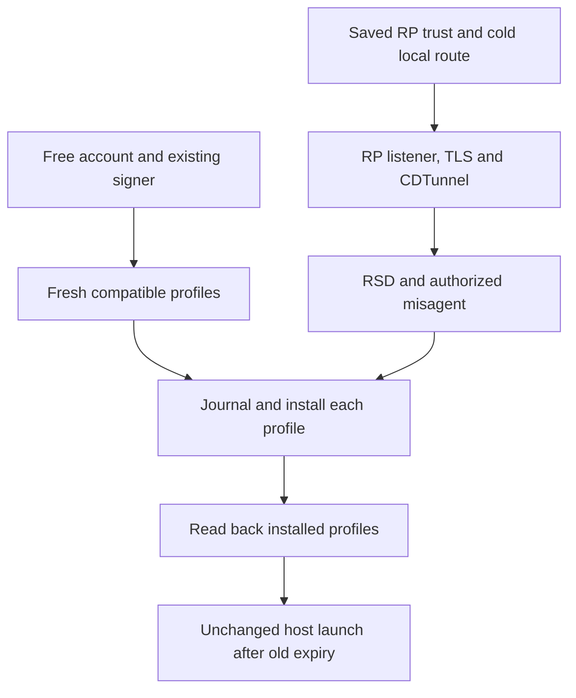
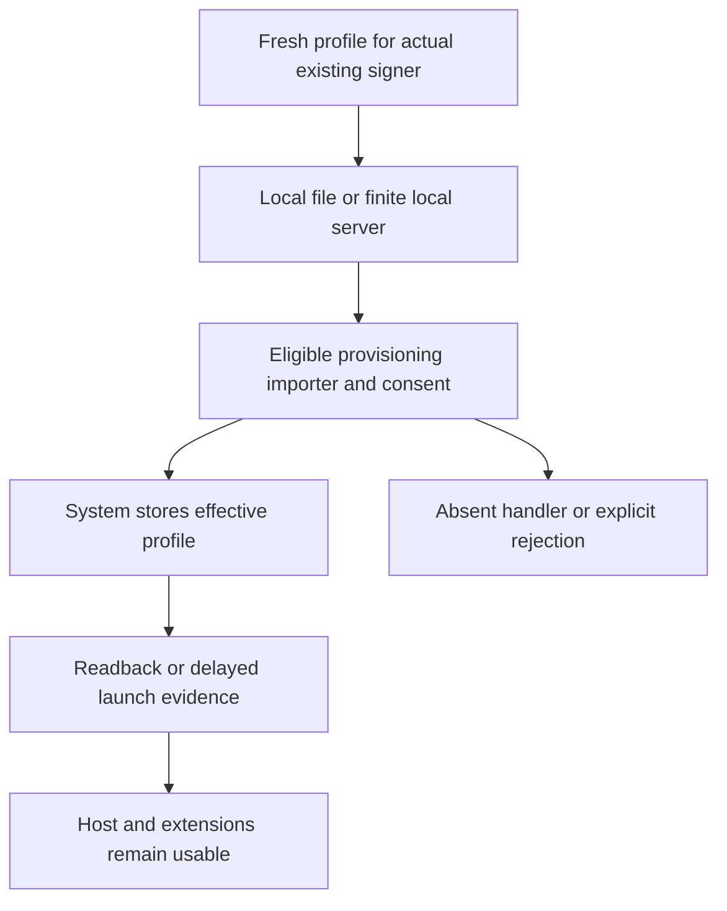
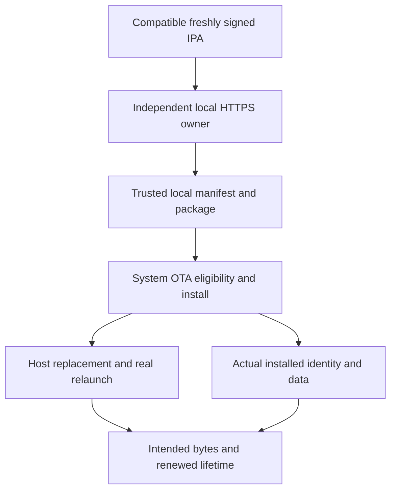
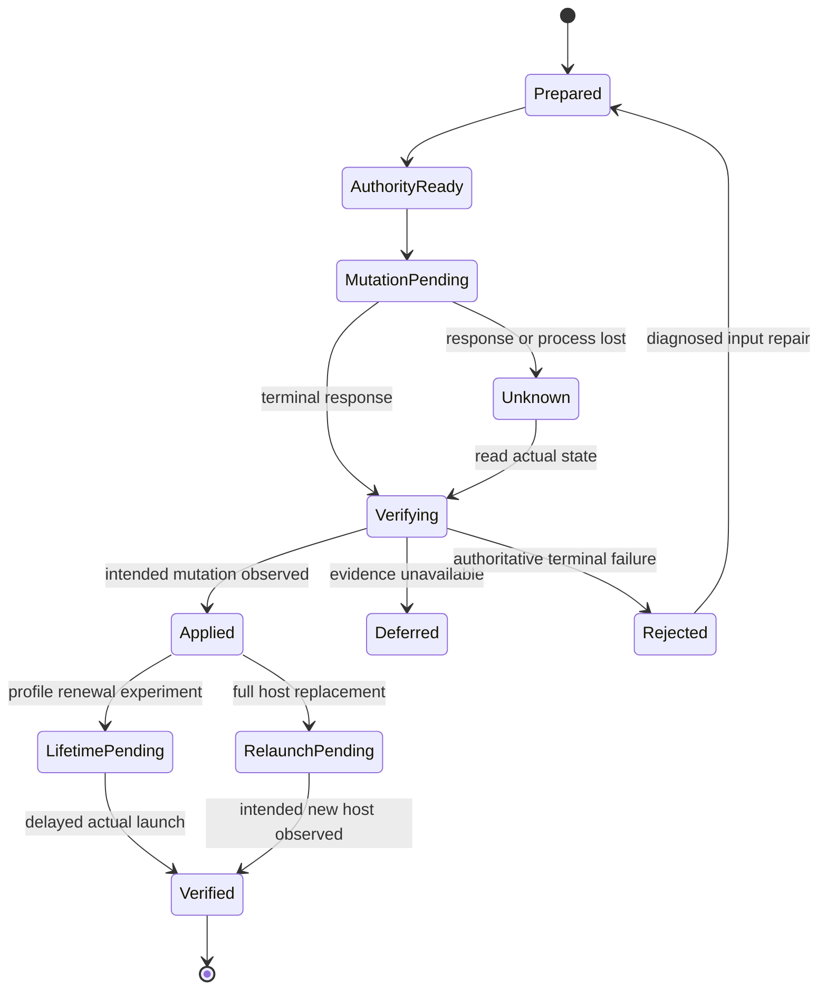

# Cellular-only refresh: architecture discovery, feasibility and recovery plan

**Research date:** 2026-10-22. **Phase:** 2, superseding the architecture restrictions in Phase 1. **Review vehicle:** [Draft PR #49][pr49], on the existing research branch. The [Phase 1 revision][phase1] remains the provenance for its historical observations.

**Capability-level conclusion:** no reviewed evidence yet demonstrates all requested cellular-only, no-toggle, free-account, on-phone refresh conditions, including the host's usable lifetime. **The broader capability remains open; impossibility has not been established.**

**Recommended primary research candidate:** renew the installed app's compatible provisioning profiles through an authenticated **RemotePairing → developer tunnel → RSD → misagent** path, using the newly implemented Madeira self-refresh work as the closest inspectable reference. This removes classic Lockdown as the first hop, routine IPA transfer and routine host replacement. Its actual local route/provider, cold-cellular tunnel access and lifetime extension remain unverified; RP-first does not mean VPN-free. Independently test a **system provisioning-profile importer** and a **fully local HTTPS → iOS installer** path; neither depends on success of the primary transport experiment.

**Work delivered:** revised comparative engineering plan; isolated Python profile-preflight and lifetime-evidence diagnostics; a public-API, own-container SwiftUI receipt probe; reproducible device procedures. **Physical iPhone tests and native Swift compilation: NOT RUN.** The available Linux environment has Python/OpenSSL, but no iPhone, Xcode, Swift or Rust toolchain. No production implementation, dependency pin, release or deployment is changed.

## Contents

1. [Correction and scope audit](#part-1-correction-and-scope-audit)
2. [Independent architecture discovery](#part-2-independent-architecture-discovery)
3. [Expanded failure evidence](#part-3-expanded-failure-evidence)
4. [Architecture comparison](#part-4-architecture-comparison)
5. [Recommended primary solution](#part-5-recommended-primary-solution)
6. [Independent alternatives](#part-6-independent-alternatives)
7. [Per-architecture recovery design](#part-7-per-architecture-recovery-design)
8. [Minimal proofs of concept](#part-8-minimal-proofs-of-concept)
9. [Concrete implementation roadmap](#part-9-concrete-implementation-roadmap)
10. [Remaining blockers and adversarial review](#part-10-remaining-blockers-and-adversarial-review)

## Part 1: Correction and scope audit

### 1.1 Requirements, preferences and implementation choices

The updated mission supersedes the narrower [Issue #3 request][request3], Phase 1's design preference, and the existing repository contribution guidance to retain official LocalDevVPN/CoreDevice. That guidance still describes the current production backend; it does not exclude replacement architectures from this research. There is no authorization here to publish or enable an unverified replacement.

| Category | Requirement or boundary |
|---|---|
| Functional acceptance | Wi-Fi **Off in Settings before startup and throughout the run**; cellular connectivity; no direct or indirect radio toggles; no PC/USB participating during refresh; genuine extension of installed usable signing lifetime; host self-refresh; application/data continuity where supported; stage-local recovery. |
| Preferred product | Free Apple Account; no jailbreak; no external server/relay participating in device-installation transport; no user requirement for paid Developer Program membership; no unavailable/private entitlements; reasonable active time, cellular bytes and battery. |
| Permitted research | Other signing/distribution authorities, privileged helpers, paid workflows, alternate VPNs and no-VPN designs. State the precise conflict before considering a compliant derivative. A conflicting implementation is not silently selected. |
| Not architectural requirements | LocalDevVPN, an unchanged VPN topology, Lockdown-first bootstrap, CoreDeviceProxy, CDTunnel, RSD, AFC, the existing InstallationProxy provider, minimuxer, or one backend for every operation. |
| Setup versus runtime | Initial signing/install, Developer Mode where required, pairing and trust enrollment may require a separate computer/setup procedure. Requiring that computer again during an accepted refresh fails the runtime requirement. Setup privileges must not be hidden inside retries. |
| Foreground versus background | A user-mediated cellular refresh can satisfy the core functional capability. Unattended scheduling is an additional capability and must have its own evidence; it is not promised by foreground success. |

Apple account/provisioning HTTPS and any disclosed anisette authentication dependency are different from an installation-transport relay. A design must identify both. For example, external hosting of the OTA manifest participates in installation even if the IPA is local; a DNS lookup that resolves a name to loopback does not by itself relay an installation payload. [feather-mechanism] [madeira-signing]

### 1.2 Adversarial audit of the previous report

Locations below refer to the immutable [Phase 1 document][phase1]. The observations are retained with corrected scope; the old recommendations are not treated as current instructions.

| Previous location / assumption | Why it no longer controls the mission | Phase 2 correction |
|---|---|---|
| Header and §A: preserve CoreDevice and gate cellular work on cold Lockdown | Chose the backend before exploring other renewal authorities | Make installed authorization/lifetime the goal; select a leading research candidate only after the discovery and evidence passes. |
| §A: the missing capability is a same-phone installation connection | Accurate for that network installer, incomplete for system-broker or profile-only approaches | Investigate separate profile-store mutation, system OTA, managed distribution and local IPC authority. |
| §D.2/§E: official LocalDevVPN and excluded alternate components treated as fixed constraints | Earlier instructions narrowed the search; the correction explicitly removes them | Research legitimate custom/released VPN providers, IPv6 reflection and no-VPN brokers. Record signing/deployment requirements individually. |
| §C.1/§C.2: old RP failures and shared code used to defer SideInstaller | Shared dependencies identify what to measure; they do not invalidate a newer contrary claim | Audit v0.7.0, v1.5.3, current main, Madeira PR #264, the actual video and the exact RP/misagent source. Reopen controlled replication. |
| §C.3: qualified saturation around the old mechanism families | Did not cover standalone profile import, local OTA authority or newer self-profile refresh sufficiently | Add independent discovery lanes and record remaining access/coverage limits. Search volume is not proof of completeness. |
| §F–§I: one 16-stage transport recovery graph | Valuable for the existing backend, not a universal lifecycle | Retain the 16 stages under architecture D and add separate RP/profile, UI-import, OTA and managed-broker machines. |
| §K common controls: every experiment uses the official VPN and Developer Mode | VPN and launch enrollment are distribution-specific | Keep the physical radio/no-PC controls global; apply provider, pairing and Developer Mode only where the candidate requires them. |
| §K E4/E5: Lockdown gates all downstream work | A prerequisite of classic/CoreDevice, not of RemotePairing or the system installer | Give each architecture its own entry, authority and mutation gates. |
| §A/§K E7–E9: full IPA and full self-reinstall precede useful profile research | Confuses independent product capabilities | Profile-only lifetime renewal is a first-class acceptance path. Full third-party installation and full host replacement remain separate required product experiments. |
| §K acceptance: InstallationProxy completion is universal | Other system brokers may expose different status APIs | Require the selected broker's real outcome plus independent installed identity/launch/lifetime evidence. |
| §L R1/R2 stop rule: failed current bootstrap stops cellular implementation investment | Exhaustion of one connection family is not capability-level impossibility | Stop only that branch; continue independent broker/authority tests with their own falsifiers. |
| §M final review: self-refresh effectively equated to full host replacement | A valid replacement profile may keep the same host code usable | Distinguish profile-only host renewal from full self-reinstallation, including the combined outer host. |

### 1.3 Findings that remain valid

The current backend's Wi-Fi success, explicit Wi-Fi readiness gates, radio-toggle cellular mode, scoped LocalDevVPN failures, historical authenticated RP closures, signing/login gap, non-atomic profile writes and weak optimistic UI evidence remain useful. So do durable intent, immutable prepared bytes, bounded retries, exact target identity, ownership of staging, and **UNKNOWN → reconciliation before replay**. None establishes that every installation authority has the same networking limitation. [verification] [min-impl] [ss-cellular] [ldv31] [v19] [issue42] [ss-refresh]

The source audit also found a distinct security limit: the maintained idevice TLS verifier accepts server certificates/handshake signatures without independent verification. In that backend, a pairing session accepted with matching protocol-reported identity must not be described as an independently verified TLS peer. This is a concrete source property, not an allegation about every library or RP implementation. Preserve required TLS; audit the actual verifier before production promotion. [idev-sni]

### 1.4 Evidence vocabulary and decision rules

| Classification | Meaning in this report |
|---|---|
| **PROVEN ON DEVICE** | An identified device/build/operation has a reproducible acceptance record. None was produced in this environment. External reports remain attributed reports, with missing controls disclosed. |
| **IMPLEMENTED BUT NOT DEVICE-VALIDATED** | Inspectable code exists for the stated operation; the target cellular/lifetime acceptance has not passed. Compilation is a separate fact. |
| **EVIDENCE-SUPPORTED** | Primary sources support the mechanism or a scoped external observation; at least one target condition remains unverified. |
| **EXPERIMENTAL** | A falsifiable hypothesis with explicit missing dependencies; no working target capability is claimed. |
| **BLOCKED BY A SPECIFIC DEPENDENCY** | Name the unavailable authorization, absent importer, failed service or other required dependency, and its tested/source scope. |
| **DISPROVEN UNDER DOCUMENTED CONDITIONS** | The exact intervention failed under documented conditions. It does not generalize to a different OS, authority or transport without evidence. |
| **NONCOMPLIANT WITH PRODUCT CONSTRAINTS** | The implemented architecture needs a prohibited runtime dependency or signing/privilege requirement. Its underlying mechanism may still teach something useful. |

These labels apply at dependency and operation level. One architecture can contain implemented signing, an experimental cold bootstrap, and an unvalidated lifetime verifier. A functioning guest, profile download, TCP connection, pair verification, VPN icon or changed database date is below refresh acceptance.

## Part 2: Independent architecture discovery

### 2.1 Pass 1 — unranked inventory

This inventory was produced in separate transport, profile/Apple-authority, and local-installer research lanes **before** ranking. Entries are grouped by what changes installed authorization, not counted as independent simply because they use different app names.

| Family / discovered mechanism | Complete dependency sketch | What it avoids / question to investigate |
|---|---|---|
| Profile store through RemotePairing | Existing signer → fresh Apple profile → saved RP trust → control/listener/TLS tunnel → RSD misagent → profile store → later launch | Avoids classic Lockdown-first, AFC and replacing app bytes; must prove cold route and effective free-profile renewal. |
| Profile store through classic services | Existing signer → fresh profile → paired Lockdown → direct or CoreDevice misagent → store → later launch | Avoids IPA transfer; shares the classic first-hop constraint only when this backend is selected. |
| User-mediated system profile importer | Fresh matching `.mobileprovision` → phone-local file/handoff → actual system importer and consent → store → later launch | Potentially no VPN, pairing or private app entitlement; current Personal Team handoff is unverified. |
| Local HTTPS system installer | Fresh signed IPA → local TLS manifest/package server → `itms-services` → iOS installer → actual app launch | No developer-service tunnel; free-profile eligibility and host-serving lifecycle need proof. |
| Direct local installation/profile IPC | Fresh signed package/profile → LS/MobileInstallation/MIS/ManagedConfiguration method → system mutation | No network bootstrap; current method ABI and ordinary-caller authority are separate gates. |
| Independent local helper | Host prepares bytes → separately running authorized or ordinary broker → selected installation authority → host relaunch | Separates lifecycle; a helper gains no extra privilege merely by being separate. |
| MDM provisioning/profile or app command | Enrollment/identity/rights → authorized management command → OS device agent → store/app status → launch | Real system authority; conventional design needs a runtime management server. Same-phone MDM is an unimplemented hypothesis. |
| Marketplace / managed catalog / App Store / TestFlight | Distribution eligibility → approved package/license/catalog → system broker → installed state | Real alternative authorities; not arbitrary Personal Team IPA installers. |
| CoreTrust / jailbreak installation | Vulnerable or privileged platform → local helper → installation/registration → launch | Avoids normal free-profile lifecycle; modern OS/privilege constraints conflict with the preferred product. |
| LiveContainer guest execution | Renewed installed host → guest signing/loading inside host → guest state | Reduces independent guest installs; cannot renew the outer host or another independently installed app by itself. |
| New developer-service implementation | Trusted RSD endpoint → installation coordination service / streaming install | Potentially avoids AFC/old InstallationProxy downstream; current inspected client has Install/Revert TODOs and still needs trusted bootstrap. |

Transport subfamilies considered independently: LocalDevVPN and StosVPN reflection; original EMP/WireGuard configuration; a different supported packet-tunnel route policy; native Network.framework/BSD interface selection; same-phone direct/loopback service entry; RemotePairing/RemoteXPC discovery; current sing-tun IPv6 loopback reflection in a released-client ecosystem; off-device Tailscale reflection as a noncompliant routing control. These are not eleven independent installation authorities. [ldv-provider] [emp] [apple-scope] [sing-tun] [tailscale-reflector] [installcoordination]

### 2.2 Pass 2 — current implementation and publication audit

The source/claim distinction is especially important for SideInstaller: the original cellular claim, latest published release and today's main do **not** select identical transport policy.

| Project / immutable revision or dated source | Inspected path and positive evidence | Target-condition limit |
|---|---|---|
| SideInstaller **v0.7.0**, 2026-08-03, `cfffd5480496195073cec3570f107a4e18c0c690` | First saved-pairing cellular-install release claim. RP port 49152 → create listener → same address/dynamic port → TLS-PSK/CDTunnel → RSD; not classic-first. | Its pinned NOTES still described actual tunnel/install as unverified in that build environment. The release assertion deserves exact-build replication, not acceptance or dismissal. [si07-release] [si07-tunnel] [si07-notes] |
| SideInstaller latest published **v1.5.3**, 2026-10-16, `91fcb9e949919bf928004b9f25da671f1e3f9f10` | Real on-device signer/installer, for composite records RP-first on iOS 27+, classic-first below iOS 27; single-format records use their available route; later notes include iPhone 16/iOS 27 installs. | Those notes do not establish Wi-Fi disabled before startup, no warm transport, or delayed lifetime. [si153] [si-current-notes] |
| SideInstaller main observed **2026-10-22**, `ab98d3e2f7d75cd18e7342be3101c0fecd42e02c` | for composite records RP preferred on iOS 26.4+, moving the v1.5.3 cutoff from iOS 27; integrates Madeira self-refresh and token/pairing handoff. | Source main is not automatically the release binary. Pin the exact artifact and record actual selected path. [si-current] |
| Madeira self-refresh fork / open PR #264, `bc31f042092cdad6aa7dced35296b002a6cbd8c7`; fork release **2026-10-22** | `SigningRefresh.swift` fetches matching host/extension profiles; Rust `install_profile` uses RP → listener → TLS-PSK/CDTunnel → RSD → `misagent.install`. Does not invoke a radio-toggle shortcut. | Author's October 12 40.5-second video shows “Refreshed”/seven days **with the Wi-Fi icon visible**. No store readback, exact OS or later launch proof. PR remains a fork contribution, not assumed merged. [madeira-pr] [madeira-release] [madeira-signing] [madeira-rp] [madeira-demo] |
| Maintained SideStore `d507f9e…`; current upstream separately searched | Existing `.refresh` installs profiles; `.install`/`.resign` transfer/replace packages. September cellular success #1505 used radio Shortcuts. | Current source already distinguishes operation types. The shortcut flow fails the no-toggle requirement; source sharing does not make all new profile transports identical. [ss-steps] [ss-refresh] [ss1505-success] |
| StikDebug / PR457 | Closed/unmerged PR (September 5 2026) proposed preserving a live tunnel over path changes and avoiding reconnect on cellular. | Warm-session preservation and JIT are not cold installation/profile renewal. Claimed latest change was not device-verified; location traffic is not a product keepalive strategy. [stik457] |
| StosVPN / EMP / LocalDevVPN | Actual packet reflection implementations and several version-scoped tests. | Different provider activation, routing and service policy must be measured; shared “VPN connected” UI is not proof. [coxson] [pr935] [ldv31] |
| ClashMi | Current pairing/client integration reports and newer nightly success. | Parsing/setup repairs do not demonstrate no-toggle cold-cellular mutation. [clash9] |
| idevice `26a28f6a46b5d85a28043c2e62febfa394c8b0a6`, 2026-10-19 | Classic/RSD misagent and installation helpers. `installcoordination_proxy.rs` names a stream-based install service. | Its Install/Revert paths are TODO; a service name is not a working replacement installer or new authority. [install-helpers] [installcoordination] |
| pymobiledevice3 current `fca5818b…`, 2026-10-22; libimobiledevice service clients | Independent reference implementations for pairing, RemoteXPC, AFC, installation and profile management. | A host tool reaching services through USB or a host tunnel does not prove same-phone cellular access. Current implemented full installation still uses AFC/InstallationProxy. [pymobile-current] [libimobile-misagent] |
| Feather `7078b053c0af262809a48e4d3898d42b0d35fedf`, 2026-09-25 | Fully local HTTPS + system OTA mode, separate from idevice mode. Actual server, manifest and `UIApplication.open` calls inspected. | Paid distribution workflow documented; Personal Team acceptance unproven. Source explicitly prevents server-mode self-update; current progress-based “success” needs independent verification. [feather-compute] [feather-server] [feather-preview] |
| LiveContainer `9108ae624ea001f7d7696d48407f890b48fa2653`, 2026-10-17 | Newer guest-signature reuse and iOS 26 dyld compatibility. | Guest loadability is not independent host signing authorization. [lc-current] [lc-refresh] |
| ReProvision Reborn `d8ae294c1f47cfa6b23a1a2900a557aed75f9872`, 2026-06-05 | Direct installation of free-account-signed IPAs via LSApplicationWorkspace/`AllowInstallLocalProvisioned`. | Jailbreak daemon/private entitlements; it supplies mechanism evidence, not an ordinary-app permission grant. [rr-install] [rr-entitlements] |
| TrollStore `88424f683b2a08f34a3f88985f790f97d84ce1df`, 2026-04-01 | Root helper plus CoreTrust-based persistent installation on documented vulnerable versions. | Current commit date does not expand support to iOS 26/27; unavailable privileges and altered trust model conflict with product constraints. [troll-readme] [troll-helper] |

### 2.3 New OS and routing opportunities, with exact limits

The iOS 26.4 regression, later 26.6.1 failures, iOS 27 reports and current installers must be compared by build and selected protocol. SideInstaller main's `>=26.4` RP preference is a policy change worth testing; it is not evidence of a new OS authorization grant. A primary-source source change that avoids an earlier assumption justifies a bounded new experiment, even before target success exists. [si-current] [ldv31] [ss1505]

The IPv6 loopback reflection implementation in current **sing-tun** changes a real assumption: official LocalDevVPN's inspected reflector is IPv4. Inspect the actual released SFI/client version and configure only supported settings, then determine whether an eligible IPv6 service endpoint exists and accepts the connection. The code alone supplies neither an IPv6 listener nor cellular service permission. Failure of an IPv4 reflected address does not disprove this arm; failure of the same authenticated service after successful IPv6 delivery would narrow it. [sing-tun] [sfi]

`Network.framework.requiredInterface` and BSD interface binding can change route/source selection. They cannot be assumed to change daemon authorization. A client comparison needs the **actual socket** used by the chosen backend, an observed interface and matching address family; a Swift-side path flag does not scope Rust/Tokio sockets. `enforceRoutes` is likewise a configuration hypothesis, not a tested fix. A custom legitimate provider is now in research scope, but its developer deployment, distribution and effective entitlements must be checked. A user's free-account constraint and a publisher's paid distribution setup are different costs; do not silently conflate or waive them. [apple-scope] [apple-enforce] [apple-deployment] [idev-provider]

New system installation frameworks were also examined. Current Apple documents list alternative marketplaces in Japan from iOS 26.2 and Brazil from iOS 26.5, in addition to EU mechanisms. Current EU eligibility pages changed in October 2026; older fixed financial/install-count summaries must not be reused as universal current rules. These channels still require their own approved developer/distributor, notarized package and distribution services; their existence does not authorize arbitrary free-account packages. `ManagedAppDistribution` presents assigned managed content and has a documented installation-UI capability. Neither public API name grants an unrestricted local installer. [apple-regions] [apple-market-eu] [apple-web-eu] [apple-managed] [apple-managed-entitlement]

### 2.4 Search coverage and limits

Primary repository source, release tags, issue threads, official Apple documentation and an author-hosted security paper were used to check transport, trust and installation separately. The new lanes covered all five required families: current installers/forks; alternate/released/no-VPN routing; independent profile renewal; local/system/privileged helpers; recent iOS/tooling changes. Searches followed actual mutations, not only descriptions. The Madeira video was downloaded and visually inspected; Feather #182/#313/#629 bodies and available comments were read; current source/entitlement files were inspected.

Unseen material includes private Discord, unpublished device traces, every shipped binary and App Store entitlement, carrier internals and private daemon source. Source snapshots do not prove binary equivalence. Some old linked support pages are unavailable, so quoted historical statements remain secondary limitations rather than new platform rules. This is a bounded coverage result, **not search-based proof of impossibility**. The remaining material gaps now have distinct experiments in Part 8.

## Part 3: Expanded failure evidence

### 3.1 Preserved nineteen historical records

The observations below are retained from Phase 1; interpretation is updated where the corrected scope or newer primary evidence changes it. “Unspecified” is a real evidence gap. Several rows exercise the same reflected-network/service dependency and are not independent impossibility proofs. An author's causal explanation is labeled separately from the observed failure.

| ID | Attempt and assumption | Actual observation / tested scope | Established mechanism and classification | Newer evidence and recovered knowledge |
|---|---|---|---|---|
| N01 | Connect directly to the phone's own Lockdown address; assume localhost access suffices | Original transport author reports rejection; historical versions/devices not fully specified | Author's reverse engineering attributes rejection to local-address checks. Evidence for that path, not every developer service. [coxson] | Reflection addressed source identity in older designs. Loopback RemotePairing access is not equivalent to authenticated Lockdown. |
| N02 | Secret-Tunnel userspace IP/TCP plus adapted libimobiledevice | Early SideStore work, 2022: small connections worked, larger requests stalled; implementation abandoned | Implementation/flow failure, not impossibility of userspace TCP. [coxson] | EMP reflection replaced it. Small probes must never substitute for real IPA transfer. |
| N03 | Remove minimuxer's Wi-Fi readiness gate after StosVPN replaced EMP | PR #935, SideStore 0.6.1-era build: author still could not install/refresh because of misagent/Lockdown; contrary reviewer impression lacked controlled radio conditions | Failure below eligibility; exact daemon cause unestablished. [pr935] [pr935-fail] | A later toggle proposal is outside scope. Bypass preflight only to measure the next stage. |
| N04 | StosVPN with stable/nightly SideStore on cellular | Issue #1022, 0.6.2 and contemporary nightly, July 2025: Wi-Fi requirement and continued refresh failure; device/OS absent | Product-level failure; no packet/service trace. [ss1022] | “Not implemented” guidance from February 2026 is not a timeless statement; later shortcut support exists. |
| N05 | Re-pair/reinstall the old local-VPN path after iOS 26.4 | #1174/#1194: heartbeat, connection and MuxError failures even on Wi-Fi; 26.4 betas/stable, including iPhone 14 report | Version-specific transport regression; error does not prove bad keys. [ss1174] [ss1194] | Updated pairing/nightlies restored Wi-Fi for some reporters. Record client and pairing format before replacing credentials. |
| N06 | Put reflected VPN addresses in the Wi-Fi subnet or enlarge that subnet | StikDebug #318/#320 on 26.4: some repaired connections, some continued failures, one transition to PermissionDenied | Partial address workaround with unresolved downstream authorization differences. [stik318] [stik320] | Useful Wi-Fi compatibility evidence; it requires a Wi-Fi context and supplies no cellular solution. |
| N07 | Add IKEv2/IPsec before LocalDevVPN | #1222/#1225 and related reports: mixed success, AFC failure and connectivity loss; 26.4 beta/stable, including iPhone 17 | Conditional route workaround; underlying differences unproved. [ss1222] [ss1225] | Remote VPN/server dependence conflicts with the preferred runtime constraint; it remains a research comparator. A local computer-hosted substitute also fails the runtime constraint. |
| N08 | Replace classic protocol with RemotePairing and expect cellular to follow | ByeTunes #62: v2.2 on iPhone 17 Pro Max, iOS 26.5.1, tunnel failure; maintainer attributes case to cellular | Same-device transport limitation reported; new pairing protocol alone did not remove it. [byetunes62] | Paid signing in this report did not fix networking. Pairing success and tunnel success remain separate. |
| N09 | Start official LocalDevVPN on cellular, preserve it across Wi-Fi loss, or restart it afterward | #31: all failed in reported conditions; 1.3.0, iPhone 17 Pro/26.6.1/Verizon; another report on 17 Pro Max/27.0 build 24A5424a | Connected-but-unreachable path; exact route/filter cause unresolved. Maintainer calls it Apple-enforced. [ldv31] | Loopback/control-port reachability is partial. Proposed `enforceRoutes` was not tested. |
| N10 | Start LocalDevVPN with no physical connectivity and assume an existing-session result generalizes | #31's fully disconnected cold state did not reach connected | VPN lifecycle failure, distinct from N09's connected-but-unreachable state. [ldv31] | A previously live offline session cannot prove cold-start or post-reboot behavior. |
| N11 | Cure self-install stalls by removing EMP or changing radio state | #891, iPhone 16 Pro, iOS 18.3–18.4 DB1 / later nightly: failure recurred after initially claimed fixes | Cause remained unresolved; UDP/stale-socket hypotheses were not established. [ss891] [ss891-retract] | Treat self-install as pending verification. A retracted anecdote is not a recovery guarantee. |
| N12 | Import a newer RP record into an incompatible client | ClashMi #9, iOS 26.3/26.4: import/minimuxer failure, later nightly refresh success | Format/client integration failure, not proof of invalid cryptographic material. [clash9] | Update matching setup/client components once, separately from testing transport. Successful network conditions were not this mission's full acceptance. |
| N13 | Select cellular shortcut flow without correct capability/context | #1413/#1380: missing shortcut, redirection and AFC failure; Wi-Fi-only iPadOS 18.1 and iOS 26.3.1 reports | Client orchestration regression. [ss1413] [ss1380] | Disabling experimental shortcut flow/new nightlies repaired some cases. Transport selection must not silently mutate radio state. |
| N14 | Repeatedly reinstall and replace pairing for UDID/profile errors | #1401: iPhone 14/iOS 18.7.8 and other versions still failed; newer installer/nightly helped some | Setup/version incompatibility; no general proof keys were bad. [ss1401] | One-time setup repair can require a computer, but cannot be counted as phone-only runtime recovery. |
| N15 | Substitute personal hotspot for AltServer's expected connection | AltStore #33, iPhone XR/iOS 13.1.2/Windows 10: partial progress then device discovery failure; later version reportedly fixed | Historical host discovery issue, not a modern CoreDevice theorem. [alt33] | Internet connectivity and device discovery differ. PC involvement excludes this architecture regardless of later repair. |
| N16 | Keep using an old host QUIC command with a newer toolchain | AltStore #1591, pymobiledevice3 4.20.23/macOS/Python 3.13/iOS 18.2+: command missing, manual TCP substituted | At least a tool/API mismatch. The report alone does not prove universal QUIC removal. [alt1591] | A working host TCP tunnel does not establish on-phone dynamic TCP. |
| N17 | RemotePairing control → dynamic TCP → TLS-PSK → CDTunnel | Target V19: PairVerify/listener and verified TLS Finished succeeded, then authenticated `close_notify` after CDTunnel. The fallback QueryType frame received a TCP ACK, then reset/close without a valid Lockdown response. Phone/OS/radio state absent. [v19] | Experimentally unsuccessful after cryptographic progress. Exact daemon rejection policy remains an inference. | New SideInstaller/Madeira code and claims justify controlled replication; the exact listener/tunnel remains a gate. TLS success is below acceptance. |
| N18 | NAT dynamic-listener traffic toward the phone's IKEv2 interface as though it were a transit hop | Target V21 describes V20: forward rewrite, no SYN-ACK/reverse packet; physical-interface TLS attempt still closed. Model/OS absent. [v21] | The observed destination was another local address, not demonstrated transit; no working end-to-end path. | Later proposed Lockdown markers in the file are plans, not successful results. |
| N19 | Compare reflected, loopback and physical endpoints; use USB as positive control | Target V25 describes V24 on iOS 26.6.1 build 23G83: peer timeout, loopback refusal, physical-address TLS then alert; computer USBMux obtained RSD/services. [v25] | Endpoint-specific unsuccessful local attempts; USB demonstrated service availability through a different transport. | Wi-Fi-off was not established by these historical files. The USB control cannot validate phone-only reachability. |

Historical target files remain pinned at `5ce20c1498b3cba1abc868398a6c238a188c4166`. V19's authenticated alert and V25's description of V24 must not be combined into one controlled sequence. Model, OS, radio state and client implementation do not match automatically. Existing USB success establishes a different access path, not phone-only cellular acceptance. [v19] [v21] [v25]

### 3.2 Scope, independent reproduction and reopening conditions

This supplement answers the independence/change questions that the compressed historical table could not settle. “No controlled independent replication” means none was established in the reviewed record; it does not deny that another user may have tried it.

| Records | Independence and boundary | What must change / current alternative |
|---|---|---|
| N01 | Original-author reverse engineering; exact old model/build not established. Local-address rejection, not every local IPC/API. | An accepted source/interface/service or a system broker. Manual profile/OTA authority avoids this network hop. |
| N02 | One implementation history; no universal userspace-stack failure. | Correct flow/MTU/backpressure with full payload verification; profile-only avoids the large transfer entirely. |
| N03–N04 | Related product reports, not two independent kernel-policy proofs. Eligibility removal and actual service failure are distinct. | New accepted transport or broker. New RP profile code deserves a separate controlled trial. |
| N05–N06 | Multiple reporters/builds support a 26.4 compatibility problem; not identical experiment replications. Some Wi-Fi fixes work. | Match client/pairing/OS, then measure actual service acceptance. IPv6 reflection and system brokers are different hypotheses. |
| N07 | Multiple mixed reports; IKEv2 routing cause not isolated. | An off-device transit relay can change topology but violates the preferred runtime constraint. Use it only as a labeled comparator; local/no-VPN routes remain separate. |
| N08 | One attributed cellular RP tunnel failure on named device/build. | New source/OS/provider and controlled RP result; Madeira/SideInstaller supply code/claims to test, not proof that this report was wrong. |
| N09–N10 | More than one model/build reported, but common provider and differing cold/offline conditions. | Demonstrated changed packet delivery/service policy. Current IPv6 released-client arm changes address family; UI/OTA bypasses reflection. |
| N11 | Initial “fix” retracted; repetitions do not establish cause. | Actual host mutation/relaunch evidence. Profile-only host renewal avoids process replacement; local OTA needs an independent helper test. |
| N12–N14 | Format/setup/orchestration reports; mixed devices and client revisions. | Correct diagnosed format/version once, without radio toggles; preserve valid trust on ordinary timeouts. Does not answer new broker eligibility. |
| N15–N16 | Old host-assisted discovery/tool mismatch; later counterevidence. | Current host implementations can change these failures, but a runtime PC remains noncompliant. Neither disproves on-phone system brokers. |
| N17 | One historical target investigation, radio/build gaps. Authenticated closure is strong evidence below the specific mutation. | Contemporary RP/misagent and installation claims justify exact-build reproduction. Repeated same authenticated closure rejects that arm, not all profile authorities. |
| N18 | One NAT attempt; no demonstrated transit/reverse path. | A real remote reflector changes transit but conflicts with product constraints; same-device address rewriting is not automatically transit. |
| N19 | Specific endpoints/client on 26.6.1/23G83, with a USB control; no independent cold-radio replication. | A genuinely changed endpoint/client/OS or system authority. Retain exact failing boundary when comparing newer RP code. |

The tracked V14 patch already used interface binding on RP/control/dynamic-listener candidates, while reflected-peer/local-utun candidates did not bind. No equivalent reflected **Lockdown62078 socket scoped to the observed utun** was found in the reviewed tracked sources. A historical standalone diagnostic workflow lacks its app source in the examined trees. Therefore the classic scoped-socket arm is a bounded residual question, not a claim of novelty or a global research gate. [v14-matrix] [source-bound]

### 3.3 Additional independent failures and evidence limits

Rows describing source limitations or missing proof are explicitly identified; they are not fabricated device failures.

| ID | Exact evidence / device and date | Failure class and scope | Independent evidence, change and alternative |
|---|---|---|---|
| N20 | Feather #182, Nov 2024–Jan 2025; reports include iOS 18.2 beta,17.3,18.0.1 | Maintainer diagnosed revoked bundled `localhost.direct` TLS certificate; HTTPS manifest trust, distinct from IPA signing. | Multiple reports; maintainer later reports replacement cert/v1.2 working. Renew TLS trust, not app certificates. Does not disprove local OTA. [feather182] |
| N21 | Feather #313, Apr 2025; iPhone 15 Pro Max/18.4, iPhone 11/17.6.1, iPhone 15/18.2 and mixed others | Local installer stalls/failures, cause not uniquely established. Online mode or retry helped some. | Same account differed by device; other local successes, including prior cellular anecdote, are counterevidence. Need actual cold-radio/profile-type controls. [feather313] |
| N22 | Feather #629, Apr 24 2026; iPhone 15 Pro Max/26.4.1, Feather2.6.0; current source guard | Server-mode self-target update unsupported by this implementation. Exact server/process failure cause not traced. | Owner recommends another signer or idevice; independent local helper is a new lifecycle hypothesis, not existing self-refresh proof. [feather629] [feather-preview] |
| N23 | Current TrollStore support envelope and registration code | Implemented trust bypass targets older vulnerable OS; icon-cache reclassification can break launch even there. | Persistence helper is documented recovery. A new modern signature authority is needed; a newer commit/SDK does not supply it. Noncompliant comparator. [troll-readme] [troll-helper] |
| N24 | LiveContainer guest code and host refresh guide, current source | Guest loadability/skip-resign and refreshed UI do not establish outer host lifetime. This is an operation mismatch, not a failed installer test. | Independent host profile-store or reinstall proof can coexist with guest optimization. [lc-current] [lc-refresh] |
| N25 | ReProvision Reborn #37, Jun 24 2025, iPhone 5/iOS 10.3.3/h3lix | Reporter can manually sign but automatic path cannot reach its daemon. Old helper/execution failure. | No comments/controlled independent reproduction. Does not diagnose iOS 26 networking; a foreground working signer is not a working scheduler. [rr37] |
| N26 | Pinned ReProvision installer code | Selected error64/LaunchServices recovery uninstalls before reinstalling. Source behavior, not a newly run failure. | Incompatible with default data-preserving recovery. Use in-place identity/reconciliation or stop; do not transplant destructive retry. [rr-install] |
| N27 | Kobold2020 paper, reported iOS 11.3.2 ordinary-app experiments, method-entitlement tables | Some profile/install methods deny callers lacking specific private entitlements. Port access and method authorization differ. | Primary experiment, old OS. Current ABI/method could differ; a legitimate UI/MDM broker is a different caller. No universal modern MIS denial inferred. [kobold] |
| N28 | Old TestFlight/iOS 8 standalone profile-import reports; weak iOS 17 web-handoff complaint | UI route absent/changed in those accounts; neither establishes modern Personal Team importer policy. | Current TN3125 still mentions Settings provisioning-profile install. Test exact iOS 26/27 handler; `.mobileconfig` success is not counterproof. [profile-ui-old] [profile-ui17] [apple-profiles] |
| N29 | Madeira source/October 12 video at current reviewed PR | Code writes refreshed expiry after sequential `misagent.install`; no store readback or real old-expiry crossing. Wi-Fi visible. | Positive implemented self-profile mechanism, incomplete target acceptance. Add signer/value preflight and actual lifetime test; do not call it a cellular failure. [madeira-signing] [madeira-demo] |
| N30 | Current idevice installation-coordination client | Install/Revert TODO; no complete streaming install implementation in reviewed client. Source coverage limit. | Implementing this downstream protocol would not itself remove bootstrap/trust. Do not advertise a no-VPN replacement from a service name. [installcoordination] |
| N31 | Official MDM/marketplace/managed APIs | Real mutation authority requires enrollment/rights or distribution eligibility; ordinary arbitrary-IPA access not established. | A public framework or local HTTP endpoint is not an authority grant. No blanket claim of all custom/local MDM impossibility; its exact missing setup/runtime dependencies are listed in §6.4. [apple-mdm] [apple-market-install] |

### 3.4 Credible contrary evidence remains active

A separate contemporary positive control is SideInstaller’s Side by Side report from September 18 2026. A contributor reported two physical iOS 27 phones completing RP approval, TLS-PSK/CDTunnel, RSD, signing, AFC transfer and `InstallComplete`. The report explicitly describes a Wi-Fi tunnel; exact device models and OS builds are absent. This supports contemporary RP installation authority in that topology, while the additional phone and Wi-Fi prevent it from establishing same-phone cold-cellular feasibility. [si-two-phone]

SideInstaller's saved-pairing cellular claim remains a high-priority unresolved contradiction, now tied to exact releases and protocol selection. Madeira's Wi-Fi-context UI demo is positive evidence for an implemented self-profile workflow, while its source directly omits classic Lockdown. Local OTA successes are evidence that network device-service access is not the only installation family. SideStore #1505 establishes a later **toggle-dependent** capability, superseding older “not implemented” statements without satisfying this mission. None is dismissed because it resembles historical code; none is promoted above its recorded controls. [si07-release] [madeira-pr] [feather313] [ss1505-success]

## Part 4: Architecture comparison

### 4.1 Independent paths and compatibility

The alternatives below differ in **who authorizes the installed mutation** or how that authority is reached. D's direct-classic/CoreDevice variants and A's reflector variants are not counted as new independent installer families. A profile-only path can meet lifetime/self-refresh requirements while leaving full package update as a separate capability.

| ID / architecture | Full dependency path | VPN / classic Lockdown / IPA required? | Evidence and preferred-product compatibility |
|---|---|---|---|
| **A — RP profile renewal** | Free account/profile issuance → existing signer compatibility → saved RP trust → reachable RP control and dynamic TLS/CDTunnel → RSD misagent → installed profiles → host/extension lifetime proof | Current Madeira implementation uses local VPN; **no classic Lockdown-first**, no IPA for compatible renewal | Implemented reference, Wi-Fi-context author demo; cold cellular and post-expiry renewal **unvalidated**. No paid/jailbreak/relay/private app entitlement is introduced by the inspected profile path; protocol access still must work. |
| **B — system profile import** | Same profile issuance/compatibility → local file/finite server → actual iOS provisioning importer/consent → effective profile store → later unchanged-app launch | Potentially **no VPN, pairing, Lockdown, AFC or IPA** | OS profile-store mechanism evidence; exact modern Personal Team importer **EXPERIMENTAL**. User interaction acceptable for foreground goal; no unattended claim. |
| **C — fully local OTA plus independent helper for host** | Free-account signing → immutable IPA/manifest → local trusted HTTPS → system `itms-services` installer → exact installed app → host relaunch | **No VPN or developer pairing** in this mode; full IPA required | Local OTA implemented for distribution signing; **Personal Team acceptance unknown**, paid established workflows noncompliant. Helper lifecycle/self-renewal additionally unproven. |
| **D — classic services / CoreDevice** | Fresh profile or signed package → local route → classic pairing/Lockdown → direct service or CoreDevice/CDTunnel/RSD → misagent or AFC/InstallationProxy → verification | Existing route uses local VPN; classic Lockdown required; IPA only for full mode | Current Wi-Fi backend evidence, scoped cellular failures. Keep as an independent regression/control and bounded route experiment, not a universal gate. |
| **E — enrolled management broker** | Enrollment/certificates/MDM rights → authenticated command delivery → OS agent profile/app mutation → list/status → launch | No local developer VPN/pairing; operation may be profile-only | Documented authority. Conventional external command server **NONCOMPLIANT**. Entirely local MDM is unimplemented with multiple independent gaps. |
| **F — alternative distribution / managed catalog / store** | Eligible publisher/distributor → approved/notarized or assigned package/license → OS install/update broker → framework/managed status and launch | No same-device developer tunnel | Real current mechanisms; generic free-account arbitrary-IPA renewal **NONCOMPLIANT** with membership/distribution/server requirements. A host-only distribution change does not solve arbitrary app refresh. |
| **G — privileged local helper / CoreTrust** | Legitimate signing or altered signature authority → privileged local API/helper → installation/registration → launch | No VPN required | Implemented outside preferred privilege/OS constraints. Copying calls, options or entitlement strings cannot grant authority. |
| **H — guest execution** | Independently renewable installed host → prepare/load guest code in host container → guest state | No per-guest OS installation needed | Useful optimization, **not a complete solution** for independent installed apps or the host. It must be composed with A/B/C/D or another host authority. |

All apparently compliant entries remain conditional on their unverified dependencies. “No private entitlement in the inspected client” is narrower than a guarantee that a distributed binary, profile, provider and OS service will accept the operation.

### 4.2 Dependency graphs for the three leading research directions

**A — profile mutation through a paired developer service.** Account HTTPS and local developer-service access are separate lanes; neither is inferred from the other.



**B — profile mutation through a system importer.** The missing importer is a concrete dependency, not a euphemism for an ordinary app writing a protected store.



**C — full package mutation through the system OTA installer.** Serving ownership and authorization are independent; a second app resolves neither automatically.



### 4.3 Ranking after the evidence pass

This is a ranking of **research investment**, not a release recommendation. No candidate has the full target acceptance record.

| Priority | Why it deserves this position | Smallest high-information result / abandonment condition | Effort |
|---|---|---|---|
| **A, primary** | Complete profile-refresh source exists; a host UI demonstration and contemporary cellular installer claim justify testing. It removes unnecessary large transfer/self-replacement and classic-first dependency without requiring a new signing authority. | Cold RP → actual misagent read access, then fresh profile mutation/readback and delayed host lifetime. Repeated authenticated closure or explicit service denial rejects the exact route/build; test B/C independently. | Small diagnostic extraction/instrumentation; medium production integration if validated, including trust, per-profile journal and account handling. |
| **B, parallel first probe** | Most directly avoids the historical local-network dependency. The decisive importer question is cheap; OS profile-store mechanism has authoritative support with distribution-scope limits. | A current Personal Team system importer accepts the real profile and makes it effective. No handler/rejection blocks that handoff/build; do not implement a large server/UI before this gate. | Small handler/byte-handoff probe; larger product work only after acceptance, especially extensions and user-flow reliability. |
| **C, parallel authority probe** | A genuinely independent full installer already exists. Stronger implementation evidence than a hypothetical private-API grant, but free-profile eligibility is a material risk. | Fully local system installation of an owned Personal Team IPA with actual receipt. If policy rejects that profile despite known-good TLS/package controls, abandon the compliant OTA branch for that build. | Small unchanged-installer comparison; medium/large helper, serving and self-update work only if the first gate passes. |
| **D and changed transport arms** | Preserves useful working Wi-Fi controls and can support full install if a changed route succeeds. Current cold-cellular evidence is adverse. | Bounded actual-socket scoping or supported IPv6 reflection test, followed by required service capability. Do not fund a generic fallback engine from TCP success. | Small isolated route diagnostics; existing backend integration only after success. |
| **E/F/G, comparative mechanisms** | They prove alternate authorities exist and clarify where lifecycle/state can be delegated. | A legitimate compliant authority/deployment route, not a renamed private entitlement or external server. Without it, remain explicitly noncompliant/research only. | High for a new authority or local-management design; not selected as the default product. |

A is not ranked first merely because it shares libraries with SideStore. It is the only inspected leading direction with a fresh, complete **host profile-renewal implementation** and a device UI demonstration that does not itself require a full package replacement. B may leap ahead after one positive importer/lifetime experiment; C may leap ahead if Personal Team eligibility is demonstrated. A negative result must update the ranking, not end the mission.

## Part 5: Recommended primary solution

### 5.1 Candidate A: first-class profile renewal with RP-backed authority

**Status: implemented reference; experimental target cellular architecture.** Use the mechanism, not Madeira's success UI or hard-coded addresses, as the reference. The current code connects to `10.7.0.1:49152`, verifies saved RP trust, creates a listener and connects to its dynamic port on the **same address**, negotiates TLS-PSK/CDTunnel, obtains RSD and installs through misagent. It therefore still has the dynamic-tunnel dependency that failed in historical experiments. That exact fact is the reason to instrument and test the contemporary claim, not grounds to dismiss it from source similarity. [madeira-rp] [v19]

The initial diagnostic should preserve the claimed build/configuration and record it. A later reusable adapter should receive an explicitly observed/configured endpoint and capability record, not encode one private subnet as a platform constant. Replacing the reflector is permitted, but every provider/address-family arm receives its own result; silently changing several variables destroys the comparison.

### 5.2 End-to-end operation and evidence for every dependency

| Step | Operation / authority | Evidence and missing proof |
|---|---|---|
| A0 — baseline | Identify exact installed host/app and extensions; capture own executable/profile/build/data receipt; identify actual signing certificate and signed entitlement values. | The new receipt probe records own bytes/data. It does not inspect arbitrary apps or authenticate profiles. Signer/entitlement evidence must come from the exact installed signed build. |
| A1 — account session | Use authorized existing Apple account/anisette context over cellular; reauthenticate only for diagnosed token/session refusal. | Existing SideStore signing pipeline and Madeira token handoff. Account login in the target fork still has an unresolved issue; prepared inputs can isolate installation but do not solve full refresh. [ss-resign] [madeira-signing] [issue42] |
| A2 — renew profiles | Request fresh profiles for the existing executable signer, device and every signed application identity; keep app bytes unchanged. | Madeira and SideStore implement profile acquisition/refresh. No new certificate is needed merely because the profile expires; exact service quotas/account errors remain separate. |
| A3 — compatibility | Verify CMS integrity diagnostically; match actual signer, identity, device and signed entitlement values; require later expiry. | The isolated preflight implements conservative supplied-metadata checks. Apple trust, authoritative DER semantics, revocation and device policy remain outside that tool. [apple-profiles] |
| A4 — cold RP authority | With Wi-Fi already off, start the selected legitimate local transport if needed; verify existing RP record; open its listener/tunnel and discover the required profile service. | Exact code exists. Neither cold cellular nor the listener/TLS/CDTunnel path is validated here. Stop at the first specific failure; no forced new pairing or radio shortcut. [madeira-rp] |
| A5 — profile capability | Perform a minimal read-only profile query before mutation, validating target/trust and RSD service capability. | `CopyAll` exists in idevice; current Madeira installer needs a readback wrapper/instrumentation. Do not dump complete profiles to a public log. [idev-misagent] |
| A6 — mutation | Persist per-profile intent, hash and prior-state reference, then install each exact profile; main and extensions are not atomic. | misagent Install exists. Current Madeira/SideStore loops need durable per-item outcomes rather than one optimistic batch date. [ss-refresh] [madeira-signing] |
| A7 — reconcile | Read back the exact newly installed profile where possible; retain UNKNOWN on lost acknowledgement until reconciled. | A service acknowledgement proves that service result, not future launch. Different embedded/store profiles are expected in this mode. |
| A8 — lifetime and self | Relaunch the actual host; in acceptance, wait beyond the old effective expiry, reboot, first-unlock and launch unchanged code/data before the new expiry. Exercise relevant extensions. | This is the decisive missing device evidence. A normal foreground host can renew its own profile without its executable being replaced; a currently expired host may be unable to start the operation. |
| A9 — complete/defer | Record applied, partial, unknown and lifetime-validation outcomes separately; release session resources when useful work ends. | No idle traffic, forced scheduling, new signing or whole-batch restart as generic recovery. |

The mandatory `CopyAll` gate in A is a safe diagnostic choice for this adapter; it is **not** a universal requirement for B or other authorities. If a broker cannot expose store readback, delayed unchanged-app launch can establish observed lifetime extension with weaker attribution to the particular submitted profile. State that limitation instead of inventing inaccessible metadata.

### 5.3 Profile renewal is a different operation from re-signing

A valid new profile must authorize the **actual signer of the unchanged executable**. Intersecting old/new allowed-certificate lists is insufficient when either profile contains several certificates. Signed entitlement values, not just keys, must remain authorized, including keychain/app groups and each extension. New certificate issuance does not rewrite an existing code signature; an incompatible signer/identity requires a separate re-sign/install plan. Profile bytes or an edited expiry in application storage are not installed authorization. These engineering checks follow the platform constraints and the inspected refresh implementations; the preflight remains a diagnostic, not a replacement for iOS validation. [apple-profiles] [madeira-signing] [ss-refresh]

The distinction has authoritative support: Apple documents replacing the effective profile of an existing **enterprise** app without reinstalling its archive. That establishes the profile-store mechanism, with enterprise scope. Apple's Personal Team page describes seven-day profiles and Xcode rebuild/reinstall; it does not document every profile-only importer route. Free-account profile-only efficacy must therefore be demonstrated through the actual selected authority. [apple-enterprise] [apple-personal]

Do not promise lifetime using a universal `min(profile expiration, certificate NotAfter)` formula. Apple explicitly distinguishes certificate expiration from revocation and profile expiration for already-signed enterprise apps, and App Store re-signing has another lifetime model. The actual Personal Team behavior at signer expiration is a separate unresolved boundary. The diagnostic reports dates and conservatively marks that case indeterminate; it does not silently revoke certificates or claim perpetual reuse. [apple-enterprise] [apple-certificates]

### 5.4 What to reuse and what to correct in Madeira

Reuse the separation of profile acquisition from installation, saved-session import with explicit provenance, verification-only pairing, bounded request/install timeouts, and the direct RP → misagent operation. Inspect licensing before importing code; this PR adds independently written diagnostics, not a vendored port.

Add operation-level cancellation and UNKNOWN reconciliation; the current profile FFI timeout is not a cancellation handle. Correct four evidence/recovery weaknesses before product use: validate the actual executable signer and entitlement **values**; treat XML/plist extraction as unauthenticated unless checked; persist outcomes for each profile; query installed state instead of storing a future date merely because each install call returned. Current source moves the handed-off developer-service session into a device-only, when-unlocked Keychain item and deletes the transfer file. A SideStore integration should use its existing session owner where possible, minimizing extra token copies. A separate companion does not gain installation privilege and may itself expire; it is optional lifecycle engineering, not A's cold-bootstrap fix. [madeira-signing]

### 5.5 Acceptance and abandonment

The first useful result is cold RP → real profile-service capability; it only clears the transport/authority gate. First establish the baseline effective authorization horizon; a previously installed later-valid compatible profile would invalidate attribution based only on the embedded expiry. The actual success record must then establish a fresh compatible profile and host/app usability beyond the old effective lifetime, with real wall time, reboot, unchanged executable/profile archive and retained data. For a combined application, measure the **outer installed host**, not an embedded guest SideStore.

If the current verified RP path repeatedly reaches authenticated closure at CDTunnel, record the exact build, address family, provider and boundary, then stop that arm. If the profile service denies access, changing upload APIs cannot repair that authority. If installation succeeds but the unchanged app fails after old effective expiry/reboot, reject that profile compatibility/effectiveness hypothesis and diagnose signer, DER/entitlement, store selection or revocation before retrying. Continue B/C. Full IPA installation and full host reinstallation remain independent experiments; failure of either does not erase a genuinely successful profile-only lifetime result.

## Part 6: Independent alternatives

### 6.1 B — system-mediated standalone provisioning-profile import

**Mechanism and trust:** Apple-issued compatible `.mobileprovision` → local delivery → an actual system importer acting with user consent → device profile store → unchanged-app launch. The app itself never writes the protected store. This avoids developer-service networking entirely **if** the eligible importer exists for the target profile/build.

Current TN3125 mentions device-wide installation via Settings, while modern “Profile Downloaded” instructions describe **configuration** profiles. Those are not interchangeable. A `.mobileconfig` success, renamed extension, share-sheet completion or `UIApplication.open` return does not establish provisioning-profile installation. Historical iOS 8/iOS 17 handoff complaints are weak scoped negatives; none supplies a current Personal Team procedure. [apple-profiles] [apple-config-ui] [profile-ui-old] [profile-ui17]

**Sequence:** capture baseline → obtain matching fresh profile → run metadata preflight → query the actual device's `UTType(filenameExtension: "mobileprovision")` → offer exact bytes through a public local file handoff → observe actual system handler/consent/result → query store through a separately available read-only authority if possible → run delayed launch proof. The receipt app records the device's UTI/MIME lookup only; it does not implement or claim an importer. Optional Safari/local-server experiments must use a bounded server, exact bytes and observed content type, with server suspension measured as its own stage. Do not infer a handler from a macOS registry snapshot.

**Critical missing dependency:** a current iOS 26/27 importer accepting a Personal Team application profile. **Smallest experiment:** one profile and one sacrificial existing app; no custom network stack. **Stop:** no handler or explicit rejection closes that tested delivery route/build arm; another independently supported handoff remains a separate experiment. If accepted but ineffective after old expiry, reject its effective-authorization hypothesis. **Effort:** small probe; product UX, extensions and reliable handoff only after success. **Compliance:** potentially all preferred constraints; manual user consent and profile delivery remain necessary. If testing a remote-hosted profile as a control, label that run noncompliant with the no-installation-server condition. No automatic unattended claim.

### 6.2 C — fully local OTA with independent serving ownership

**Mechanism:** sign an owned app with the desired identity → create an immutable manifest/package → serve them over a phone-local TLS endpoint → open `itms-services` → iOS's authorized installer performs replacement → verify the installed app. Feather contains a working implementation of this family, separate from its pairing mode. Its fully local mode must be distinguished from its semi-local external-manifest service. [feather-mechanism] [feather-server] [feather-compute]

**Authority and trust gates:** trusted TLS endpoint; eligible app signing/profile category; system installer acceptance; same-team/bundle identity for an in-place data-preserving update. Feather's checked-in entitlement file has only `get-task-allow`, but that does not certify a shipped binary's effective entitlements. Its mechanism document discusses additional capabilities in some iOS 18 local configurations, and its documented developer-account workflow uses a paid account. These facts warrant a controlled actual-profile/entitlement comparison; they do not prove that every current Personal Team local OTA route is impossible. [feather-entitlements] [feather-paid] [feather-mechanism]

**Sequence for ordinary apps:** prepare identifiable IPA and profile metadata → start fully local server and confirm the system fetches the exact manifest/package → record terminal rejection or real installation → launch the app and verify intended build/profile/executable plus canary → verify later lifetime. Resolve DNS/TLS failures separately from `InstallLocalProvisioned`/signature policy. A successful paid-profile control shows the transport works, not that the free-profile authority works; use an already-authorized control if available, not a requirement to buy membership.

**Host sequence:** only after ordinary-app Personal Team installation works, keep the serving owner independent from the host being replaced. The current Feather UI explicitly blocks server-mode self-target updates and its owner recommends another signer or idevice. A second local helper could retain the server while SideStore is replaced, but must remain executable, renewable and within account slot limits. Two apps that both expire are not a solved recovery system. A pre-downloaded OS-owned installation transaction might remove the helper lifetime issue, but that behavior needs proof. [feather-preview] [feather629]

**Decisive experiment:** exact Personal Team IPA, fully local manifest/payload, no developer pairing/VPN, Wi-Fi off before startup; observe actual system refusal or installed receipt. Then a separate helper/host replacement test. **Stop:** explicit profile-category rejection under otherwise valid control, or an inaccessible required capability. Inability to complete host install without the target process stops that self-replacement implementation, not ordinary-app OTA already demonstrated through C; A or B may separately renew the host. **Effort:** small existing-client authority probe; medium/large robust helper product. **Compliance:** paid OTA remains noncompliant; free-account variant is experimental, not silently selected.

### 6.3 D — classic/CoreDevice and changed transport arms

The existing backend remains useful for full package operations and control runs. Its source uses classic pairing → Lockdown StartService → required service TLS → CoreDeviceProxy/CDTunnel → RSD, or direct classic services if they are actually available. Profile mode needs misagent; full install needs a complete staging/install contract. A direct classic AFC-only result is not a complete backend. [idev-lib] [idev-cdp] [min-gateway]

Three bounded route experiments are now eligible, without being confused with independent authorities:

1. **Actual socket scoping:** compare normal routing with one unambiguously observed/matched interface, using the socket factory the backend really calls. The Rust IPv4 provider's `scope_id` is not interface binding; it only has IPv6 zone semantics. Record bind result, selected source, first protocol response and authority separately. [idev-provider] [apple-scope]
2. **Supported alternate local reflection:** inspect shipped/configurable StosVPN, LocalDevVPN or sing-tun/SFI behavior and compare one concrete change, including the supported IPv6 reflection arm. An address-family change is material only if a real eligible service endpoint exists. Missing endpoint evidence closes the experiment before scanning or inventing ports. [sing-tun] [sfi] [ldv-provider]
3. **RemotePairing/RemoteXPC variants:** fresh discovery/bootstrap can be retried where source/OS evidence changes an assumption. A RemoteXPC-discovered RP endpoint can still lead to the same dynamic listener and service policy; label the complete path. Direct trusted RSD would be different only if an actual accepted endpoint and installation authority are established. [rp-socket] [si-current]

Off-device Tailscale reflection and IKEv2 transit are legitimate **noncompliant comparators**: they can test whether leaving/re-entering the phone changes delivery, but they introduce an installation-transport relay. A same-phone VPN address is not automatically a transit hop. A custom NE provider is allowed in research now; it still needs lawful deployable entitlements and a reasoned change in routing behavior. No idle location/TCP traffic is a reliable or acceptable substitute for cold bootstrap. [tailscale-reflector] [v21] [apple-deployment]

**Stop conditions:** exact authenticated service refusal; repeated unchanged timeout/closure within budget; no actual destination/interface; unavailable provider capability. These stop the arm, not B/C. **Effort:** small bounded diagnostics; retain existing package backend only when its whole service contract is proven. Part 7 preserves its detailed 16-stage recovery design.

### 6.4 E — MDM and system distribution authorities

MDM is concrete positive evidence that a system agent can install provisioning profiles without the app replacing itself. `InstallProvisioningProfile` requires the enrolled management channel and `AllowProvisioningInstallationRemoval`; `ProvisioningProfileList` supports readback, and the command documents duplicate identical-profile behavior. Conventional MDM needs server/check-in endpoints, identity and APNs configuration. An ordinary local app with an HTTP listener does not automatically possess that enrollment authority. Personal Team profile acceptance is not explicitly promised by the command. [apple-mdm-install-profile] [apple-mdm-list-profile] [apple-mdm]

**End-to-end path:** initial enrollment/identities → legitimate authenticated command delivery → OS agent installs profile → profile-list query → later host launch. This is **NONCOMPLIANT** in a conventional external-server design. A same-phone command server is not declared impossible, but has independent unresolved enrollment/certificate, local HTTPS/APNs/check-in and background lifetime requirements. Test those only after identifying a legitimate complete implementation; do not enroll/erase a user's phone or invent a signing entitlement as a diagnostic shortcut.

MarketplaceKit, Web Distribution, managed catalogs, App Store and TestFlight similarly have complete authorized system actors. Their packages, licenses, accounts, regional eligibility and publication/update services differ from a locally resigned Personal Team app. Public browser/marketplace installation entitlement names are not ordinary-app grants; a managed installation-UI capability operates on assigned managed content. A store-distributed host might avoid that host's seven-day development profile, but still would not authorize arbitrary third-party free-profile mutations. These are noncompliant general replacements, useful for studying OS-owned transaction/status recovery. [apple-market-install] [apple-app-library] [apple-managed] [apple-testflight]

### 6.5 G/H — direct privileges, persistent trust and guest execution

ReProvision's direct `LSApplicationWorkspace` install with `AllowInstallLocalProvisioned` supplies direct installation of free-account-signed IPAs without a developer-device tunnel, **under jailbreak/private entitlement authority**. TrollStore supplies local install/registration under a different trust flaw and privileged helper on its documented iOS 14.0 beta2–16.6.1, iOS 16.7RC build 20H18 and iOS 17.0 envelope. Neither grants that authority to a normal app on iOS 26/27. A historical `MISInstallProvisioningProfile` symbol or extracted ManagedConfiguration header supplies neither a validated current ABI nor permission; no guessed private call is included in the diagnostic code. If future primary evidence establishes an ordinary caller or public broker, test that exact method/build rather than extrapolating old denials. [rr-install] [rr-entitlements] [troll-readme] [mis-symbols] [mc-header] [kobold]

LiveContainer changes how guests execute and can avoid needless guest signing when their code remains loadable. Its own installed host still needs valid authorization. Compose guest optimization only after a host renewal mechanism passes; verify standalone SideStore and the combined outer host separately. This is useful product restructuring but cannot alone satisfy the current independent-app/self-refresh capability. [lc-current] [lc-refresh]

## Part 7: Per-architecture recovery design

### 7.1 Shared intent and outcome contract

Preparation, authority, mutation and verification have separate owners. The persistent journal identifies the operation (`profile_only`, `full_app_install`, `full_host_reinstall`), exact installed target/outer-host kind, source revisions, immutable profile/package hashes, actual signer/entitlement evidence references, prior **effective** authorization deadline, per-profile outcomes, data-canary baseline and connection generation. Secrets remain in their protected owner; journals contain references/redacted identifiers, not pairing material, Apple sessions or full profile contents.

Before a potentially mutating call, persist and flush intent. On response loss or process death after submission could have started, persist **UNKNOWN**. If that write fails before submission, do not submit. If the write fails after submission, retain the earlier durable pending intent; absence of a final success entry must not mean failure. A later run reconciles that intent before preparing a conflicting install or revoking/replacing a certificate.



The diagram intentionally has no `Unknown → MutationPending` shortcut. An unresolved mutation can be revisited read-only, not blindly replayed through another backend. No general protocol-level exactly-once key has been established for InstallationProxy or misagent. MDM's documented identical-profile behavior is narrower and does not grant idempotency to every operation. [idev-misagent] [apple-mdm-install-profile]

**Proposed initial diagnostic budgets:** one cold attempt per named route/provider arm; at most one additional same-stage retry for a diagnosed transient; one parent reconstruction within the operation budget; no automatic mutation retry after an ambiguous response. Use a shared cancellation/deadline budget, initially a conservative two-minute foreground profile attempt, with individual timeouts recorded. These are test-policy defaults, not measured reliability. Full-package budgets must account for actual size/useful transfer and OS execution time. A human consent wait or genuine days-long expiry observation is deferred state, not a busy retry loop.

### 7.2 A — RP/profile-only state machine

| Stage / entry → successful exit | Credible failure and primary response | Compatible fallback / retry limit | Reuse, invalidate, reconciliation and downstream contract |
|---|---|---|---|
| A0 baseline → exact target, old effective profile/lifetime and data record | Wrong host, absent signer evidence, preexisting later compatible profile | Correct observation; no mutation until known. One read retry if transient. | Preserve raw evidence privately; a unique AppID alone may not exclude a wildcard profile. Baseline must support the claimed old effective deadline. |
| A1 account → authorized portal session | Transient HTTPS, expired token, lock-protected credential unavailable, explicit account refusal | Retry transient once; reauthenticate only for diagnosed refusal or defer to unlock. No certificate revoke. | Keep known valid downloaded inputs. Account failure does not invalidate healthy local services; missing account proof still blocks full workflow acceptance. |
| A2 profile set → complete fresh compatible main/extension profiles | Quota, wrong team/device, unchanged expiry, signer mismatch, unsupported entitlement/DER interpretation | Retry only affected transient request once. Full re-sign/install is a separate plan after compatibility diagnosis. | Reuse compatible profiles. A changed signer/identity invalidates the profile-only plan and relevant staged bytes, not unrelated credentials/connection state. |
| A3 route/RP control → saved trust accepted on matching target | No route, timeout, `EPERM`, protocol rejection, explicit stale trust | One named route arm plus one transient reconnect; provider/IPv6 alternative only as separately measured arm. Explicit trust repair belongs to setup. | Keep profiles and record; no speculative pair deletion. RP trust cannot be converted into classic trust by changing a flag. |
| A4 listener/TLS/CDTunnel → usable negotiated tunnel | Dynamic port unreachable, authenticated closure, malformed framing/MTU, timeout | Recreate current listener/session once only if transient; known repeated policy closure stops arm. | Invalidate old listener port, ephemeral key, stream and all adapter/RSD children. Retain durable pairing/profile bytes. Never replay handshake on a consumed stream. |
| A5 RSD/misagent → authorized usable profile service | Discovery-only/untrusted map, absent shim, service TLS/protocol denial, adapter failure | Reopen failed service once on live parent. Rebuild parent once if demonstrably dead; a different backend must independently authenticate. | Keep healthy sibling channels. Replace dynamic service map after parent generation changes. A debug-service connection is not sufficient for this mutation. |
| A6 per-profile intent/install → acknowledgement or exact error | Explicit incompatible profile; lost acknowledgement; later extension fails | No blind replay. Reconcile the affected UUID/hash; retry only if rejection/absence and no active prior mutation are established. | Preserve already confirmed main/extension profiles; no whole-set removal/rollback. Every item retains its own state. Profile-only fallback to full install requires a new compatible artifact and reconciled old intent. |
| A7 store readback → matching installed profile evidence | Query timeout, stale/missing profile, access denied | One read retry/reconnect; otherwise accepted-but-unverified or UNKNOWN. | Retain exact requested bytes and response. A UI/DB expiry cannot substitute for store evidence; if unavailable, delayed launch can support lifetime with explicit attribution limits. |
| A8 host/extensions → actual delayed launch and canary | Old-expiry failure, wrong target, recreated canary, clock/OS changes, unrelated later profile | Repeat observation only if inconclusive; diagnose compatibility/revocation/store. No automatic new mutation. | Cross old **effective** expiry, reboot/unlock, then launch. A host that can no longer launch cannot initiate its own repair; independent user/setup recovery may be necessary. Extension and combined-host results remain separate. |
| A9 finalization → durable partial/applied/verified outcome | Cleanup/write/export failure | Defer nonessential cleanup; no mutation retry. | Release useful-session resources; retain minimum reconciliation evidence. Cleanup failure cannot turn verified mutation into failed installation or UNKNOWN into success. |

### 7.3 B — system-import state machine

| Stage / entry → exit | Failure / primary operation | Fallback and limit | Reuse, invalidate and reconcile |
|---|---|---|---|
| B0 baseline/profile preparation → immutable compatible bytes | Same account/profile issues as A0–A2 | Reuse those independent preparation stages; no networking bootstrap prerequisite | Preserve baseline/signing metadata; do not substitute a configuration profile. |
| B1 local delivery ready → actual eligible system handler observed | No registered handler, wrong content type, unavailable file access | One public local-file handoff; optionally a separately labeled finite local-server handoff using observed metadata | UTI lookup proves registry metadata only. No handler is a specific route/build blocker, not permission to guess private APIs. |
| B2 handler/consent → system accepted or explicitly rejected | User cancels; importer rejects category/identity; delivery suspended | User may resume same immutable item; retry handoff once for delivery failure. No repeated automatic Settings opening | Consent state cannot be assumed from share completion. Maintain pending intent if an import may already have started. |
| B3 system result → observed profile effect | No result API; app returns without disposition; pending download overwritten by another item | Reconcile store if available; otherwise retain UNKNOWN/pending and use delayed proof. Serialize profiles | Do not install the whole extension set repeatedly. A successful `.mobileconfig` is not a fallback for a failed application-profile import. |
| B4 lifetime → unchanged app/host usable beyond prior deadline | Profile not effective, baseline confounder, launch fails | Same delayed observation rules as A8; another authority is a **new** experiment after reconciliation | Embedded profile may remain unchanged. Without store access, first observing pre-intervention expiry failure is an alternative way to establish a meaningful baseline. |
| B5 cleanup → durable result | Local temporary file/server cleanup fails | Stop local server; remove only owned reconciled temporary items later | Keep immutable evidence until disposition. No persistent background server or synthetic keepalive. |

### 7.4 C — local OTA/helper state machine

| Stage / entry → exit | Failure / primary operation | Compatible fallback and limit | Reuse, invalidate and downstream contract |
|---|---|---|---|
| C0 identity/signing → immutable eligible signed IPA | Wrong team/bundle, expired/incompatible profile, unsupported local-provisioning category | Repair diagnosed signing input only; explicit Personal Team policy rejection stops this channel | Preserve old installed app/data. Paid signing is a labeled comparator, not silent recovery for the preferred product. |
| C1 manifest/package → exact owned local staging | Corrupt file, insufficient disk, wrong URL/version/hash | Regenerate manifest or recopy exact artifact once; fail on persistent integrity/space issue | A new artifact hash invalidates only unsubmitted preparation for old bytes; submitted/UNKNOWN generations retain their original journal and evidence until reconciled. Keep baseline and old app. |
| C2 local TLS server → system-fetchable trusted endpoint | DNS failure, expired/revoked TLS cert, OS trust/capability rejection | Repair legitimate server credential/configuration; one bounded reconnect. Do not switch to remote manifest without a noncompliant label | App-signing and HTTPS certificates are separate. A successful app signature does not repair TLS trust. Retain exact app bytes. |
| C3 broker handoff → accepted transaction or explicit refusal | `openURL` accepted but no installation; policy rejection; user cancel | Observe broker/installed state; repeat only canceled/proven-unsubmitted handoff | Persist intent before opening URL. URL success is not install success. Missing disposition is UNKNOWN. |
| C4 server/transfer → OS has required bytes | Target replaced, serving app suspended, range request interrupted | Independent already-validated helper may retain serving; resume exact request only when supported. One server restart within budget | Do not assume the OS prefetches everything before replacing the host. Content hash/URL identity must remain stable; an interrupted fetch establishes neither installation success nor non-submission; preserve the broker transaction disposition and reconcile before another install request. |
| C5 install → terminal/independent installed evidence | Progress falls to zero, client dies, install reply lost, explicit rejection | Reconcile exact bundle/build/profile and fresh receipt before replay; unknown stays pending | Feather's progress heuristic is insufficient. Never uninstall as generic retry. No guaranteed rollback after system replacement. |
| C6 host relaunch → intended outer host with retained data | Old host launches, new host cannot launch, helper expires, wrong combined identity | Read pending intent in real new host; foreground user launch is allowed. Separate setup repair if no valid host/helper can run | All previous process handles die. Preserved helper journal must be accessible through a legitimately supported boundary; arbitrary app containers are not shared. |
| C7 renewed lifetime/cleanup → verified result | Same expiry, restored data confounder, unavailable proof | Record full reinstall success separately from extension of lifetime; defer observation, do not reinstall solely to obtain a better UI date | Preserve package/manifest until reconciliation, then clean only owned files. Data canary is evidence for its bytes, not every user file. |

### 7.5 D — retained 16-stage classic/CoreDevice recovery analysis

These stages apply **only to the existing classic/CoreDevice installation architecture and its direct-classic contingency**. A/B/C do not inherit S3–S9 as prerequisites. The old analysis is retained because its source-level failure boundaries, consumed-stream handling and mutation reconciliation remain useful.

**D stage contracts.** S2/S11–S14 describe full package replacement; compatible profile-only runs use S10 and their separate host/lifetime observation.

| Stage | Preconditions / inputs | Successful output and independently identifiable failures |
|---|---|---|
| S0 — Run ownership and execution | Explicit operation, target, journal storage, enough execution budget; protected data accessible; required Developer Mode already enrolled | Exclusive run lease and baseline. Detect concurrent run, journal write failure, first-unlock/keychain-unavailable, missing setup, cancellation, expired OS budget or variant mismatch before mutation. [host-scheduler] [apple-keychain] [apple-devmode] |
| S1 — Internet/account/provisioning | Cellular permitted for app; required account state and signing resources | Valid required profiles/certificate/download inputs. Separate no Internet/DNS/TLS, cellular policy/Low Data Mode, account challenge, rate limit, certificate/capacity errors and server rejection. None alone diagnoses LocalDevVPN. [apple-cellular] [apple-constrained] [issue37] [issue42] |
| S2 — Signed artifact and identity | S1 complete or previously prepared valid artifact; sufficient storage; exact app/team/device requirements | Immutable package plus hash, signed IDs, profiles/expiration and nested manifest. Detect signing error, expired/revoked/mismatched material, wrong device/team, corrupt archive, disk exhaustion or stale artifact generation. [ss-resign] [ss-install] |
| S3 — Official VPN lifecycle | User-installed official VPN and configuration; appropriate foreground activation context | Observed activation correlated to request plus interface/route evidence. Distinguish app-open failure, missing consent/configuration, activation timeout, disconnect and another VPN replacing the expected topology. “Connected” alone is insufficient. [host-preflight] [ldv-provider] |
| S4 — Peer route and endpoint | S3 topology; observed peer/interface; pairing-required protocol/port | Selected candidate and bounded TCP/protocol attempt with route-source metadata. Distinguish absent route, wrong/default route, unavailable bind, local permission error, refused connection, timeout and protocol mismatch. Timeout cannot distinguish drop, daemon policy or missing listener by itself. [min-scanner] [min-manager] [apple-scope] |
| S5 — Lockdown authentication | Reachable classic endpoint; correct record type; available protected keys | Authenticated session and matching device identity. Separate parse/record-type failure, locked-device response, explicit trust rejection, TLS failure, request reset, malformed response and timeout. Nil UDID is not a root-cause classification. [idev-lib] [issue24] |
| S6 — Heartbeat / CoreDeviceProxy service TLS | S5 and bounded remaining budget | Protocol heartbeat and authenticated CoreDeviceProxy stream. Separate service absent/denied, returned port unreachable, TLS flag/handshake failure, heartbeat failure and session loss. `StartService` success does not prove stream success. [idev-cdp] [idev-ffi] |
| S7 — CDTunnel / userspace adapter | Valid S6 stream | Complete negotiation, inner addresses/MTU/RSD port, live adapter. Detect early authenticated close, short/malformed framing, unsupported values, allocation failure, stream closure and TCP stall. TLS Finished is not this output. [idev-tunnel] [idev-ffi] [v19] |
| S8 — RSD discovery | Live adapter or independently proven trusted RSD endpoint | Fresh service map bound to connection generation. Distinguish connect timeout, RemoteXPC failure, stale port, wrong protocol, untrusted-only map and required service absence. [idev-rsd] [remotexpc] |
| S9 — Individual service connection | Authenticated backend and current discovery/start-service result | Live AFC, InstallationProxy or misagent connection as needed. Separate port failure, service-level authorization/TLS, protocol mismatch and local parent death. Service failure alone is not proof every sibling stream failed. [idev-lib] [min-gateway] |
| S10 — Profile-only mutation branch | Explicit profile-refresh mode; S9 misagent; valid profiles match exact main-app and extension identities | Confirm each expected profile through filtered profile-store readback. Distinguish explicit rejection, lost acknowledgment, partial profile-set completion and DB update failure. The profile loop is not atomic; embedded unchanged bytes are not this observation. [ss-refresh] |
| S11 — AFC staging and integrity | S2 artifact; S9 AFC; owned staging namespace; space/quota | Exact intended signed package staged with verified transfer metadata. Detect open/write/short-write/close failures, size mismatch, no space, missing file, collision, stale namespace and interrupted transfer. Size equality alone is not a cryptographic content check. [min-gateway] |
| S12 — InstallationProxy commit | Valid S11, durable intent, exact options/bundle identity, no unresolved prior mutation | Terminal completion or explicit terminal error; otherwise UNKNOWN. Distinguish signature/profile/entitlement/capacity/device-compatibility errors from transport loss, timeout, process termination or partial response. [ss-install] [min-gateway] [issue37] |
| S13 — Third-party post-install verification | S12 terminal/uncertain outcome; fresh read capability or controlled test-app receipt | Exact installed identity/build plus signing/expiration and launch evidence appropriate to the test. Detect app absent, old build, wrong signed ID, expired profile, inaccessible evidence, database-only change or launch failure. [verification] [ss-install] |
| S14 — Host replacement and relaunch | S12 self-install intent; durable accessible baseline/journal; host last | Newly launched host reconciles intended build/profile, validity; advanced expiration is a separate lifetime gate; external app results preserved. Process exit, missing relaunch, old profile/build, lost app-group access or guest-health-only failure are distinct outcomes. [host-scheduler] [ss-install] [issue13] |
| S15 — Cleanup, reporting and future scheduling | Reconciled outcome or explicitly retained pending state | Owned temporary resources released, result durable, no active idle work. Detect cleanup failure, stale lock, reporting write failure or undelivered background opportunity without rewriting installation truth. [host-scheduler] [apple-earliest] |

**D local recovery and termination.**

Within architecture D, these rules apply to every row: keep valid pairing/account/artifact state unless the failure specifically invalidates it; never change radios; never exceed shared budget; never replay an unresolved mutation. “None” is intentional when no technically supported second fallback exists.

| Stage | Primary action / first fallback | Second fallback and downstream compatibility | Preserve / invalidate / rollback / stop |
|---|---|---|---|
| S0 | Acquire lease and atomically journal; join/report an existing correlated run rather than duplicate it. On protected-data unavailability, defer until a legitimate unlock/run. | Foreground user-started continuation when background budget is unavailable; no promise the OS will relaunch. | Preserve durable intent. After process restart discard all handles and reconcile S12/S14 first if needed. Stop if the journal cannot be persisted; never begin an unjournaled mutation. |
| S1 | Retry a transient idempotent HTTPS request within account/server policy and budget; handle explicit account challenge in foreground. | Use cached signing inputs only if still valid for the exact operation; otherwise defer. No automatic certificate revocation, external installation-transport relay or unvalidated credential handoff. A separately validated authorized authentication endpoint may be an account-stage fallback. | Preserve healthy local pairing and reusable artifact. Invalidate only rejected/expired signing state and descendants. No device transport rebuild for an account error. Stop on unresolved authentication/capacity failure. |
| S2 | Validate/recreate artifact from valid inputs; on storage error remove only owned nonessential temporary files. | Reuse an earlier identical valid artifact if its identity and validity are proven; otherwise return to S1 when new signing material is needed. | A new signature/hash invalidates unsubmitted S11 preparation; retain every submitted/UNKNOWN old generation until reconciled. Keep installed app and data. Stop on unknown signature identity or insufficient storage; no uninstall-as-recovery. |
| S3 | Request official VPN once in supported foreground context and wait for correlated state. | If configuration/consent requires interaction, defer to that explicit user action; no unattended URL-opening loop. A different provider requires an independently validated route/service contract; it is not an automatic transparent fallback. | Preserve S1/S2. A replaced VPN invalidates route assumptions; actually dead connections invalidate descendants. Do not infer another `utun` is the same provider. Stop when official VPN cannot initialize. |
| S4 | Use one observed route/candidate and useful protocol request; refresh topology once if an actual change invalidated the candidate. | One justified scoped comparison on the observed interface under P7. Direct owned-address research is separate and requires new evidence, not a runtime address sweep. | Preserve credentials/artifact. Rebinding requires new outer sockets; do not reuse old service sessions. If route choice is correct but protocol fails, retain UNKNOWN cause and stop after budget. No account reset. |
| S5 | If transport was transiently lost, reconnect once using the same intact record within budget. If explicitly locked, defer until unlock. | A new pairing/setup repair only after explicit trust invalidation is diagnosed; this is a **blocked runtime operation**, potentially requiring separate one-time computer setup. RP-only material has no automatic classic conversion. | Preserve record on reset/timeout/nil UDID. A new Lockdown session alone does **not** invalidate healthy service siblings; actual owner failure or changed identity/trust does. Stop on mismatch/rejection; no speculative key deletion or TLS weakening. |
| S6 | Reopen only the failed heartbeat or CoreDeviceProxy service while classic connectivity remains usable; perform fresh Lockdown authentication and required service TLS. | The direct-classic branch in §6.3 if classic service capability succeeds. If bootstrap no longer works, one bounded rediscovery/reconnection; no unlimited fallback/retry chain. | Preserve artifact/intent and useful existing channels. Replacing CoreDevice invalidates S7–S9; direct backend needs fresh services and staging verification. A prior bootstrap pass does not guarantee later StartService success. |
| S7 | Record exact framing/closure boundary; recreate this tunnel once if the failure class justifies it. Open a **new CoreDeviceProxy service socket and TLS stream**; the previous stream/proxy was consumed and cannot receive a replayed handshake. | Direct classic services under §6.3 if authenticated Lockdown still works. RP/QUIC is a separately authenticated backend experiment, not a substitution of the consumed stream or inherited session. | New tunnel invalidates adapter, RSD and service streams. Preserve signed artifact; remote staging must be independently checked. Repeated authenticated closure ends this route, not a trigger for NAT experiments. |
| S8 | Repeat the RSD connection/handshake once on a live adapter with the current negotiated port. | Rebuild a demonstrably dead parent once, or select proven direct classic services. Untrusted-only discovery has no install fallback through itself. | Replace the whole service map on new tunnel generation. Never reuse stale dynamic ports. Stop when required services are absent/denied and no compatible backend exists. |
| S9 | Reopen the failed service once through the same authenticated backend; honor its own TLS/protocol. | If parent I/O proves failure, rebuild parent within shared budget; the direct-classic branch is allowed only with its complete service contract. | Preserve siblings only when still healthy. A new stream does not resume an interrupted mutation. Before S12, revalidate staged state; after possible commit, route to reconciliation. Stop on explicit service denial. |
| S10 | Journal each main-app/extension profile by UUID, content hash and exact application ID. Correct explicitly rejected inputs; on lost response query that profile before replay. | Full resign/install only as an explicitly selected compatible operation after reconciliation, using S2/S11/S12; it is not a blind retry of the profile set. | Preserve old installed state and individually confirmed successes. Never bulk-remove/replay the set because a later profile failed. If authoritative verification is unavailable, keep that profile outcome unknown; database expiry cannot close it. |
| S11 | Reopen AFC and inspect owned partial content. Default recovery deletes only that incomplete staging object and uploads the same immutable artifact again. | File/range resume only after the exact AFC seek/write/truncation semantics and content verification are tested; otherwise no resume claim. Direct-backend switch requires namespace proof or fresh staging. | Keep local artifact. Current remote-size checks detect truncation, not arbitrary corruption; use readback/hash when required by acceptance and feasible. Never submit partial/unverified staging. Stop on persistent no-space or integrity mismatch. |
| S12 | On a proven terminal install rejection, classify it and repair only relevant input; preserve transport if healthy. On possibly accepted request with lost reply, enter UNKNOWN immediately. | Reconnect read-only services and reconcile S13/S14. Resend only after authoritative evidence that the intended change did not occur and prior mutation is no longer active. No second mutation fallback while unresolved. | Preserve intent, baseline, artifact and staging until disposition. Do not rebuild/re-sign automatically for a signature error, and do not revoke certificates without explicit diagnosis. No guaranteed installed-app rollback is claimed. |
| S13 | Re-query exact bundle ID/build and obtain appropriate profile/launch evidence; allow a bounded verification delay. | For a controlled test app, use its own post-launch receipt. If required facts remain inaccessible, retain verification pending/unknown rather than invent proof. | Do not use prefix lookup or only SideStore DB dates. An unchanged-version upgrade may remain ambiguous without a distinguishing test receipt/profile. Do not reinstall merely because verification is inconclusive. |
| S14 | On next real host launch, read journal and installed embedded profile/build before clearing pending intent. | If auto-relaunch is unavailable, request a user launch; it is a verification step, not a radio/network workaround. Separate one-time recovery setup only if the host cannot launch at all. | All old process handles are invalid. Preserve completed external-app results and host pending state. If old host still runs, reconcile before retry. Expired/unlaunchable host is a safe stop, not a promise of unattended self-repair. |
| S15 | Release owned service/batch resources; clean only reconciled owned staging; write final outcome. | Defer nonessential cleanup to a later bounded run. Schedule normal OS opportunities only; foreground completion remains available. | Cleanup/reporting failure cannot convert verified install success into failure or unknown into success. Keep minimal journal until reconciled; never delete unrelated staging/profiles. |

The current FFI CoreDevice connect operation includes CDTunnel negotiation, so its existing PASS marker spans the proposed S6/S7 distinction. Finer attribution needs instrumentation inside `CoreDeviceProxy::from_stream`/constructor, not a misleading new outer log label. Likewise `IdeviceService::connect` starts a fresh Lockdown session for a requested service and opens a **new returned-port socket**, with TLS when requested; a healthy parent tunnel does not mean a reusable global Lockdown session exists. [idev-cdp] [idev-lib] [idev-ffi]

### 7.6 E/F/G/H — comparative architecture recovery boundaries

These are not enabled product fallbacks. Their state machines matter if a compliant derivative becomes feasible, or for an explicitly noncompliant control.

| Architecture / stages | Entry/exit and credible failure | Bounded compatible recovery | Reuse, invalidate and outcome reconciliation |
|---|---|---|---|
| E enrollment/identity → authorized MDM channel | Missing enrollment/right, expired device/server/APNs credential | Repair that legitimate authority once through its supported flow; no generic re-enroll/erase | Keep signed profiles; enrollment removal may remove managed data and is not rollback. Local-server hypothesis must prove the whole channel first. |
| E command → acknowledgement / NotNow / error | Lost acknowledgement or temporarily unavailable device | Wait for normal check-in/NotNow handling; query profile list before duplicate. Same identical-profile behavior only where documented | Stable command/profile identity. No repeated push loop; profile/token/account states remain distinct. |
| E list/status → effective profile/app and later launch | Server says accepted but device status unavailable | One status retry at legitimate opportunity; retain pending until evidence | Installed profile evidence plus delayed lifetime; external-server success is still noncompliant with runtime preference. |
| F eligibility/package/license → system transaction | Region, publisher, notarization, entitlement or license refusal | Correct eligible distribution input; no networking retry for authority refusal | Reuse unchanged approved bytes/license only while valid. Personal Team IPA cannot be substituted into an alternative-distribution package protocol. |
| F transaction/status → installed app/host | Download interrupted, broker status pending, client killed | Let authorized OS broker continue; query real status on return | Do not reupload/re-sign because UI disappeared. Cross-channel conversion/data preservation must be separately established. |
| G privileged helper → local install/registration | Helper/daemon unavailable, method entitlement denial, unsupported OS | Reopen legitimate helper once in its supported environment. No entitlement injection or privilege workaround in this product plan | Preserve artifact. TrollStore registration repair is its scoped recovery, not free-profile renewal; ReProvision uninstall-first recovery is rejected here. |
| G result → installed launch | Unknown LS result or registration state | Query exact state and launch before another mutation | No inferred success from IPC connection. Authority mismatch is terminal for this caller/build. |
| H renewable host → guest load | Host expired or incompatible guest signature | Use separately proven host-renewal path; reprepare guest only for its own diagnosed failure | Retain guest/user data; host failure cannot be repaired by only re-signing guest files. |
| H guest result → guest usable | Guest starts but host/profile evidence absent | Record guest outcome independently; no host acceptance promotion | Sharing an installed host changes the product's identity/isolation behavior and must be an explicit product choice. |

### 7.7 Cross-architecture compatibility and combined failures

| Transition | State reusable | State that must be replaced/revalidated |
|---|---|---|
| Same-service reconnect on healthy A/D parent | Exact profile/IPA, durable intent, valid saved trust | Service protocol/TLS and operation outcome; remote handles are not resumable by assumption. |
| RP tunnel replacement | Pair record, immutable prepared bytes and per-item journal | Listener port/key, stream, adapter, RSD map and children; exact target and any staging state. |
| RP → classic | Profile/package and nontransport intent | Independently established classic pairing/StartService authority; no transplantation of PSK, session or RSD stream. |
| CoreDevice → direct classic | Matching classic trust, immutable package and intent | Fresh per-service sockets/TLS; complete AFC/install/misagent capability and staging namespace. |
| A/D profile service → B importer | Same verified compatible profile bytes | User-mediated system authority and its disposition. Resolve uncertain prior writes first; no assumed background equivalence. |
| A/B profile-only → C/D full replacement | Compatible profile and target metadata where still valid | New code signature/package hash, manifest/staging, full-install intent and full-host acceptance. A changed certificate invalidates unchanged-code assumptions. |
| C server owner → independent helper | Immutable IPA/manifest and reconciled operation intent | Legitimate file handoff/shared storage, helper signing lifetime, actual server/broker continuation; an arbitrary second sandbox cannot read the first. |
| Any process restart/self-replacement | Durable protected journal, surviving artifacts and key references | Every socket/FFI handle, lease and transient path observation; reconcile actual installed state before any new mutation. |
| New profile or package generation while old outcome UNKNOWN | Old generation's evidence remains intact | Keep distinct pending mutation identity; do not overwrite it with the new artifact or claim old staged bytes match. |
| Useful I/O progresses across path notification | Working authenticated session and transfer | Observation/topology generation only. Rebuild on actual failure, not an icon/path event alone. |

Combined failures to verify include: account HTTPS loss after profiles are prepared; one extension installed before service death; local OTA fetch complete followed by client death; host replacement while the helper's profile expires; old mutation UNKNOWN while a new profile becomes available; corrupted journal or disk-full before versus after submission; data/canary retained with wrong installed build; and an alternate backend exposing read access but denying mutation. Each case preserves confirmed partial progress and retries only the invalid stage. No compatible fallback exists for every authority denial; a precise safe stop is preferable to an invented one.

For the old backend, immutable local artifacts, a run-owned remote staging namespace and exact installed-ID reconciliation are still required changes. Existing bundle-scoped `/PublicStaging` paths and prefix lookups do not satisfy those contracts. The self-reinstall path's early temporary-file cleanup must not discard the only immutable artifact before an uncertain installation is reconciled. These are conditional production changes, not changes made by this PR. [min-gateway] [ss-install] [ss-send]

## Part 8: Minimal proofs of concept

### 8.1 Implemented diagnostic package and limits

The isolated package is [`diagnostics/cellular-refresh/`](../../diagnostics/cellular-refresh/README.md). It has no production call site, installer permission, account mutation, network installer or radio control. Its purpose is to reject misleading profile/lifetime evidence and prepare a repeatable on-device observation.

| File | Executable contribution | Explicit limit |
|---|---|---|
| `profile_preflight.py` | Python stdlib/OpenSSL CLI; bounded CMS signature/content verification; exact input hashes; actual supplied signer, identity, device, entitlement-value and date checks; redacted report written atomically with mode 0600 | `openssl cms -verify -noverify` verifies integrity with an untrusted signer, **not Apple trust**. Authoritative DER profile content, revocation, actual installed signer provenance and iOS policy are not evaluated. |
| `verify_lifetime_receipts.py` | Checks baseline/after receipt consistency, old/new profile dates and hashes, prior effective-lifetime evidence, genuine-expiry/reboot chronology, unchanged executable/profile/build/canary, declared controls and contradictory observations | Inputs are unauthenticated reports. It never emits “PROVEN ON DEVICE”; a supportive result is explicitly **RECORDED_OBSERVATIONS_SUPPORT_PROFILE_ONLY_LIFETIME_EXTENSION**. |
| `evidence.template.json` | Machine-readable controls/provenance record with unknown values, including baseline authorization method | No fabricated successful record is included. The operator must supply evidence; changing null to true is not device measurement. |
| `ios/LifetimeProbeApp.swift` | Public-API SwiftUI own-container app; executable/profile/build hashes, persistent data canary, process UUID, wall time/uptime, UTI lookup, optional one-shot NWPath, user-initiated JSON export | Diagnostic source, not a built IPA or Xcode project. It sees itself, not SideStore/other apps or the system profile store. Native build and device execution **NOT RUN**. |
| `test_profile_preflight.py`, `test_lifetime_receipts.py` | Synthetic CMS tamper/compatibility cases and evidence-consistency regressions | Temporary self-signed fixtures are deliberately not Apple profiles. Passing tests do not establish cellular installation or usable lifetime. |

Run the implemented checks from the repository root:

```bash
python -m unittest discover -s diagnostics/cellular-refresh -p 'test_*.py' -v

python diagnostics/cellular-refresh/profile_preflight.py \
  --old /private/test/old.mobileprovision \
  --new /private/test/new.mobileprovision \
  --signer-cert /private/test/actual-signer.der \
  --signed-entitlements /private/test/actual-entitlements.plist \
  --device-udid-file /private/test/device.txt \
  --output /private/test/preflight.json

python diagnostics/cellular-refresh/verify_lifetime_receipts.py \
  --before /private/test/before.json \
  --after /private/test/after.json \
  --preflight /private/test/preflight.json \
  --evidence /private/test/evidence.json \
  --output /private/test/lifetime-comparison.json
```

The paths are placeholders in a private local test directory. Do not commit or publicly upload profiles, certificates, signed IPAs, UDIDs, pairing records, Apple session files or raw logs. The diagnostic reports suppress raw identifiers; hashes remain linkable, not anonymous. The profile CLI needs actual signer/entitlement evidence from the **same signed build** used for the baseline, not a developer certificate merely present in both profiles. Missing inputs or unsupported metadata semantics remain indeterminate.

The Python programs are **offline setup or post-run analysis tools**, not runtime dependencies of a compliant refresh. An end-to-end phone-only acceptance run must acquire profiles, make required compatibility decisions and perform installation on the phone, with no computer participating. Export evidence for Python analysis only afterward. A pre-prepared artifact/profile test that used a computer isolates the mutation capability and must not be labeled proof of the complete account-to-renewal workflow. Porting a validated preflight contract into the on-device owner is explicit roadmap work.

### 8.2 Common physical controls and baseline

Record exact device model and **OS build**, source/release/artifact revisions, app variant, actual operation mode, signing category, provider/configuration when applicable and whether the run is cold/warm. Wi-Fi must already be **Off in Settings**, not just disconnected in Control Center. Cellular remains enabled; no Shortcuts/radio workarounds. Disconnect USB and stop any participating setup computer before the run. Export diagnostics afterward. Initial setup controls and separate positive controls are not accepted runtime evidence. Developer Mode applies to development-signed launch where needed; do not impose it as a fictional requirement of every distribution authority. [apple-wifi] [apple-devmode]

The baseline must establish the **previous effective authorization horizon**. An embedded old profile may not be the only compatible profile already installed. A complete compatible-profile inventory can rule out a later existing authorization; alternatively, a real post-expiry, post-reboot **pre-intervention launch failure** can establish that the prior app is no longer usable before a separate broker renews it. A unique AppID alone does not rule out wildcard-profile authorization. If neither condition is available, report launch beyond the embedded expiry with unresolved attribution, not proven extension of the prior effective lifetime.

For a delayed profile-only test, capture the baseline before expiry, keep automatic time unchanged, let the real prior effective expiry pass, reboot after that deadline plus a documented clock margin, first-unlock, then launch before the new profile expires. Reboot is a **validation condition**, not a radio workaround or required production recovery step. Apple warns in its enterprise management documentation that cached app usability can persist until restart after profile removal; the stronger test avoids relying on a same-session launch. The warning is not a universal free-profile runtime theorem. [apple-mdm-remove-profile]

Use a sacrificial app first. Build the probe in Release or disable debug-dylib mode so its executable hash is not merely a loader stub; retain the signed baseline archive. It hashes one executable file, not every framework/extension or loaded memory. Exercise extensions separately and use the actual host's own diagnostic observation for SideStore. For combined LiveContainer, a guest receipt is not an outer-host receipt. Data-canary continuity supports continuity of those bytes, not a full forensic audit of all user data or proof that no backup was restored.

### 8.3 Reproducible experiment matrix

All physical experiments below are **NOT RUN**. Each branch can proceed independently of the unrelated branches' failure.

| Experiment / hypothesis | Required setup and precise operation | Meaningful pass / definitive or scoped failure | Next action |
|---|---|---|---|
| **P0 — offline profile compatibility** | Exact old/new CMS profiles, signed build's signer and entitlements, target UDID file. Run `profile_preflight.py`; independently tamper a temporary synthetic fixture in unit tests. | Supportive supplied metadata with all trust limits; tampered CMS rejected. A mismatch/indeterminate report is not an installed-app diagnosis. | Resolve exact incompatible/missing input. Do not mutate real device based on certificate overlap or XML dates alone. **Implemented; synthetic tests run.** |
| **P1 — own-app receipt consistency** | Build supplied Swift source as a separate signed iOS app during setup. Capture twice in one process, relaunch and capture, then perform a controlled data-preserving update separately. | Stable process ID within process; new ID on new process; retained canary; correct own-byte hashes. Any missing/malformed receipt is incomplete. | Fix capture/build issues before using it as evidence. No cellular claim from this test. **Source supplied; build/device NOT RUN.** |
| **P2-R — A's cold read-only authority gate** | Exact saved RP record/provider/client build; Wi-Fi off before startup, no surviving tunnel. Instrument control → PairVerify → listener → TLS/CDTunnel → RSD → misagent `CopyAll`, one attempt plus only justified transient retry. | Real authenticated profile-service response for intended phone. TCP, PairVerify or RSD list alone fails the gate. Explicit refusal/closure identifies exact dependency. | If pass, P2-M. If fail, one separately justified changed transport arm, plus B/C immediately. The current Madeira API needs a diagnostic CopyAll/stage wrapper; that transport wrapper is **specified, not implemented by this PR**. |
| **P2-M — A's effective profile renewal** | Current Madeira fork for self-profile UI replication, or diagnostic SideStore profile adapter for controlled probe target; record exact build. Obtain fresh same-signer profiles, journal per item, install, read back hashes/UUIDs, capture own-host/probe evidence. | Correct new store profile, compatible unchanged app, retained data and delayed lifetime test. UI date or successful install call alone does not pass. | Partial set → per-profile reconciliation; incompatible signer → separate full-install plan; lifetime failure → profile-selection/authorization diagnosis. Current unchanged Madeira can replicate its mutation/UI; authoritative readback/host receipt additions remain explicit implementation work. |
| **P3 — B's Personal Team importer** | Fresh matching profile for disposable installed app, baseline established. Query on-device UTI; use public local-file handoff, then optionally finite local-server/Safari variant as a separate arm. | Actual system application-profile importer acceptance and effective later unchanged-app launch. No handler/type rejection closes that delivery/build arm. Share completion does not pass. | Positive importer → store/lifetime proof; negative → retain A/C. Do not rewrite a mobileconfig or use guessed private ABI. |
| **P4 — C's free-profile local OTA** | Use pinned Feather **fully local** server mode with an owned signed Personal Team IPA and actual signed entitlement inventory. Record local manifest/payload endpoints and broker result. Pairing mode and semi-local external manifest are separate controls. | Intended installed package/identity/profile, fresh launch and canary. Explicit eligibility refusal after valid TLS/package control rejects free OTA for that build. Timeout leaves cause unresolved. | If ordinary-app pass, P6 host-helper test. Paid existing-account control distinguishes TLS vs free-profile policy but remains noncompliant. |
| **P5 — SideInstaller contrary full-install claim** | Reproduce v0.7.0, then separately v1.5.3/current-main selection with controlled saved pairing/cold radio state. Record classic vs RP, service milestones, full signed payload and terminal install. | Actual independent app installed and renewed, not merely signed/downloaded. Its current raw `.app` path is genuine full installation but **not** an IPA-archive transfer test. | Compare exact failure to N17/N19 without discarding newer evidence. Success reopens corresponding service backend and host test. A failed v1.5.3 classic selection does not falsify v0.7.0 RP claim. |
| **P6 — full IPA and full host replacement** | Use maintained `AppManager.install(...)` / `.resign` paths with `preferResignedIPA=true` when requiring the archive; route through an independently proven backend. For C, an independent legitimate local server/helper must serve the actual host. | Intended full package/signing state and exact installed identity; actual new outer host launches; canary retained; expiry advances for lifetime claim. Equal expiry may pass replacement, not renewed lifetime. | Preserve intent/immutable artifact on process loss. Test standalone and combined host separately. **Not a prerequisite to P2/P3 profile renewal.** |
| **P7 — changed IPv6/scope transport** | Verify installed released client's local IPv6 loopback support and a real eligible IPv6 endpoint. Or bind actual classic socket to matched observed interface. Change one variable per cold arm. | Useful authenticated response, then required profile/install service. No inference from route/TUN/TCP alone. | Successful service → P2/P6 as applicable; missing endpoint/entitlement or repeated refusal closes arm only. No invented addresses/port scan. |
| **P8 — recovery and execution** | In isolated diagnostic builds inject one stage failure: service loss, partial profile set, server suspension, upload interruption, lost mutation reply, process death, journal failure. Then test real background opportunity separately. | Correct invalidation, retained bytes, bounded retries, no duplicate unresolved mutation, reconciled or explicitly UNKNOWN result. Real trigger/completion required for scheduling claim. | Repair failing recovery edge before product exposure. No location keepalive, radio toggle or exact-time guarantee. |

The package intentionally does not pretend to be a cellular installer. P0/P1 and receipt comparison are implemented diagnostics. P2's transport/stage wrapper, real account/profile generation, physical broker experiments, full host instrumentation and hardware tests remain stated work. An unchanged public release's operation can be reproduced before porting it, but its own optimistic completion UI is not the acceptance oracle.

### 8.4 Safe observations and real success records

Record stage, operation/target kind, monotonic elapsed time, error domain/code, source/configuration generation, redacted identity/hash, profile date and mutation disposition. The service instrumenter should parse/read profiles locally and emit a filtered receipt; do not call an existing “dump all profiles to Documents/PROVISION” utility as a public logger. Runtime credentials and packet payloads are not needed for a shareable result. [min-gateway]

| Independent capability | Required success evidence | Current status |
|---|---|---|
| Offline diagnostic correctness | Synthetic tamper/incompatibility/chronology/contradiction checks | **51 tests PASS** at final code review; no Apple/device fixtures. |
| Native receipt app | Xcode build, actual own-container captures/relaunch/data checks | **NOT RUN**; no native toolchain/device. |
| Cold-cellular authorized profile service | Exact radio controls and real service response | **NOT RUN**. |
| Profile-only ordinary-app renewal | Established prior effective expiry; compatible profile mutation; unchanged signed app/data; post-expiry/reboot launch | **NOT RUN**. |
| Profile-only host renewal | Same proof for actual standalone/combined outer host and relevant extensions | **NOT RUN**. |
| Full IPA installation | Actual archive/package transport plus broker/installed identity/signing/launch evidence | **NOT RUN** for target conditions. |
| Full self-reinstallation | Intended host replacement, real relaunch, retained data and intended signing state; later usable lifetime verified separately when renewal is claimed | **NOT RUN** for target conditions. |
| Recovery/reliability | Every implemented recovery edge tested; repeated cold runs and explicit device/OS coverage | **NOT RUN**. |
| Battery/data and unattended execution | Measured useful bytes/active time; no idle traffic; actual OS task delivery/completion | **NOT RUN**. |

One qualifying device result establishes feasibility for that recorded configuration, not universal support. A proposed initial engineering gate is three consecutive cold foreground runs per implemented operation, a separate post-reboot run and coverage of implemented recovery edges; this is not a statistical guarantee. Profile-only transfer is smaller by design, but battery/data savings have not been measured. Resource comparisons must count account HTTPS, retransmissions, server/helper lifetime and repeated per-profile tunnel creation, not only payload size.

## Part 9: Concrete implementation roadmap

### 9.1 Existing source owners retained from Phase 1

The default branch is not the whole current development picture. This investigation read `main`, the later maintained-source integration/diagnostic branch, relevant history, and the runtime forks named by its manifest. Conclusions refer to these snapshots, not an unspecified latest build. [main] [manifest] [cutover]

| Component | Audited immutable revision | Relevant responsibility |
|---|---|---|
| Builder default branch | `c0a286b55fadf5954f258e3cf6aec2a0b961fd10` | Published documentation, compatibility reports, legacy build-time patch history |
| Builder maintained-source diagnostic baseline | `3edd9fa523a223bcd2898d5c960c5da7ff335be8` | `migration/maintained-sources.json`, source-owner cutover, host scheduler/preflight templates |
| NRG-Wardog/LiveContainer | `545438e1f0a89fdef375f73273c5c9fc2735cbce` | Maintained host integration named by the manifest; not every host file independently audited here |
| NRG-Wardog/SideStore | `d507f9e417f12c262b4d7e717c84d4a244c8e625` | Operation pipeline, signing, upload/install, profile refresh, self-reinstall intent |
| NRG-Wardog/minimuxer | `efbcab05d7d636aa37c6bf6c7f364d122c5610f6` | Transport policy, endpoint discovery, batch lifetime, device gateway |
| NRG-Wardog/idevice | `803f9368e6b27a43d8a9f22dc0ec281c87883113` | Lockdown/service TLS, CoreDeviceProxy, CDTunnel, RSD, FFI tunnel creation |
| NRG-Wardog/jktcp | `32c0210f286b4fd16efe05be4f57167a9d94459b` | Userspace TCP dependency; pin recorded, not a separate complete implementation audit |
| Official LocalDevVPN public source | `af3fd697803ada4ac2b8d518358f5ab0a534844c` | External packet-tunnel provider; latest public main observed in this investigation |

The same manifest pins SideSign `c733332b0d64022cd603ab9ac5de054413729aab` and AnisetteKit `e6e9d4aac698de2a5219aaef02c9a417da45f4e9`. Signing/login has its own unresolved diagnostics; this report does not certify those libraries. For this existing implementation, future changes belong in the **maintained source owner**, then the integration manifest and its required validation. Editing only a legacy builder patch would miss the cutover. [manifest] [cutover] [issue42]

### 9.2 Required versus conditional changes

Only the research document and isolated diagnostic directory are changed in this PR. The table describes subsequent implementation work and the evidence that must authorize its promotion.

| Owner / actual source location | Required change if its candidate proceeds | Why / evidence gate |
|---|---|---|
| Builder `docs/research/CELLULAR_REFRESH_FEASIBILITY_AND_RECOVERY_PLAN.md`; `diagnostics/cellular-refresh/` | This Phase 2 plan and isolated evidence tools | **Delivered now.** No hook into shipping pipeline or dependency manifest. |
| `NRG-Wardog/SideStore`, `SideStore/Core/Operations/OperationStepDefinition.swift`, `PipelineRunner.swift`, `PipelineOperations/RefreshAppOperation.swift` | Keep profile-only as an explicit operation; add per-profile intent/readback/partial outcome and selected authority capability; do not force full package stages | Required for A production after cold-service/lifetime proof. Existing refresh loop is not an atomic profile transaction. |
| Same fork, `PipelineOperations/ResignAppOperation.swift`, `SendAppOperation.swift`, `InstallAppOperation.swift`; `AltStore/Managing Apps/AppManager.swift` | Preserve separate full `.install`/`.resign` path; retain immutable package and intent; exact target and post-host relaunch reconciliation | Required for full-install recovery when any package backend proceeds. Routine profile-only renewal must not invoke resign/upload unnecessarily. |
| `NRG-Wardog/minimuxer`, `Sources/RefreshTransportPolicy.swift`, `Sources/MinimuxerImpl.swift` | Select backend by operation and **proved capability**, not Wi-Fi eligibility alone; explicit no-toggle research policy; optional RP-profile adapter | Required if A integrates through this library; replacing minimuxer entirely is permitted if a cleaner authority boundary wins. Remove only diagnostic eligibility gates before evidence, not protocol checks. |
| Same fork, `DeviceGateway/idevice/IdeviceGateway.swift` | Expose filtered profile query/install/reconcile, stage-local open/retry and cancellation; separate service lifecycle from whole connection rebuild | Required for A/D verification/recovery. Avoid existing full-profile dump utility and bundle-prefix result checks. |
| `NRG-Wardog/idevice`, `idevice/src/services/misagent.rs`, `remote_pairing/`, `services/rsd.rs`; `ffi/src/` | Add isolated stage-aware RP/misagent probe/readback bridge, with explicit endpoint and saved-record ownership. Validate peer/trust behavior before production. | Primary A diagnostic gap. Madeira `build/rppairing-ios/src/lib.rs::install_profile` is a reference, not blindly copied code/addresses. |
| Same fork, `idevice/src/provider.rs`, `lib.rs`, `services/core_device_proxy.rs`, `tunnel.rs`; `ffi/src/tunnel_provider.rs` | Actual-socket family/scope option if experiment warrants; finer service/TLS/CDTunnel attribution; preserve requested TLS and consumed-stream ownership | Conditional D or IPv6 route work. A Swift path setting cannot change the Rust socket by itself. Existing FFI pairing ownership must not be double-freed; reparse/clone owned bytes as required. |
| `NRG-Wardog/SideStore`, proposed diagnostic `ProfileCompatibilityPreflight` and `ProfileInstallAuthority` interfaces | Bind target's actual signed identity/entitlement evidence to profile requests and per-profile outcomes; choose A or, if proved, B | Required for safe profile product integration. Python preflight is a reproducible reference/check, not the in-app CMS/DER platform implementation. |
| SideStore/host, proposed `RefreshIntentStore` / `InstalledStateObserver` interfaces | Durable versioned journal, old effective horizon, exact package/profile generations, protected credential references, own-host receipt | Required across all promoted architectures. Must remain accessible to actual new outer host and survive process death. New interface names are proposals, not existing files. |
| B diagnostic target / public system UI | Observe actual UTI and supported handoff; keep one exact profile and consent/result state | Only after P3 identifies an eligible importer. No private ABI guessing, fabricated URL scheme or configuration-profile substitution. |
| C experimental local helper; Feather `Backend/Server/ServerInstaller.swift`, `ServerInstaller+Compute.swift`, `Views/Library/Install/InstallPreviewView.swift` as references | Fully local immutable serving, appropriate TLS, actual system result observation; independent host serving/journal ownership | Only after P4 free-profile eligibility. Reference filenames do not mean vendor code is patched in this PR. No remote-manifest fallback hidden in the product. |
| Host integration templates `scripts/templates/livecontainer_network_preflight.swift`, `livecontainer_refresh_scheduler.swift`; maintained LiveContainer owner | Candidate-specific preflight, no radio shortcuts, real outer-host observation and legitimate execution handling | Conditional on actual successful backend. Do not retain an unconditional Wi-Fi gate for B/C or assume a guest refresh updates the outer host. |
| `SideStore/Core/Shortcuts/CellularRefreshManager.swift` | Ensure new no-toggle operations never call legacy `TurnOffData`/`TurnOnData`, including error recovery | Required acceptance guard; it does not itself repair transport. |
| Integration `migration/maintained-sources.json` and cutover validation | Pin separately reviewed owner commits only after their tests/device evidence | Last integration gate. Do not patch only obsolete builder scripts or publish a release from research results. |

### 9.3 Proposed interface contracts

The capability boundary should expose **what the backend can do**, not impose one network stack:

| Proposed interface | Contract |
|---|---|
| `ProfilePreparation` | Produces immutable requested profile set tied to actual signer, exact target/extension identities and required entitlements; never claims installed success. |
| `ProfileInstallAuthority` | Opens its own authorized channel, optionally enumerates compatible installed profiles, submits one exact profile with durable caller intent, and reports acknowledged/rejected/unknown. It declares whether it needs pairing, UI, management enrollment or an external service. |
| `PackageInstallAuthority` | Accepts an immutable signed package/manifest and exact target; declares staging ownership and status-query capabilities; distinguishes “request submitted” from “installed.” |
| `InstalledStateObserver` | Observes exact app/profile/host state through available legitimate mechanisms and marks inaccessible facts unknown. Own-app receipts cannot inspect unrelated apps. |
| `RecoveryCoordinator` | Applies per-architecture budgets and invalidates only descendants of failed state; UNKNOWN is reconciled before route or operation-class switches. |
| `ExecutionOwner` | Owns foreground/user-continuation/OS-scheduled lifetime. A helper or background API is not installation authority, and no execution promise overrides OS scheduling. |

These can be implemented as internal protocols or replaced during implementation review; the contract is more important than the naming. Add meaningful tests only for mutation journaling, partial-profile results, trust/state ownership, parser boundaries and false-success rejection. A test asserting that a Wi-Fi check disappeared does not test the product.

### 9.4 Evidence-driven order of work

| Gate | Concrete work product | Exit / branch decision |
|---|---|---|
| R0 — corrected research | This document, exact source/claim inventory, isolated diagnostics | Review source/evidence scopes; no device claim. |
| R1A — profile authority | Minimal A cold-service wrapper/run plus current Madeira/SideInstaller claim replication | Actual misagent capability or exact failed stage. Failure affects A's route, not R1B/C. |
| R1B — system importer | One real Personal Team local profile handoff on target build | Eligible importer and effective mutation, or exact missing handler/policy boundary. |
| R1C — local OTA authority | Fully local system install of owned free-account IPA with real receipt | Free-profile acceptance or precise policy/TLS/capability failure. |
| R2 — useful renewal | Baseline-compatible profile, store/actual launch evidence, delayed effective-lifetime test for probe then host | Promote only that validated operation/build. No full-IPA prerequisite to profile renewal. |
| R3 — separate package capabilities | Full IPA transfer/install and full outer-host replacement | Independent package, identity, signing, data and relaunch proof. |
| R4 — production recovery contracts | Per-profile/transaction journal, retained artifact, exact staging, readback and UNKNOWN handling | Faults resolve at the intended stage without duplicating uncertain mutation or deleting valid apps/credentials. |
| R5 — execution/resources/compatibility | Measured foreground and legitimate scheduled runs, supported device/OS/provider matrix | Repeated exact-condition evidence; explicit unsupported conditions; no background deadline or battery claim from source alone. |
| R6 — integration review | Maintained-owner commits/pins and updated compatibility evidence | Separate review/release authorization. This PR stays draft and does not merge/deploy/release. |

If all three authority probes fail, report **which dependencies failed under which conditions**, retain the useful profile/lifetime tooling, and revisit only a concrete new service, importer, provider or OS change. Do not turn a bounded coverage limit into an impossibility claim; do not continue endless retries of unchanged failed conditions.

## Part 10: Remaining blockers and adversarial review

### 10.1 Exact remaining evidence gaps

| Gap | Why it matters / evidence that would resolve it |
|---|---|
| No device access or native Apple toolchain here | Native source compilation, real signing, every physical cellular/lifetime experiment and battery measurement are **NOT RUN**. A real device/build record is irreplaceable. |
| A cold RP control/listener/tunnel/service | Existing complete code and Wi-Fi demo do not prove cold-cellular service access. P2-R/P5 must record each boundary and actual selected transport without radio toggles. |
| Effective profile-only lifetime on free account | Same-session launch and embedded expiry can mislead. Need actual signer/entitlement compatibility, prior effective authorization evidence, exact installed mutation and post-expiry/reboot launch. |
| B current Personal Team system importer | TN3125 plus enterprise store semantics do not supply a modern free-profile UI procedure. P3's actual importer/result resolves the first gap. |
| C free-profile OTA eligibility and host serving | Paid local OTA/ordinary app installation does not establish Personal Team category or self-replacement. P4 and independent P6 helper/host run are separate gates. |
| Actual new source versus installed binary | Pin release/binary and record effective entitlements/core version, especially SideInstaller main vs release, Madeira video vs later fork build, SFI IPv6 core, and LocalDevVPN public source vs App Store metadata. |
| Complete account flow | Prepared profiles/IPA isolate mutation but do not resolve target Issue 42's account/signing problems. Real cellular profile issuance must eventually pass without hidden runtime setup. |
| Actual signer expiry/revocation and authoritative DER | Metadata checks do not implement iOS policy. No universal certificate-expiry formula or claim of authenticated Apple profile trust is made by the diagnostic. |
| Current peer verification | Maintained idevice TLS behavior requires explicit production review; pair acceptance and reported device identity are not a substitute for independent server verification. |
| Store baseline/query and generic-app observability | An ordinary sandbox cannot inspect all apps; B may lack readback. Use scoped service queries or actual pre-intervention expiry failure and controlled own-app receipts; state remaining attribution limits. |
| Modern private API authority | Symbols/headers/historical method denials do not settle iOS 26/27 ABI or ordinary-caller permission. No unsupported calls or guessed prototypes were implemented. |
| IPv6 reflector/listener acceptance | Current source supplies reflection, not an actual eligible IPv6 listener or same-phone daemon admission. Prove shipped client/config and endpoint before service tests. |
| Persistence and identity across host replacement | Outer-host identity, journal/app-group access, helper lifetime and free app-slot constraints need real validation. No process/socket continuity is assumed. |
| Scheduling and resources | Foreground success does not establish delivery while locked/terminated, useful background budget or low battery use. Record legitimate triggers, actual completion and byte/time measurements. |
| Research coverage | Private traces, some old attachments, full published binaries and private daemon internals were unavailable. Three independent source lanes improve coverage; they do not prove exhaustive search. |

### 10.2 Pass 3 — independently challenge every leading architecture

| Candidate | Strongest attempted falsification | Result of review |
|---|---|---|
| A RP/profile | Historical TLS-authenticated closure; same dynamic listener; related JIT Wi-Fi limitation; misleading profile/UI checks | These are real unresolved transport/correctness gates. New exact code and claims justify controlled reproduction. Does not establish success or disprove all profile brokers. |
| B system importer | Configuration/provisioning confusion; old removed UI; no current Personal Team procedure | First dependency remains unproved. Small test retained because it directly avoids old network policy, not because TN3125 guarantees the whole flow. |
| C local OTA/helper | Paid authority; TLS/capability regressions; explicit self-target guard; server lifetime; optimistic progress | Ordinary-app free-profile eligibility must pass before helper engineering. A second process is not an authority grant. No noncompliant paid workflow silently selected. |
| D changed routes | Old binding/NAT experiments, service-policy possibility, lack of IPv6 listener evidence | Only interventions with a material observed difference remain; no blanket ban on RP/custom NE, no packet success promoted to refresh. |
| E/F managed/distribution | Public command/framework mistaken for authority; ongoing server/eligibility needs | Conventional routes remain noncompliant. Entirely local MDM not declared impossible, but no complete compliant implementation found. |
| G/H privileged/guest | Old OS or private grants; guest success substituted for host | Scope remains explicit; these are comparators/optimizations unless a new legitimate authority exists. |

Independent review of the diagnostic caught and corrected multiple false-success paths: comparing certificate-list overlap instead of actual signer; relying on entitlement keys rather than values; treating an embedded expiry as the prior effective deadline; ignoring impossible creation/readback chronology; accepting recreated data canary or contradictory Wi-Fi observations; and treating an explicitly surviving untreated control as no concern. Synthetic regression tests cover those checks. The review also removed an unsupported claim that Madeira's profile-install path already exposes operation cancellation.

### 10.3 Required fourteen-question review

| Question | Answer and remaining limit |
|---|---|
| 1. Solutions without LocalDevVPN? | Yes: system profile importer, fully local OTA, MDM/distribution/local IPC, and supported alternate reflection. Their authority gaps are explicit. |
| 2. Without current Lockdown bootstrap? | Yes: exact RP-first path, system UI/OTA and other OS brokers. RP still needs its own control/tunnel route. |
| 3. Profile renewal independent from full IPA? | Yes: separate mechanism, diagnostics, gates and host acceptance. No full-install prerequisite for profile research. |
| 4. Other authorized installation mechanisms? | Yes: system OTA, enrollment-bound MDM, managed catalogs, marketplaces/store, and privilege-scoped local installers. |
| 5. Current projects and forks? | Yes: exact 2026 SideInstaller/Madeira changes and releases, current Feather/LiveContainer/ReProvision/TrollStore/idevice/pymobiledevice3, Stos/ClashMi/SFI evidence. Source is not assumed identical to a binary. |
| 6. Cellular claims examined at code level? | Yes: SideInstaller's first claim/current selection, full upload/install path, Madeira RP/misagent and actual demo controls. |
| 7. Historical failures with scope/version? | Yes: all N01–N19 retained, supplemental independence/reopening analysis, and N20–N31 from other families. Missing build/radio facts remain missing. |
| 8. Genuinely independent candidates? | A paired service, B system profile importer and C system OTA have different complete authority paths; provider variants are not counted as new authorities. |
| 9. Every critical dependency evidenced or experimental? | Yes in the per-path tables. Neither exported symbols nor public API names are treated as grants. |
| 10. Per-architecture recovery? | Yes: dedicated A/B/C/E/F/G/H stages; retained detailed D stages; shared cross-state compatibility and UNKNOWN rules. |
| 11. Actual mechanism tested rather than network indicators? | Offline evidence diagnostics were tested; device procedures require real mutation and later installed usability. Hardware tests are not represented as run. |
| 12. Rejecting replacement of existing components? | No. B/C can bypass minimuxer/network developer services; A changes first-hop and mutation structure. |
| 13. Product constraints confused with implementation preferences? | No. Noncompliant mechanisms are researched and labeled, then evaluated for a compliant derivative. |
| 14. Why stop this phase here? | The remaining decisive gates need a real iPhone/native build, current authorization or inaccessible evidence. Concrete experiments/tools are ready where feasible; no working target solution or universal impossibility is claimed. |

### 10.4 Verification performed in this environment

- **Isolated diagnostics:** 51 synthetic Python/OpenSSL tests pass; Python compilation and Info.plist parsing pass. These establish tool behavior only.
- **Native/device:** Swift/Xcode build, real-account issuance, profile installation, all cold-cellular/full-IPA/self-refresh tests, scheduling and resources: **NOT RUN**.
- **Repository checks:** `GIT_NO_LAZY_FETCH=1 python -m unittest discover -s tests -v` reported 81 tests: 39 passed, 41 skipped and 1 error. The existing full-history privacy scan cannot enumerate a missing partial-clone blob (`7166d4cacc8d7f8d99d70ab9443ca1602baf7e33`). This is the same pre-existing Phase 1 environment limitation; the gate was not weakened or marked passed. Native/source-fixture skips remain skips. Diff/reference/current-file checks are recorded in the PR validation summary.
- **Publication:** update this existing draft research PR only. No merge, release, deployment, app binary or production transport change is authorized by this report.

The next engineering decision is a real, narrowly controlled **profile authority and lifetime experiment**, pursued alongside the independent importer and local-OTA probes. The conclusion remains two separate statements: current specific transports have scoped failures; a fully compliant broader capability has not yet been demonstrated and remains open.

## References

Primary sources below were reviewed on 2026-10-22. Immutable code revisions are preferred; moving release/issue/Apple pages retain their date and scope in the text. External observations are attributed reports, not this environment's device results. The Phase 1 reference definitions are retained for historical evidence and maintained-source ownership; Phase 2 adds current transport, profile and system-authority sources.

### Current primary mechanisms

- RP/profile implementation and claim: [Madeira source][madeira-signing], [RP/misagent bridge][madeira-rp], [PR264][madeira-pr], [fork release][madeira-release]; [SideInstaller first cellular claim][si07-release], [release-era notes][si07-notes], [current connection policy][si-current], [current notes][si-current-notes], [two-phone positive control][si-two-phone].
- Independent system installation: [Feather mechanism][feather-mechanism], [server][feather-server], [self-target guard][feather-preview]; [Apple profile model][apple-profiles], [enterprise profile replacement][apple-enterprise], [Personal Team limits][apple-personal], [MDM profile command][apple-mdm-install-profile].
- Changed transport: [sing-tun IPv6 reflection][sing-tun], [official configuration][sing-loopback], [Apple client][sfi]; [external Tailscale comparator][tailscale-reflector]; [current installation-coordination limitations][installcoordination].
- Other authorities: [ReProvision installer][rr-install] and [entitlements][rr-entitlements]; [TrollStore support][troll-readme]; [LiveContainer current source][lc-current] and [host verification][lc-refresh]; [Kobold primary research][kobold].
- Current Apple distribution boundaries: [regional installation][apple-regions], [marketplace eligibility][apple-market-eu], [Web Distribution][apple-web-eu], [managed installation UI][apple-managed-entitlement], [MDM channel][apple-mdm].
- Provenance and maintained owners: [Phase1 report][phase1], [manifest][manifest], [integration cutover][cutover], [original issue][issue3]. Historical N01–N19 and the retained recovery tables link directly to their original sources in the body.

[issue3]: https://github.com/NRG-Wardog/sidestore-auto-refresh/issues/3
[request3]: https://github.com/NRG-Wardog/sidestore-auto-refresh/issues/3#issuecomment-6322132404
[main]: https://github.com/NRG-Wardog/sidestore-auto-refresh/tree/c0a286b55fadf5954f258e3cf6aec2a0b961fd10
[compatibility]: https://github.com/NRG-Wardog/sidestore-auto-refresh/blob/c0a286b55fadf5954f258e3cf6aec2a0b961fd10/docs/COMPATIBILITY.md
[verification]: https://github.com/NRG-Wardog/sidestore-auto-refresh/blob/c0a286b55fadf5954f258e3cf6aec2a0b961fd10/docs/VERIFICATION.md
[history]: https://github.com/NRG-Wardog/sidestore-auto-refresh/commits/main/
[manifest]: https://github.com/NRG-Wardog/sidestore-auto-refresh/blob/3edd9fa523a223bcd2898d5c960c5da7ff335be8/migration/maintained-sources.json
[cutover]: https://github.com/NRG-Wardog/sidestore-auto-refresh/blob/3edd9fa523a223bcd2898d5c960c5da7ff335be8/migration/MAINTAINED_INTEGRATION_CUTOVER.md
[issue1]: https://github.com/NRG-Wardog/sidestore-auto-refresh/issues/1
[issue2]: https://github.com/NRG-Wardog/sidestore-auto-refresh/issues/2
[issue4]: https://github.com/NRG-Wardog/sidestore-auto-refresh/issues/4
[issue13]: https://github.com/NRG-Wardog/sidestore-auto-refresh/issues/13
[issue24]: https://github.com/NRG-Wardog/sidestore-auto-refresh/issues/24
[issue35]: https://github.com/NRG-Wardog/sidestore-auto-refresh/issues/35
[issue37]: https://github.com/NRG-Wardog/sidestore-auto-refresh/issues/37
[issue42]: https://github.com/NRG-Wardog/sidestore-auto-refresh/issues/42
[issue46]: https://github.com/NRG-Wardog/sidestore-auto-refresh/issues/46
[v19]: https://github.com/NRG-Wardog/sidestore-auto-refresh/blob/5ce20c1498b3cba1abc868398a6c238a188c4166/docs/V19_DIAGNOSIS.md
[v21]: https://github.com/NRG-Wardog/sidestore-auto-refresh/blob/5ce20c1498b3cba1abc868398a6c238a188c4166/docs/V21_DIAGNOSIS.md
[v25]: https://github.com/NRG-Wardog/sidestore-auto-refresh/blob/5ce20c1498b3cba1abc868398a6c238a188c4166/docs/V25_DIAGNOSIS_AND_PLAN.md
[v14-matrix]: https://github.com/NRG-Wardog/sidestore-auto-refresh/blob/5ce20c1498b3cba1abc868398a6c238a188c4166/scripts/patch_v14_protocol_matrix.py.gz
[source-bound]: https://github.com/NRG-Wardog/sidestore-auto-refresh/blob/5ce20c1498b3cba1abc868398a6c238a188c4166/scripts/apply_source_bound_dynamic.py
[host-preflight]: https://github.com/NRG-Wardog/sidestore-auto-refresh/blob/3edd9fa523a223bcd2898d5c960c5da7ff335be8/scripts/templates/livecontainer_network_preflight.swift
[host-scheduler]: https://github.com/NRG-Wardog/sidestore-auto-refresh/blob/3edd9fa523a223bcd2898d5c960c5da7ff335be8/scripts/templates/livecontainer_refresh_scheduler.swift
[min-policy]: https://github.com/NRG-Wardog/minimuxer/blob/efbcab05d7d636aa37c6bf6c7f364d122c5610f6/Sources/RefreshTransportPolicy.swift
[min-impl]: https://github.com/NRG-Wardog/minimuxer/blob/efbcab05d7d636aa37c6bf6c7f364d122c5610f6/Sources/MinimuxerImpl.swift
[min-scanner]: https://github.com/NRG-Wardog/minimuxer/blob/efbcab05d7d636aa37c6bf6c7f364d122c5610f6/Sources/Services/NetworkIfaceScanner.swift
[min-manager]: https://github.com/NRG-Wardog/minimuxer/blob/efbcab05d7d636aa37c6bf6c7f364d122c5610f6/Sources/Services/DeviceConnectionManager.swift
[min-observer]: https://github.com/NRG-Wardog/minimuxer/blob/efbcab05d7d636aa37c6bf6c7f364d122c5610f6/Sources/Services/NetworkObserverService.swift
[min-gateway]: https://github.com/NRG-Wardog/minimuxer/blob/efbcab05d7d636aa37c6bf6c7f364d122c5610f6/DeviceGateway/idevice/IdeviceGateway.swift
[idev-lib]: https://github.com/NRG-Wardog/idevice/blob/803f9368e6b27a43d8a9f22dc0ec281c87883113/idevice/src/lib.rs
[idev-sni]: https://github.com/NRG-Wardog/idevice/blob/803f9368e6b27a43d8a9f22dc0ec281c87883113/idevice/src/sni.rs
[idev-provider]: https://github.com/NRG-Wardog/idevice/blob/803f9368e6b27a43d8a9f22dc0ec281c87883113/idevice/src/provider.rs
[idev-provider-ffi]: https://github.com/NRG-Wardog/idevice/blob/803f9368e6b27a43d8a9f22dc0ec281c87883113/ffi/src/provider.rs
[idev-misagent]: https://github.com/NRG-Wardog/idevice/blob/803f9368e6b27a43d8a9f22dc0ec281c87883113/idevice/src/services/misagent.rs
[idev-cdp]: https://github.com/NRG-Wardog/idevice/blob/803f9368e6b27a43d8a9f22dc0ec281c87883113/idevice/src/services/core_device_proxy.rs
[idev-tunnel]: https://github.com/NRG-Wardog/idevice/blob/803f9368e6b27a43d8a9f22dc0ec281c87883113/idevice/src/tunnel.rs
[idev-ffi]: https://github.com/NRG-Wardog/idevice/blob/803f9368e6b27a43d8a9f22dc0ec281c87883113/ffi/src/tunnel_provider.rs
[idev-rsd]: https://github.com/NRG-Wardog/idevice/blob/803f9368e6b27a43d8a9f22dc0ec281c87883113/idevice/src/services/rsd.rs
[ss-pipeline]: https://github.com/NRG-Wardog/SideStore/blob/d507f9e417f12c262b4d7e717c84d4a244c8e625/SideStore/Core/Operations/PipelineRunner.swift
[ss-manager]: https://github.com/NRG-Wardog/SideStore/blob/d507f9e417f12c262b4d7e717c84d4a244c8e625/AltStore/Managing%20Apps/AppManager.swift
[ss-steps]: https://github.com/NRG-Wardog/SideStore/blob/d507f9e417f12c262b4d7e717c84d4a244c8e625/SideStore/Core/Operations/OperationStepDefinition.swift
[ss-refresh]: https://github.com/NRG-Wardog/SideStore/blob/d507f9e417f12c262b4d7e717c84d4a244c8e625/SideStore/Core/Operations/PipelineOperations/RefreshAppOperation.swift
[ss-resign]: https://github.com/NRG-Wardog/SideStore/blob/d507f9e417f12c262b4d7e717c84d4a244c8e625/SideStore/Core/Operations/PipelineOperations/ResignAppOperation.swift
[ss-send]: https://github.com/NRG-Wardog/SideStore/blob/d507f9e417f12c262b4d7e717c84d4a244c8e625/SideStore/Core/Operations/PipelineOperations/SendAppOperation.swift
[ss-install]: https://github.com/NRG-Wardog/SideStore/blob/d507f9e417f12c262b4d7e717c84d4a244c8e625/SideStore/Core/Operations/PipelineOperations/InstallAppOperation.swift
[ss-cellular]: https://github.com/NRG-Wardog/SideStore/blob/d507f9e417f12c262b4d7e717c84d4a244c8e625/SideStore/Core/Shortcuts/CellularRefreshManager.swift
[ldv31]: https://github.com/jkcoxson/LocalDevVPN/issues/31
[ldv-main]: https://github.com/jkcoxson/LocalDevVPN/tree/af3fd697803ada4ac2b8d518358f5ab0a534844c
[ldv-provider]: https://github.com/jkcoxson/LocalDevVPN/blob/af3fd697803ada4ac2b8d518358f5ab0a534844c/TunnelProv/PacketTunnelProvider.swift
[ldv-ui]: https://github.com/jkcoxson/LocalDevVPN/blob/af3fd697803ada4ac2b8d518358f5ab0a534844c/LocalDevVPN/ContentView.swift
[ldv-cidr]: https://github.com/jkcoxson/LocalDevVPN/blob/af3fd697803ada4ac2b8d518358f5ab0a534844c/TunnelProv/CIDRValidator.swift
[ldv-build]: https://github.com/jkcoxson/LocalDevVPN/blob/af3fd697803ada4ac2b8d518358f5ab0a534844c/Build.xcconfig
[ldv-store]: https://apps.apple.com/us/app/localdevvpn/id6755608044
[coxson]: https://jkcoxson.com/blog/i-made-apple-mad
[emp]: https://github.com/jkcoxson/em_proxy
[pr935]: https://github.com/SideStore/SideStore/pull/935
[pr935-fail]: https://github.com/SideStore/SideStore/pull/935#issuecomment-2775008996
[pr945]: https://github.com/SideStore/SideStore/pull/945
[ss1022]: https://github.com/SideStore/SideStore/issues/1022
[ss1174]: https://github.com/SideStore/SideStore/issues/1174
[ss1194]: https://github.com/SideStore/SideStore/issues/1194
[ss1222]: https://github.com/SideStore/SideStore/issues/1222
[ss1225]: https://github.com/SideStore/SideStore/issues/1225
[ss891]: https://github.com/SideStore/SideStore/issues/891
[ss891-retract]: https://github.com/SideStore/SideStore/issues/891#issuecomment-2802124356
[ss1380]: https://github.com/SideStore/SideStore/issues/1380
[ss1389]: https://github.com/SideStore/SideStore/issues/1389#issuecomment-5095982030
[ss1401]: https://github.com/SideStore/SideStore/issues/1401
[ss1413]: https://github.com/SideStore/SideStore/issues/1413
[ss1505]: https://github.com/SideStore/SideStore/issues/1505
[ss1505-success]: https://github.com/SideStore/SideStore/issues/1505#issuecomment-5705681562
[ss1656]: https://github.com/SideStore/SideStore/issues/1656
[discussion380]: https://github.com/orgs/SideStore/discussions/380
[discussion610]: https://github.com/orgs/SideStore/discussions/610
[stik318]: https://github.com/StikDebug/StikDebug/issues/318
[stik320]: https://github.com/StikDebug/StikDebug/issues/320
[stik457]: https://github.com/StikDebug/StikDebug/commit/29eb18386149364159d5253a2ab8f377afea032e
[byetunes62]: https://github.com/EduAlexxis/ByeTunes/issues/62
[clash9]: https://github.com/tom-snow/Sidestore-ClashMi/issues/9
[rrpairing]: https://github.com/StephenDev0/rrpairing-test
[alt33]: https://github.com/altstoreio/AltStore/issues/33
[alt1591]: https://github.com/altstoreio/AltStore/issues/1591
[si-engine]: https://github.com/FrizzleM/SideInstaller/blob/691513021976f9aea6ec5e944e3667fbb9f73c86/ios-app/Engine.swift
[si-device]: https://github.com/FrizzleM/SideInstaller/blob/691513021976f9aea6ec5e944e3667fbb9f73c86/ios-app/DeviceConnection.swift
[si-network]: https://github.com/FrizzleM/SideInstaller/blob/691513021976f9aea6ec5e944e3667fbb9f73c86/ios-app/NetworkStatus.swift
[si-tunnel]: https://github.com/FrizzleM/SideInstaller/blob/691513021976f9aea6ec5e944e3667fbb9f73c86/rust-core/vendor/idevice-ffi/src/tunnel_provider.rs
[si-change]: https://github.com/FrizzleM/SideInstaller/blob/691513021976f9aea6ec5e944e3667fbb9f73c86/CHANGELOG.md
[si-notes]: https://github.com/FrizzleM/SideInstaller/blob/691513021976f9aea6ec5e944e3667fbb9f73c86/NOTES.md
[install-helpers]: https://github.com/jkcoxson/idevice/blob/26a28f6a46b5d85a28043c2e62febfa394c8b0a6/idevice/src/utils/installation/mod.rs
[rp-socket]: https://github.com/jkcoxson/idevice/blob/26a28f6a46b5d85a28043c2e62febfa394c8b0a6/idevice/src/remote_pairing/socket.rs
[remotexpc]: https://github.com/doronz88/pymobiledevice3/blob/master/misc/RemoteXPC.md
[apple-routing]: https://developer.apple.com/documentation/networkextension/routing-your-vpn-network-traffic
[apple-enforce]: https://developer.apple.com/documentation/networkextension/nevpnprotocol/enforceroutes
[apple-manager]: https://developer.apple.com/documentation/networkextension/netunnelprovidermanager
[apple-capabilities]: https://developer.apple.com/help/account/reference/supported-capabilities-ios
[apple-deployment]: https://developer.apple.com/documentation/technotes/tn3134-network-extension-provider-deployment
[apple-expected]: https://developer.apple.com/documentation/technotes/tn3120-expected-use-cases-for-network-extension-packet-tunnel-providers
[apple-scope]: https://developer.apple.com/forums/thread/798519
[apple-privacy]: https://developer.apple.com/documentation/technotes/tn3179-understanding-local-network-privacy
[apple-cellular]: https://developer.apple.com/documentation/foundation/urlsessionconfiguration/allowscellularaccess
[apple-constrained]: https://developer.apple.com/documentation/foundation/urlsessionconfiguration/allowsconstrainednetworkaccess
[apple-pairing]: https://support.apple.com/guide/security/physical-pairing-model-security-secadb5b6434/web
[apple-keychain]: https://developer.apple.com/documentation/security/ksecattraccessibleafterfirstunlockthisdeviceonly
[apple-devmode]: https://developer.apple.com/videos/play/wwdc2022/110344/
[apple-background]: https://developer.apple.com/forums/thread/685525
[apple-earliest]: https://developer.apple.com/documentation/backgroundtasks/bgtaskrequest/earliestbegindate
[apple-bg-network]: https://developer.apple.com/documentation/backgroundtasks/bgprocessingtaskrequest/requiresnetworkconnectivity
[apple-continuation]: https://developer.apple.com/documentation/backgroundtasks/performing-long-running-tasks-on-ios-and-ipados
[apple-lowpower]: https://support.apple.com/en-us/101604
[apple-wifi]: https://support.apple.com/en-us/102412
[pr49]: https://github.com/NRG-Wardog/sidestore-auto-refresh/pull/49
[phase1]: https://github.com/NRG-Wardog/sidestore-auto-refresh/blob/165d6bd6e3fe3050a51c3579058c01daa0a8193d/docs/research/CELLULAR_REFRESH_FEASIBILITY_AND_RECOVERY_PLAN.md
[si07-release]: https://github.com/FrizzleM/SideInstaller/releases/tag/v0.7.0
[si07-tunnel]: https://github.com/FrizzleM/SideInstaller/blob/cfffd5480496195073cec3570f107a4e18c0c690/rust-core/vendor/idevice-ffi/src/tunnel_provider.rs
[si07-notes]: https://github.com/FrizzleM/SideInstaller/blob/cfffd5480496195073cec3570f107a4e18c0c690/NOTES.md
[si153]: https://github.com/FrizzleM/SideInstaller/blob/91fcb9e949919bf928004b9f25da671f1e3f9f10/ios-app/DeviceConnection.swift
[si-current]: https://github.com/FrizzleM/SideInstaller/blob/ab98d3e2f7d75cd18e7342be3101c0fecd42e02c/ios-app/DeviceConnection.swift
[si-current-notes]: https://github.com/FrizzleM/SideInstaller/blob/ab98d3e2f7d75cd18e7342be3101c0fecd42e02c/NOTES.md
[si-two-phone]: https://github.com/FrizzleM/SideInstaller/issues/52#issuecomment-5731556940
[madeira-pr]: https://github.com/willfaust/Madeira/pull/264
[madeira-release]: https://github.com/FrizzleM/Madeira/releases/tag/v0.1.3-self-refresh.1
[madeira-signing]: https://github.com/FrizzleM/Madeira/blob/bc31f042092cdad6aa7dced35296b002a6cbd8c7/app/Madeira/SigningRefresh.swift
[madeira-rp]: https://github.com/FrizzleM/Madeira/blob/bc31f042092cdad6aa7dced35296b002a6cbd8c7/build/rppairing-ios/src/lib.rs
[madeira-demo]: https://files.catbox.moe/e2ypuo.mov
[madeira-jit]: https://github.com/FrizzleM/Madeira/blob/bc31f042092cdad6aa7dced35296b002a6cbd8c7/docs/JIT.md
[installcoordination]: https://github.com/jkcoxson/idevice/blob/26a28f6a46b5d85a28043c2e62febfa394c8b0a6/idevice/src/services/installcoordination_proxy.rs
[pymobile-current]: https://github.com/doronz88/pymobiledevice3/blob/fca5818b36390f52520a29f8df45fd3e802550d2/pymobiledevice3/services/installation_proxy.py
[libimobile-misagent]: https://github.com/libimobiledevice/libimobiledevice/blob/master/src/misagent.c
[sing-tun]: https://github.com/SagerNet/sing-tun/blob/bb3d51d6a181102724a0639e8fce0f5ef35eb847/stack_gvisor_tcp.go
[sfi]: https://sing-box.sagernet.org/clients/apple/
[sing-loopback]: https://sing-box.sagernet.org/configuration/inbound/tun/
[tailscale-reflector]: https://github.com/shiqi917/sidestore-vpn-tailscale/blob/94cf7c15d37cec8ee3709464894c2225c58e17b0/README.md
[feather-mechanism]: https://github.com/claration/Feather/blob/7078b053c0af262809a48e4d3898d42b0d35fedf/.github/HOW_IT_WORKS.md
[feather-compute]: https://github.com/claration/Feather/blob/7078b053c0af262809a48e4d3898d42b0d35fedf/Feather/Backend/Server/ServerInstaller%2BCompute.swift
[feather-server]: https://github.com/claration/Feather/blob/7078b053c0af262809a48e4d3898d42b0d35fedf/Feather/Backend/Server/ServerInstaller.swift
[feather-preview]: https://github.com/claration/Feather/blob/7078b053c0af262809a48e4d3898d42b0d35fedf/Feather/Views/Library/Install/InstallPreviewView.swift
[feather-entitlements]: https://github.com/claration/Feather/blob/7078b053c0af262809a48e4d3898d42b0d35fedf/Feather/Supporting%20Files/Feather.entitlements
[feather-paid]: https://github.com/claration/Feather/wiki/Using-Apple-Developer-Account
[feather182]: https://github.com/claration/Feather/issues/182
[feather313]: https://github.com/claration/Feather/issues/313
[feather629]: https://github.com/claration/Feather/issues/629
[lc-current]: https://github.com/LiveContainer/LiveContainer/tree/9108ae624ea001f7d7696d48407f890b48fa2653
[lc-refresh]: https://github.com/LiveContainer/livecontainer.github.io/blob/main/docs/guides/refresh-verification.md
[rr-install]: https://github.com/sohsatoh/ReProvision-Reborn/blob/d8ae294c1f47cfa6b23a1a2900a557aed75f9872/Shared/Application%20Database/RPVApplicationSigning.m
[rr-entitlements]: https://github.com/sohsatoh/ReProvision-Reborn/blob/d8ae294c1f47cfa6b23a1a2900a557aed75f9872/Shared/entitlements.xml
[rr37]: https://github.com/sohsatoh/ReProvision-Reborn/issues/37
[troll-readme]: https://github.com/opa334/TrollStore/blob/88424f683b2a08f34a3f88985f790f97d84ce1df/README.md
[troll-helper]: https://github.com/opa334/TrollStore/blob/88424f683b2a08f34a3f88985f790f97d84ce1df/RootHelper/main.m
[mis-symbols]: https://github.com/hack-different/apple-knowledge/blob/main/symbols/libmis.txt
[mc-header]: https://github.com/nst/iOS-Runtime-Headers/blob/master/PrivateFrameworks/ManagedConfiguration.framework/MCProfileConnection.h
[kobold]: https://enck.org/pubs/deshotels-sp20.pdf
[profile-ui-old]: https://stackoverflow.com/questions/26238181/testflight-doesnt-show-update-profile-option-anymore
[profile-ui17]: https://s.v2ex.com/t/1001544
[apple-profiles]: https://developer.apple.com/documentation/technotes/tn3125-inside-code-signing-provisioning-profiles
[apple-enterprise]: https://support.apple.com/guide/deployment/distribute-proprietary-in-house-apps-depce7cefc4d/web
[apple-personal]: https://developer.apple.com/help/account/basics/about-your-developer-account/
[apple-certificates]: https://developer.apple.com/documentation/technotes/tn3161-inside-code-signing-certificates
[apple-config-ui]: https://support.apple.com/102400
[apple-mdm-install-profile]: https://developer.apple.com/documentation/devicemanagement/install-provisioning-profile-command
[apple-mdm-list-profile]: https://developer.apple.com/documentation/devicemanagement/provisioning-profile-list-command
[apple-mdm-remove-profile]: https://developer.apple.com/documentation/devicemanagement/remove-provisioning-profile-command
[apple-mdm]: https://developer.apple.com/documentation/devicemanagement/mdm
[apple-regions]: https://developer.apple.com/documentation/marketplacekit/participating-in-alternative-distribution-for-specific-regions
[apple-market-eu]: https://developer.apple.com/support/alternative-app-marketplace-in-the-eu/
[apple-web-eu]: https://developer.apple.com/support/web-distribution-eu/
[apple-managed]: https://developer.apple.com/documentation/managedappdistribution
[apple-managed-entitlement]: https://developer.apple.com/documentation/bundleresources/entitlements/com.apple.developer.managed-app-distribution.install-ui
[apple-market-install]: https://developer.apple.com/documentation/marketplacekit/installing-apps-from-an-alternative-marketplace
[apple-app-library]: https://developer.apple.com/documentation/marketplacekit/applibrary
[apple-testflight]: https://developer.apple.com/help/app-store-connect/test-a-beta-version/testflight-overview/
